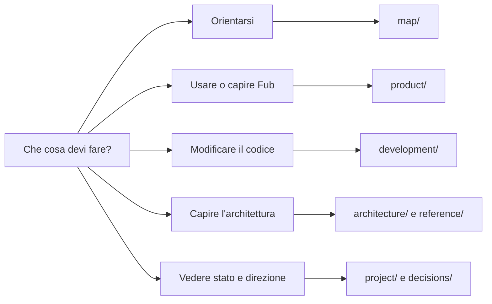

# Documentazione di Fub

Questa è la porta della documentazione: una riga per pagina, e per prima
cosa la domanda «che cosa devi fare?». La documentazione descrive **ciò che
esiste**; le attività eseguibili vivono nelle GitHub Issues; una decisione
costosa da invertire vive negli ADR; la cronologia resta in Git.

## Orientarsi

| Pagina | Risponde |
|---|---|
| [La mappa del repository](map/repo.md) | dove sta ogni cosa, e come si prova da sola |
| [Chi possiede che cosa](map/ownership.md) | ogni regola, il file che la possiede e il test che la presidia |
| [Dove sta X](map/dove-sta-x.md) | un tipo, un comando, un'impostazione: il file che lo definisce |
| [Orientarsi nella repository](getting-started/repository-tour.md) | il percorso guidato, per chi comincia |

## Iniziare

- [Installare, avviare e verificare](getting-started/install-and-run.md)

## Capire il prodotto

| Pagina | Risponde |
|---|---|
| [Panoramica](product/overview.md) | che cosa offre Fub |
| [Vault e file](product/vault-and-files.md) | che cosa Fub legge, scrive e conserva |
| [Explorer e cartelle](product/explorer-and-folders.md) | l'albero, le appuntate, gli spazi |
| [Editor e anteprima](product/editor-and-preview.md) | le superfici di scrittura |
| [Blocchi](product/editor-blocks.md) | la superficie a blocchi |
| [Tasto destro, mini-barra e «/»](product/editor-menus.md) | i menu degli editor |
| [Correttore](product/proofing.md) | l'ortografia mentre si scrive |
| [Documenti di Word](product/word-documents.md) | la videoscrittura nel vault |
| [Annotazioni dei PDF](product/pdf-annotations.md) | scrivere accanto ai PDF |
| [Ricerca, link e grafo](product/search-links-and-graph.md) | trovare e seguire |
| [Importare ed esportare](product/import-and-export.md) | dentro e fuori dal vault |
| [Plugin ed estensioni](product/plugins-and-extensions.md) | come Fub cresce |
| [Budget prestazionali](product/performance-budget.md) | i numeri e i gate della CI |
| [Criteri di accettazione](product/acceptance.md) | quando una modifica è accettabile |

I disegni sono una famiglia di trenta pagine, con l'indice dentro
[Disegni](product/drawing.md): dalla penna alle tavole, dall'import
all'export, dalla sessione dal tablet ai disegni grandi.

## Capire l'architettura

- [Vista d'insieme](architecture/overview.md) e
  [Componenti e confini](architecture/components-and-boundaries.md)
- [Modello del documento](architecture/document-model.md) e
  [Storage e identità](architecture/storage-and-identity.md)
- [Runtime, eventi e job](architecture/runtime-events-and-jobs.md)
- [Frontend e IPC](architecture/frontend-and-ipc.md)
- [Superfici dell'editor](architecture/editor-surfaces.md), la
  [superficie ricca e il correttore](architecture/rich-surface-and-proofing.md)
  e la [superficie dei fogli](architecture/grid-surface.md)
- [Inchiostro e strumenti](architecture/ink-and-tools.md)
- [Runtime dei plugin](architecture/plugin-runtime.md)

## Sviluppare

- [Workflow](development/workflow.md) e [test e qualità](development/testing-and-quality.md)
- Prove manuali: [l'inchiostro](development/ink-input-smoke-test.md) e [il moto](development/motion-smoke-test.md)
- [Le misure nella WebView](development/webview-measurements.md) e [le misure prese](misure/README.md)
- [Creare un plugin](development/plugin-authoring.md)
- [Stile della documentazione](development/documentation-style.md) e [versionamento e release](development/versioning-and-releases.md)

## Consultare i contratti

- [ABI e WIT](reference/abi-and-wit.md), [contratto IPC](reference/ipc-contract.md),
  [layout su disco](reference/on-disk-layout.md) e
  [permessi e sicurezza](reference/permissions-and-security.md)
- [Il formato della scena](reference/scene-format.md) con le sue
  quindici pagine di dettaglio, e le
  [operazioni sulla scena](reference/scene-operations.md)
- [Le annotazioni PDF](reference/annotation-format.md), la
  [proiezione dei documenti di videoscrittura](reference/rich-projection.md)
  e la [sessione live](reference/live-session.md)
- [Il server MCP](reference/mcp-server.md)

## Vedere stato e direzione

- [Stato del progetto](project/status.md): dove siamo, l'ordine di lavoro, il
  rilascio
- [M5, il runtime WASM](project/m5-wasm-runtime.md): la retrospettiva

## Capire le decisioni

- [Indice ADR](decisions/README.md)

## Le pagine che verranno

Nomi già scelti, pagine non ancora scritte: ciascuna nasce quando la sua
fase passa il cancello (l'ordine sta in [Stato](project/status.md)).

| Pagina | La fase che la scrive |
|---|---|
| `misure/motori-*.md` | K0, le misure dei motori |
| `architecture/componenti.md` | K1 e K2, il modello a componenti |
| `reference/fub-motori.md` | K3, lo strato dei motori |
| `product/lavagna.md` | la lavagna, prima versione |
| `product/pdf-lettore.md` | P2, il visore PDF |
| `product/pdf-completo.md` | P5, la modifica completa |
| `product/disegno-completo.md` | K6, tutti gli strumenti del disegno |
| `product/foto.md` e `product/libreria-foto.md` | K7 e K8 |

## Gerarchia delle fonti

Quando due fonti divergono, usa questo ordine:

1. codice e test;
2. WIT, schemi e formati persistenti;
3. pagine architetturali e riferimenti canonici;
4. ADR, limitatamente alla motivazione;
5. stato e TODO attivi;
6. cronologia Git.

Una pagina non sostituisce il codice. Deve spiegare i confini, i flussi e le
proprietà che una persona deve conoscere per modificarlo senza romperli.
