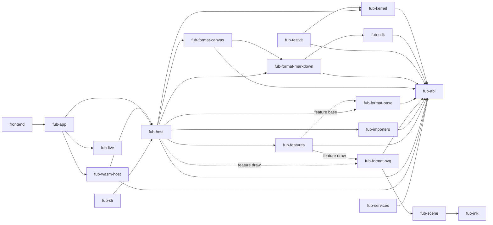
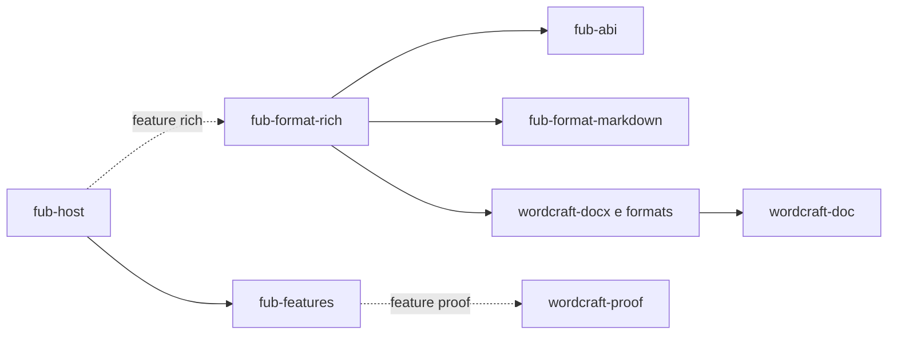
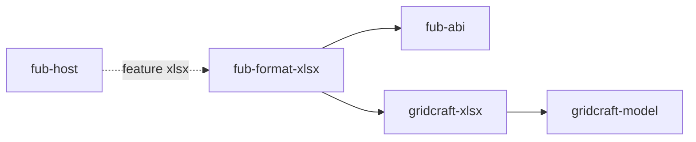

# Componenti e confini

> **Domanda:** quali componenti esistono, da chi possono dipendere e chi
> possiede una modifica?
> **Fonti autorevoli:** manifest Cargo, import TypeScript e guard CI.

## Grafo delle dipendenze

La figura mostra il verso concettuale. I manifest sono la fonte esatta e i guard
del repository verificano le eccezioni.

Il codice copiato da WordCraft (`vendor/wordcraft/`) non dipende da Fub, e lo
raggiungono soltanto due crate, ciascuno dietro la propria feature. La copia è
l'upstream più le patch, in un workspace suo; la provenienza e i proprietari
sono decisi nell'[ADR 0213](../decisions/0213-provenienza-dei-motori-esterni.md):

Il codice copiato da GridCraft (`vendor/gridcraft/`) ha lo stesso statuto e un
solo proprietario, `fub-format-xlsx`, che l'host accende con la feature
`xlsx`; il ruolo del motore è deciso nell'[ADR
0214](../decisions/0214-gridcraft-motore-del-foglio-di-calcolo.md):

## Tabella dei componenti

| Componente | Possiede | Non deve possedere |
|---|---|---|
| `fub-abi` | tipi, trait, errori, regole, WIT | storage, runtime, Markdown, UI desktop |
| `fub-kernel` | workspace, path, indici, eventi, policy | Tauri, Wasmtime, parsing Markdown |
| `fub-host` | sessioni, mount, job, watcher, configurazione | comandi Tauri e DOM |
| `fub-app` | stato Tauri, comandi IPC, adattamento eventi, registro delle sessioni live con la finestra che le possiede | regole di business, protocollo della sessione live |
| `fub-sdk` | API comoda per autori e host in memoria | composition root dell'app |
| `fub-testkit` | fixture e integrazione host/kernel | dipendenze di produzione |
| `fub-format-markdown` | parse, render, serialize e transfer Markdown | risoluzione dei path del vault |
| `fub-format-canvas` | JSON Canvas: modello con i campi ignoti conservati, `DocumentModel`, HTML statico e riscrittura dei link; il Markdown delle card lo analizza e lo disegna il provider Markdown | host, storage, Tauri, Wasmtime |
| `fub-format-base` | definizioni `.base`: modello YAML persistito, limiti e valutatore di formule | selezione delle righe, che resta del core (`query_index`) |
| `fub-ink` | il nucleo dell'inchiostro, puro: campione del puntatore, ruoli (il palmo), curva della pressione, inclinazione, stabilizzatore e ciclo di vita del tratto, come riduttore di campioni in effetti; è la copia che fa fede del nucleo TypeScript di `apps/client/src/ink/` | DOM, Tauri, kernel, formati su disco, strumenti o interfaccia di un prodotto |
| `apps/client/src/ink/` | la copia TypeScript del nucleo dell'inchiostro, per il percorso caldo, e l'adattatore del browser (`dom/`); il formato dei campioni e del pennello, la geometria dei campioni e gli strumenti: penna, evidenziatore e gomma, con il loro registro; vedi [Inchiostro e strumenti](ink-and-tools.md) | prodotti (FubDraw, shell, stato), formati su disco, Tauri, CodeMirror, globali del DOM nel nucleo |
| `fub-scene` | lettura dei disegni di FubDraw secondo il [formato della scena](../reference/scene-format.md), e delle annotazioni PDF secondo il [loro formato](../reference/annotation-format.md): classificazione, inchiostro, indice e diagnostica | `fub-abi`, host, qualunque I/O |
| `fub-format-svg` | i formati `svg` e `fubann`: modello per l'indice, segnaposto HTML o elenco delle annotazioni, documento nuovo e riscrittura dei riferimenti | disegno della scena, che resta della shell; verifica del PDF annotato |
| `fub-format-rich` | documenti di videoscrittura (`.docx`, `.odt`, `.rtf`, `.doc`): codec, provider a byte, proiezione modificabile senza perdite silenziose e copie esportate con la perdita misurata; l'HTML lo disegna il provider Markdown dal modello comune | host, storage, Tauri, Wasmtime, superficie della shell |
| `fub-format-xlsx` | cartelle di Excel: provider a byte, superficie `grid` della versione 2 sui byte con i valori del file senza ricalcolo all'apertura, i blocchi e gli avvisi di ciò che non mostra, l'innesto dei valori cambiati a livello di riga, la modalità a comandi sulla facciata di GridCraft e la riscrittura misurata con l'inventario del pacchetto | una riscrittura che perde qualcosa, ricalcolo di ciò che una modifica non raggiunge, host, storage, Tauri, superficie della shell |
| `fub-importers` | import ed export ufficiali e comandi di conversione | kernel, Tauri |
| `fub-features` | provider ufficiali indipendenti | conoscenza del desktop |
| `wordcraft-proof` | correttore di WordCraft vendorizzato in `vendor/wordcraft/`, usato soltanto dalla feature `proof` | dipendenze da Fub |
| `wordcraft-doc`, `-docx`, `-docbin`, `-formats`, `-geom` | modello del documento, codec DOCX, lettore di Word 97-2003, importatori ed esportatori e unità di misura di WordCraft, vendorizzati in `vendor/wordcraft/`, usati soltanto da `fub-format-rich` | dipendenze da Fub |
| `gridcraft-core`, `-formula`, `-functions`, `-numfmt`, `-model`, `-calc`, `-xlsx` | dominio del foglio di calcolo di GridCraft: modello, formule e funzioni di Excel, formati numerici, calcolo e codec, vendorizzati in `vendor/gridcraft/`, usati soltanto da `fub-format-xlsx` | dipendenze da Fub |
| `fub-wasm-host` | Wasmtime, binding, traduzione, store e lifecycle dei plugin installati | policy duplicata |
| `fub-cli` | automazione locale sopra `Host`, senza Tauri | un secondo coordinatore di job o di scrittura |
| `fub-services` | servizio self-hostable separato per account, sync e publish | kernel, host, app |
| `fub-live` | sessione live di FubDraw: protocollo, abbinamento, TLS con certificato effimero, server sul PC e client dello scrittore ([riferimento](../reference/live-session.md)) | contratto, kernel, host, Tauri, validazione delle operazioni |
| `frontend` | layout, interazione, resa, editor | accesso diretto al kernel |

## Dipendenze vietate

- `fub-abi` → `fub-kernel`, Tauri, Wasmtime o Markdown;
- `fub-kernel` → `fub-host`, Tauri, Wasmtime o `fub-format-markdown`;
- `fub-host` → Tauri;
- `fub-scene` → qualunque crate del workspace tranne `fub-ink`;
- `fub-ink` → qualunque crate del workspace, Tauri, Wasmtime o un prodotto;
- `fub-live` → `fub-abi`, `fub-kernel`, `fub-host` o Tauri;
- qualunque crate diverso da `fub-wasm-host` → Wasmtime;
- dipendenza normale → `fub-testkit`;
- file frontend arbitrario → `@tauri-apps`;
- feature ufficiale → dettagli privati di un'altra feature per condividere
  logica.

## Ownership pratica

### Contratto e forme condivise

Modifica `fub-abi` quando una regola deve valere per più implementazioni o
attraversare un confine. Non spostare nel contratto un helper usato da un solo
modulo.

### Workspace e persistenza

Modifica `fub-kernel` per identità, accesso al vault, cache, indici, query,
eventi e policy. Una chiamata filesystem dalla shell è quasi sempre il livello
sbagliato.

### Composizione

Modifica `fub-host` per mount, registri, lifecycle, custodia del workspace,
watcher, job, impostazioni macchina e collegamento dei provider. Ciò che tocca
il mondo lo riceve da chi lo compone: il supporto del vault
(`Host::with_storage`, il disco ancorato alla radice di serie), il rilevatore
delle modifiche esterne (`with_watcher`), il client di rete (`with_network`),
l'orologio che registro, cestino, bozze e job leggono (`with_clock`) e il
cestino di sistema (`with_os_trash_backend`). Un banco li sostituisce senza
un secondo canale verso il vault.

### Desktop e serializzazione

Modifica `fub-app` quando il cambiamento è specifico di Tauri o della forma IPC.
Un adattatore deve delegare presto all'host.

### Esperienza utente

Modifica `frontend` per pannelli, layout, editor, disegno e accessibilità.
Comunica con l'host attraverso interfacce TypeScript, non importando il bridge
Tauri ovunque.

## Feature ufficiali

`fub-features` usa feature Cargo indipendenti. Una feature spenta deve rimuovere
il proprio modulo senza lasciare import obbligatori da altri moduli.

L'inventario (`crates/fub-features/src/inventory.rs`) dichiara per ogni feature
id, nome, catalogo, impostazioni, servizi forniti e richiesti, e i provider che
si costruiscono con una chiamata: view, comandi, indice, regole di sintassi e
renderer. `fub-host` monta ogni riga con lo stesso ciclo e non confronta id.
Ciò che soltanto chi monta sa collegare, cioè l'indice di ricerca nella cartella
dati assegnata, lo store delle versioni dietro l'interruttore dell'host e i
dizionari Hunspell della macchina per il correttore, è una variante di
`HostWiring` dichiarata nella riga.

Una feature che non funziona senza un'altra lo dichiara due volte: la sua
feature Cargo accende l'altra (`trash` → `commands`, `template` e `base` →
`properties`) e la sua riga ne richiede il servizio (`requires`), così spegnere
il fornitore a runtime tiene fuori anche chi dipende da lui.
`crates/fub-features/tests/cargo_features.rs` confronta le due dichiarazioni.
Una feature che degrada senza l'altra non la richiede e dice cosa manca: le
menzioni non collegate senza la ricerca full-text ne sono un esempio.

La condizione per dividere il crate in più crate non è il numero di file: è il
primo accoppiamento reale che impedisce build, ownership o dipendenze
indipendenti.

## Percorsi principali

| Area | Percorsi |
|---|---|
| contratto | `crates/fub-abi/src/`, `crates/fub-abi/wit/fub/` |
| workspace | `crates/fub-kernel/src/` |
| composizione | `crates/fub-host/src/mount.rs`, `session.rs`, `registry.rs` |
| desktop | `crates/fub-app/src/lib.rs` |
| Markdown | `crates/fub-format-markdown/src/` |
| foglio | `crates/fub-format-xlsx/src/`, `apps/client/src/editors/grid/` |
| lavagna e base | `crates/fub-format-canvas/src/`, `crates/fub-format-base/src/` |
| disegni | `crates/fub-scene/src/`, `crates/fub-format-svg/src/`, `crates/fub-features/src/draw.rs`, `crates/fub-features/src/draw/` |
| feature | `crates/fub-features/src/` |
| codice di terzi vendorizzato | `vendor/` (provenienza in `UPSTREAM.md`) |
| runtime WASM | `crates/fub-wasm-host/src/` |
| seam frontend | `apps/client/src/host/` |
| shell | `apps/client/src/main.ts`, `desktop-shell.ts`, `panels/`, `state/`, `ui/` |
| finestra | `apps/client/src/shells/scrittoio/`, `kit/`, `moto/`, `theme/scrittoio/` |
| test | `crates/*/tests/`, `apps/client/src/**/*.test.ts` |
