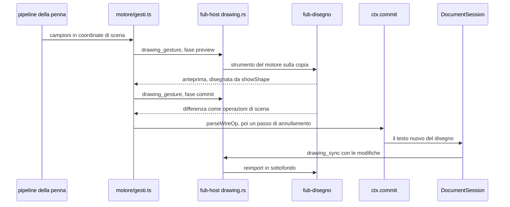
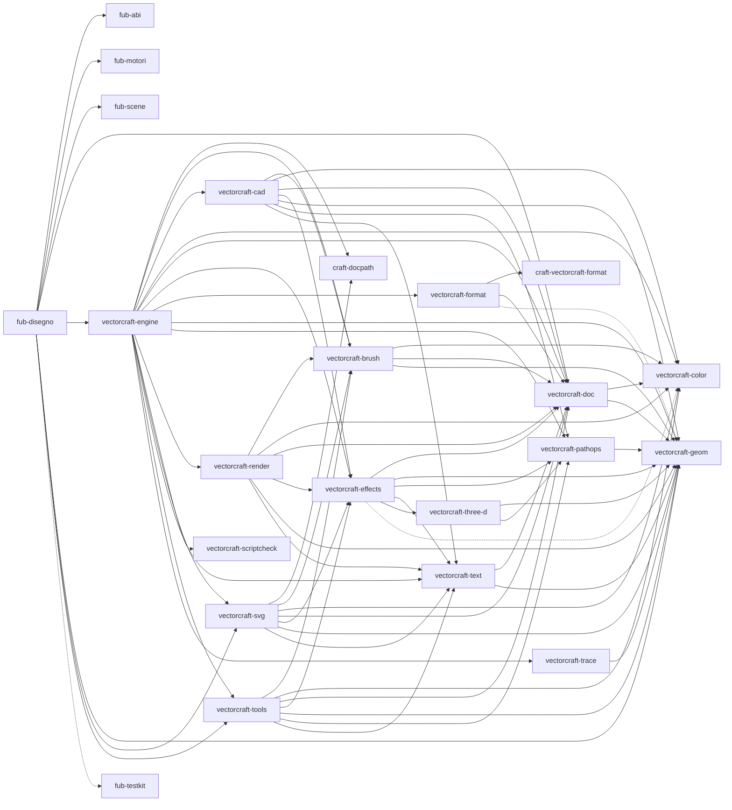

# Il disegno sul motore

> **Domanda:** come un gesto in un disegno passa dal motore vettoriale e
> torna nel file, e chi possiede che cosa fra client, motore, penna e file?
> **Fonti autorevoli:** `crates/fub-disegno/` (arriva con T9),
> `crates/fub-host/src/drawing.rs` (arriva con T19),
> `apps/client/src/editors/spatial/motore/` (arriva con T8 e T10),
> `crates/fub-abi/src/drawing.rs` (arriva con T4).
> **Decisioni:** [ADR 0239](../decisions/0239-il-disegno-sul-motore-vettoriale.md),
> [ADR 0231](../decisions/0231-la-chiusura-di-fubdraw.md),
> [ADR 0204](../decisions/0204-nucleo-inchiostro.md).

Questa pagina descrive l'architettura che il piano K5 costruisce. Ciò che non
è ancora nel codice porta accanto il task che lo porta, «(arriva con T…)»;
quando il task si fonde, il segno si toglie.

## Il percorso di un gesto

Un rettangolo disegnato, uno spostamento o un riquadro di selezione seguono
tutti lo stesso giro: il client raccoglie i campioni, il motore calcola, il
client scrive.

Il motore non scrive mai il file: restituisce operazioni, e il file cambia
solo quando il client le applica. Il giro finisce con il motore che rilegge
il testo, così la copia segue il file anche quando lo cambia un'altra
superficie.

I passi, uno per uno:

1. **I campioni.** La pipeline della penna di Fub
   (`apps/client/src/ink/dom/pointer-adapter.ts`) dà campioni stabilizzati e
   senza il palmo. Per Selezione, Rettangolo, Ellisse, Linea, Freccia e Testo
   `tools/editor/gesture-begin.ts` apre un gesto `motore` invece di quello
   TypeScript (arriva con T10). Le coordinate sono quelle di scena, le stesse
   di `toPoint` in `tools/editor/curvature-tool.ts`, e lo zoom viaggia con il
   gesto per le tolleranze.
2. **L'anteprima.** `motore/gesti.ts` (arriva con T10) accumula gli eventi e,
   a ogni fotogramma senza una richiesta in volo, manda `drawing_gesture` con
   la fase `preview` e gli eventi nuovi. L'esito (`DrawingPreview`: una forma,
   una matrice o un riquadro) si disegna con gli stessi segni della superficie
   (`showShape`).
3. **Il commit.** Al rilascio la fase è `commit`. Il motore confronta la copia
   prima e dopo e scrive le operazioni più piccole sugli elementi toccati
   (`crates/fub-disegno/src/differenza.rs`, arriva con T11): `set` degli
   attributi cambiati, `add` per i nuovi, `remove`, `move` per l'ordine, e
   `ident` prima di tutto per gli elementi senza id.
4. **L'applicazione.** Ogni operazione passa da `parseWireOp`
   (`apps/client/src/editors/spatial/scene/ops.ts`); i connettori che
   seguono si aggiungono come per gli strumenti TypeScript; poi `ctx.commit`
   fa di tutto un solo passo di annullamento, con l'etichetta dello
   strumento.
5. **Il file.** La `DocumentSession` porta il testo nuovo al file come per
   ogni altra modifica: bozze, conflitti e salvataggio non cambiano.
6. **La sincronia.** La sessione del motore
   (`motore/sessione.ts`, arriva con T8) è una superficie della
   `DocumentSession` che non origina mai modifiche: a ogni aggiornamento manda
   `drawing_sync` con le modifiche del testo, o il testo intero, e avanza la
   revisione. Il motore reimporta il testo in sottofondo
   (`crates/fub-disegno/src/sincronia.rs`, arriva con T11).

Un gesto a una revisione diversa da quella della copia è rifiutato come
`Stale`: la sessione rimanda il testo intero e riprova una volta. Un gesto
che arriva prima del reimport aspetta la revisione giusta. Le richieste della
sessione vanno in fila, una alla volta, con un tempo limite per ciascuna.

## Chi possiede che cosa

| Che cosa | Chi lo possiede | Perché |
|---|---|---|
| il file `.svg` | il client, con `ctx.commit` e la `DocumentSession` | ciò che il gesto non tocca resta byte per byte com'era |
| la copia del motore | `fub-disegno`, nell'host | gli strumenti del motore lavorano sui loro oggetti; la copia si rifà dal testo |
| la mappa degli id | `fub-disegno`, `src/mappa.rs` (arriva con T11) | lega ogni oggetto del motore a un id di Fub o a un percorso |
| la cronologia | il client, un passo per gesto | annulla e ripeti sono quelli della superficie; il motore non usa la sua |
| l'inchiostro | il client, `apps/client/src/ink/` e `crates/fub-ink` | penna, evidenziatore e gomma scrivono `fub:ink` e non chiamano mai il motore |
| i campi dell'ispettore e i menu | il client | scrivono operazioni di scena campo per campo, senza motore |

La mappa usa id sintetici `fubtmp-<n>` per gli elementi senza id, solo nella
copia d'import: non arrivano mai nel file. Un elemento senza id che un gesto
modifica riceve un id vero con `ident` nello stesso lotto. Gli id nuovi
hanno il formato di `apps/client/src/editors/spatial/scene/ids.ts`, e non
sono mai uguali a uno della scena (`crates/fub-disegno/src/id.rs`, arriva con
T11).

## Il motore come componente

Il motore è il componente `fub.motore-vettoriale`, «Motore del disegno», una
riga sua nel gruppo «Disegnare» della pagina Componenti, accesa di serie e con
il suo interruttore (`crates/fub-features/src/componenti.rs`, la riga arriva
con T13). `fub.draw` lo usa senza richiederlo: spento il motore, i disegni
restano accesi. Senza la feature `draw` l'host non compila il motore, e i
comandi del disegno rispondono `Unserved`. Il motore si costruisce al primo
disegno aperto, con i caratteri di Fub e non quelli del sistema (arriva con T7
e T11).

Il disegno usa il motore nei due spazi di lavoro, Semplice e Completo, perché
gli strumenti sono gli stessi e cambia solo l'aspetto. Il profilo `pdf` tiene
i suoi strumenti TypeScript ([ADR 0231](../decisions/0231-la-chiusura-di-fubdraw.md),
§3), e la lavagna non usa il motore.

Senza motore la sessione è `MotoreAssente`, e il disegno usa gli strumenti
semplici, quelli TypeScript del client: Selezione, forme e Testo funzionano
lo stesso. Un chip della superficie dice perché (arriva con T23, T28 e T29):

- **motore spento** (la riga del componente spenta): «Accendi…» apre la
  pagina Componenti sulla riga del motore;
- **motore fermo** (un errore all'apertura o durante il lavoro): «Riprova»
  lo riapre;
- **build senza motore**: il chip c'è, senza azione.

Le frasi esatte del chip si scelgono sul prototipo del piano (T25). Mano,
Lente, Penna, Evidenziatore e Gomma non passano mai dal motore e funzionano
sempre. I vettori dei gesti sono l'oracolo delle due strade.

## I comandi IPC

Sei comandi tipati, nella forma di quelli dei fogli, con le forme in
`crates/fub-abi/src/drawing.rs` (arriva con T4) e i comandi in
`crates/fub-app/src/lib.rs` (arrivano con T19):

| Comando | Fa |
|---|---|
| `open_drawing` | apre un'istanza sul testo del disegno e dice quanti elementi sono mappati e che cosa non lo è |
| `drawing_sync` | porta all'istanza le modifiche del testo, o il testo intero |
| `drawing_gesture` | manda gli eventi nuovi di un gesto e riceve anteprima o operazioni |
| `drawing_commands` | dice quali comandi sono attivi per una selezione |
| `drawing_command` | esegue colore del tratto, colore del riempimento o spessore |
| `close_drawing` | chiude l'istanza |

Ogni richiesta passa da `validate()` prima di arrivare al motore. Le istanze
stanno nell'host per vault, sotto un lucchetto che si prende per trovare
l'istanza e si lascia prima di chiamare il motore. La chiusura del vault
chiude i suoi disegni.

## I limiti

| Limite | Valore | Da dove viene |
|---|---|---|
| testo del disegno | 20 MiB | `MAX_EDIT_BYTES` di `crates/fub-scene/src/lib.rs` |
| elementi di un disegno modificabile | 50 000 | `MAX_ELEMENTS` di `crates/fub-scene/src/lib.rs` |
| operazioni di un esito | 10 000 | `MAX_BATCH` di `apps/client/src/editors/spatial/scene/ops.ts` |
| byte delle operazioni di un esito | 8 MiB | `MAX_OP_BYTES` dello stesso file |
| eventi di una richiesta di gesto | 100 000 | `MAX_GESTURE_EVENTS` (arriva con T4) |

Un esito oltre i limiti delle operazioni è rifiutato come `TooLarge`. Un
gesto lungo spezza i suoi eventi in più richieste, perché ognuna porta solo
gli eventi nuovi.

## Ciò che il motore non sa modificare

All'apertura il motore elenca ciò che non riesce a tenere nella mappa
(`DrawingLoss`, classificate in `crates/fub-disegno/src/perdite.rs`, arriva
con T16). I tre tipi:

| Tipo | Vuol dire | Che cosa succede |
|---|---|---|
| non mappato (`Unmapped`) | il motore non ha un oggetto per l'elemento | l'elemento si vede e si salva com'è; un gesto che lo cambierebbe in altro che una `transform` è rifiutato |
| approssimato (`Approximated`) | l'oggetto c'è, ma un attributo non tornerebbe uguale: filtri, maschere, `<use>`, `<foreignObject>`, testi su tracciato | si sposta con una `transform`; ogni altro cambio è rifiutato |
| non supportato (`Unsupported`) | il documento non è modificabile, per esempio troppo grande o con id ripetuti | la copia si apre, ma ogni gesto è rifiutato |

Ciò che non si scrive come attributi dell'elemento originale non si fa: il
motore non riscrive mai un elemento intero. Fub salva da sé, quindi la perdita
evitata si dice all'apertura e al gesto: accanto al percorso del file il chip
«N parti restano come sono» apre «Che cosa manca?» con l'elenco delle parti
(arriva con T21), e un gesto rifiutato usa il messaggio solito della
superficie. L'elenco per ogni file del corpus sta in
`crates/fub-disegno/tests/corpus/perdite.tsv` (arriva con T16).

## Dove sta il codice

| Percorso | Contiene |
|---|---|
| `vendor/vectorcraft/` | la copia di VectorCraft, con le patch numerate e `UPSTREAM.md` (arriva con T6) |
| `crates/fub-disegno/` | l'adattatore: apertura, mappa, sincronia, differenza, gesti, comandi, perdite (i moduli si riempiono da T11) |
| `crates/fub-host/src/drawing.rs` | le istanze per vault e i sei comandi lato host (arriva con T19) |
| `crates/fub-abi/src/drawing.rs` | le forme condivise e i limiti (arriva con T4) |
| `apps/client/src/editors/spatial/motore/` | la sessione, i gesti, i colori e il chip delle perdite (arriva con T8, T10, T12 e T21) |
| `apps/client/src/editors/spatial/tools/` | gli strumenti TypeScript, riferimento dei gesti e strumenti del profilo `pdf` |

`crates/fub-disegno` è l'unico crate che nomina `vectorcraft-*`, nei
`Cargo.toml` e nei sorgenti (`.github/scripts/check-engine-boundary.mjs` e
`VECTORCRAFT_OWNERS` in `crates/fub-abi/tests/dependency_invariant.rs`). La prova
che il motore fa ciò che facevano gli strumenti TypeScript sono i vettori di
`apps/client/src/__fixtures__/disegno-gesti/` (arrivano con T3); quella
senza perdite è il cancello, `node tools/disegno-cancello/cancello.mjs`
(arriva con T20).

Il motore entra senza le feature di serie di `vectorcraft-engine`: niente
caratteri di VectorCraft (`bundled-fonts`: i caratteri li dà `fub-motori`),
niente importatori di altre app né plug-in (patch 0001), e il PDF e l'EPS
fuori dal suo grafo (patch 0002). Le librerie che il motore porta in una
seconda versione, e perché, sono in
[le versioni del disegno](../misure/disegno-versioni-2026-11.md).

Il blocco qui sotto è il seguito del [grafo dei crate](overview.md): l'adattatore,
i crate di Fub da cui dipende e i crate di VectorCraft che porta. Lo confronta
con `cargo metadata` lo stesso test della panoramica
(`the_diagram_declares_the_real_dependencies`): gli archi pieni sono le
dipendenze normali, quelli tratteggiati le sole dipendenze di prova.

Per l'inchiostro e gli strumenti della superficie vedi
[Inchiostro e strumenti](ink-and-tools.md); per le superfici e le sessioni
dei documenti [Superfici dell'editor](editor-surfaces.md); per le operazioni
che il motore restituisce [le operazioni sulla scena](../reference/scene-operations.md).
