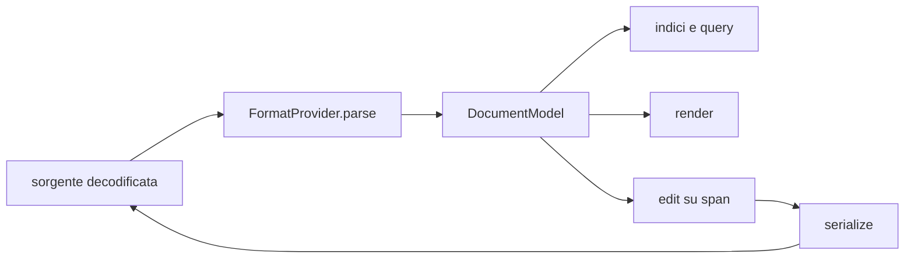
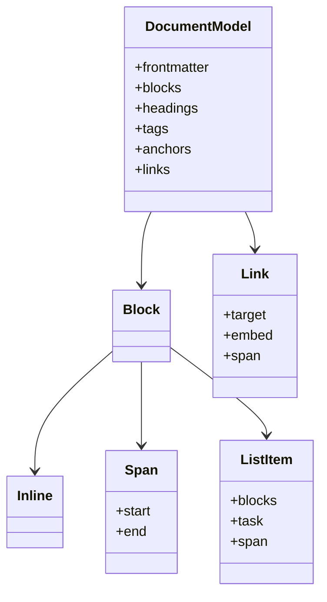
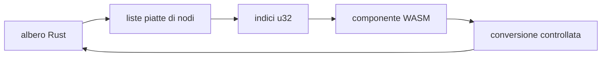

# Modello del documento

> **Domanda:** come rappresenta Fub documenti di formati diversi senza perdere
> la sorgente?
> **Fonti autorevoli:** `crates/fub-abi/src/model.rs`,
> `crates/fub-abi/src/arena.rs`, `crates/fub-abi/src/format.rs`.

## In breve

`DocumentModel` è una lettura strutturata e agnostica del formato. Non sostituisce
la sorgente: span, revisioni e serializzazione continuano a riferirsi ai byte
del file.

Il provider del formato trasforma `DocumentSource` in modello e resa. Il kernel
consuma il contratto comune.

## Flusso

## Tipi principali

Il diagramma mostra le relazioni concettuali, non tutti i campi delle enum Rust.

## Sorgente e span

La sorgente è la stringa decodificata integralmente:

- BOM conservato;
- terminatori di riga conservati;
- nessuna normalizzazione implicita.

`Span` usa intervalli `[start, end)` in byte UTF-8. Nel codice nativo gli offset
sono `usize`; nel WIT sono `u64` per avere larghezza fissa.

Il contratto Rust usa span in byte UTF-8. CodeMirror usa offset JavaScript. Il
ponte di conversione è una responsabilità esplicita e coperta da test.

La sorgente conserva i terminatori di riga. Caricare o sincronizzare un
documento non deve normalizzare CRLF involontariamente.

Un edit calcolato su un modello vale per la revisione da cui quel modello
proviene. Il kernel non applica la posizione a un testo diverso senza rilevare
il conflitto.

## Blocchi e inline

Il modello distingue blocchi e contenuto inline. Tra le forme comuni esistono:

- paragrafi e heading;
- liste e task;
- quote e codice;
- tabelle;
- link, tag e testo;
- estensioni `Custom` namespaced.

Una forma entra nel modello comune quando più consumatori devono interrogarne la
struttura o quando l'escape hatch perderebbe dati necessari. Un'estensione
specifica del formato può restare `Custom`: un disegno di FubDraw, per esempio,
è un blocco `fub.scene.summary` che contiene titolo, descrizione e testi come
heading e paragrafi comuni, così ricerca, backlink e grafo lo leggono senza
conoscere il formato ([formato della scena](../reference/scene-format.md), §9).
Le annotazioni di un PDF aggiungono blocchi custom per pagine e note, e il PDF
annotato è un collegamento come gli altri ([formato delle
annotazioni](../reference/annotation-format.md), §5).

## Identità interne

- gli heading hanno slug e possono avere un'ancora esplicita;
- i blocchi possono avere ancore;
- link e tag conservano lo span nella sorgente;
- `DocId` identifica un documento nel vault, non un nodo del modello;
- l'embed è una proprietà del riferimento, non del bersaglio;
- un documento fatto di un solo blocco `Custom` può dichiarare sezioni nominate
  in `attrs.sections` (`fub_abi::custom::SECTIONS_ATTR`): per lui `[[Doc#Nome]]`
  sceglie una sezione dichiarata invece di un heading, e il kernel consegna la
  scelta al renderer in `attrs.section`. Le viste di un file `.base` sono
  sezioni nominate; il kernel non conosce il formato.

## Proprietà

Il frontmatter grezzo resta JSON e rimane l'autorità del valore.
`PropertyValue` è una proiezione ricostruibile per valori comuni: testo, liste
piatte, numeri, checkbox, date, date-ora, tag e link. Il registro
`PropertyTypes` associa facoltativamente un tipo al nome in tutto il vault; è
metadato di interpretazione, non una copia dei valori.

Un frontmatter che non si proietta su una mappa JSON resta nel modello come
blocco `frontmatter-unparsed`, verbatim e col motivo, e non diventa un
frontmatter vuoto. Fra i motivi c'è uno YAML che il parser pagherebbe oltre il
tetto di `fub_abi::rules::yaml`: troppe `[` e `{` per la sua lunghezza. Lo
stesso tetto rifiuta un `.base` o un template prima del parser.

Senza dichiarazione restano valide le convenzioni `aliases`/`alias`,
`tags` e `cssclasses`/`cssclass`. Una dichiarazione incompatibile, un valore
annidato o uno schema futuro non viene convertito: resta JSON autorevole e si
modifica dalla sorgente. Chi interroga, ordina, conta faccette o mostra colonne
usa la stessa proiezione tipizzata; assente, `null` e lista vuota restano casi
distinti.

## Cartella di Excel `.xlsx`

Un `.xlsx` si apre nella famiglia `grid` con la versione 2 del protocollo, su
una sorgente a byte che resta nell'host. Il testo della sua `DocumentSession`
non è il file ma il **giornale** delle celle cambiate (`text_kind`
`grid_journal`): `read_document` dà il giornale vuoto con la revisione dei
byte, e la griglia apre la superficie `fub.grid.xlsx` sui byte con quel
giornale. `crates/fub-format-xlsx/src/grid.rs` legge la cartella con il
codec di GridCraft e dà le finestre che la shell mostra: per ogni cella
l'input, il valore già scritto nel formato numerico del file, l'aspetto, il
blocco e lo stato. I valori sono quelli salvati nel file, comprese le celle
versate dalle matrici. Una formula che legge una cella cambiata, e una che il
file ha salvato senza valore, prende il valore che le dà il motore di GridCraft
(`crates/fub-format-xlsx/src/ricalcolo.rs`), e l'innesto lo salva come valore
della formula; una formula che il motore non sa calcolare tiene il valore del
file, segnato come vecchio.

`apps/client/src/editors/grid/workbook.ts` controlla sessioni e finestre
campo per campo e le trasforma nel modello che
`GridEngine` disegna, con le schede dei fogli visibili, la formula nella barra
e un avviso per ciò che la griglia non mostra o non ricalcola. La griglia
disegna lo stile risolto di ogni cella (carattere, bordi, allineamento,
rotazione, barre e icone della formattazione condizionale), le celle unite, i
commenti, il testo che passa nelle celle vuote accanto e la vista del foglio
(riquadri bloccati, zoom, griglia e intestazioni). Il testo che passa accanto
non prende i gesti: un clic, un doppio clic o il tasto destro su una cella
vuota coperta da lui valgono per la cella sotto il puntatore. Modificare una costante
scrive una voce del giornale; le celle bloccate (matrici, formule condivise,
tabelle, celle unite, pivot, fogli protetti) lo dicono già nella finestra.
Una formula, un comando del catalogo (anche dalle scorciatoie di Excel,
`editors/grid/shortcuts.ts`) o un giornale che ha già comandi portano la
sessione ai **comandi**: da lì il giornale lo scrive il provider, la griglia
pubblica quello che lui conferma, e annulla e ripeti sono del documento
(`edit.undo`, `edit.redo`).

Salvare è dell'host: `write_document` del giornale rilegge i byte alla base,
innesta le voci a livello di riga (il resto del file resta byte per byte),
rilegge il risultato e lo scrive con il CAS. Un giornale di comandi
(`fub-format-xlsx`, [ADR
0219](../decisions/0219-la-cartella-si-modifica-con-i-comandi-di-gridcraft.md),
in proposta) si rifà sui byte, e si salva per
innesto quando cambia soltanto l'input di costanti, altrimenti riscrivendo la
cartella con il codec, se l'inventario del pacchetto dice che la riscrittura
non perde niente. Il giornale salvato si ribasa
nella `DocumentSession`; `resource_write` crea una cartella ma non la copre.

Una cartella cade così in una di tre classi, che
`crates/fub-format-xlsx/tests/corpus.rs` prova su un corpus scritto a mano e,
con `FUB_XLSX_CORPUS`, su uno esterno: **modificabile** (i comandi si
servono, e salvare due volte non cambia i byte), **preservabile** (la
riscrittura perderebbe qualcosa: i comandi che la chiedono si rifiutano con
il perché, l'input delle celle entra per innesto e le altre parti restano
byte per byte), **rifiutata** (cifrata o illeggibile: non si apre). Le celle
bloccate di un foglio protetto non prendono né comandi né input. Ciò che una riscrittura
può non portare senza contare come perdita, ciascuno con la sua ragione, sono
le `NORMALIZATIONS` di `inventory.rs` (la catena di calcolo, le dimensioni,
gli stili che nessuna cella usa, il percorso del salvataggio).

Il perché è nell'[ADR
0216](../decisions/0216-protocollo-grid-2-sorgente-a-byte.md), che sostituisce
la proiezione dell'[ADR
0214](../decisions/0214-gridcraft-motore-del-foglio-di-calcolo.md); la forma
del documento nel [contratto IPC](../reference/ipc-contract.md).

## Arena al confine WASM

WIT non ammette tipi ricorsivi. Gli alberi `Block`, `Inline` e `UiNode`
attraversano il confine come arena piatta:

La conversione vive in `fub_abi::arena` e viene riusata dal proxy WASM. Limiti
di profondità e indici fuori range producono un errore; non si ricostruisce un
albero malformato.

## Il testo non salvato

Nella shell il testo battuto e non ancora sul disco vive nella
`DocumentSession` del documento (`apps/client/src/state/document-session.ts`),
una per documento, condivisa da tutti i riquadri e dalle finestre che lo
mostrano. Ciò che succede a quel testo quando un gesto tocca la sessione:

- **Il rilascio.** Quando nessuno guarda più il documento, `release()` prova
  il salvataggio e, se il buffer resta sporco, la bozza. Se il buffer è ancora
  sporco (il salvataggio è fallito o c'è un conflitto, anche con la bozza
  scritta) restituisce `unsaved` e **la sessione resta aperta**: è l'unica
  copia del lavoro, e nessun chiamante la chiude da sé.
- **Una linguetta o un riquadro che si chiude.** Il controller passa da
  `dismissIfUnwatched`: davanti a `unsaved` chiede con il dialogo
  `document.close_unsaved` se scartare le modifiche o tenere la nota, e senza
  una risposta esplicita la nota torna aperta dov'era. Un fatto nuovo ritira
  la domanda (il segnale di ritiro di `platform/confirm`) col suo motivo: un
  cambio da fuori la chiude come «Tienila aperta», e il salvataggio tentato
  subito trova il disco cambiato e mostra la barra del conflitto (se non
  parte, lo dice l'avviso del salvataggio fallito); una lettura del disco
  fallita, un'eco tardiva o una rilettura che non cambia il testo la lasciano
  chiedere; una
  rinomina da fuori riapre la nota col nome nuovo; un'eliminazione da fuori
  non riapre niente, perché il testo è già nell'avviso con «Ricrea»; una
  seconda domanda sulla stessa nota prende il posto della prima, che non fa
  niente. Chiusa con Ctrl+W mentre si scriveva, la nota che torna riprende il
  fuoco nel testo.
- **Uno spazio di lavoro che toglie la nota, una finestra del documento che si
  chiude, un'apertura che finisce con la linguetta già chiusa.** Questi
  rilasci (`state/shell-layout.ts`, `state/document-bridge.ts`, il `finally`
  di `openDocument`) non chiedono niente: davanti a `unsaved` la sessione resta
  viva e sporca nella finestra principale, la nota riaperta mostra il testo e
  la bozza riparte alla prossima occasione. La chiusura dell'app la salva o
  la mette in bozza come ogni altra sessione, e si rifiuta se non ci riesce.
- **Un ripristino di versione.** `version.restore` riscrive il file sotto al
  buffer: per la sessione è un cambio da fuori come un altro. Il testo della
  persona resta, la nota dice che il file è cambiato sul disco, e il
  salvataggio successivo va in conflitto invece di coprire la versione
  ripristinata. Il ripristino scrive il disco dal kernel, non il buffer di un
  editor: Ctrl+Z nel testo non lo annulla. Il testo di prima resta però una
  versione (la fotografia prima della scrittura), e la Cronologia lo rimette
  come ogni altra.
- **Una rinomina, da questa finestra o da fuori.** La sessione cambia nome e
  tiene buffer, bozza e salvataggio in attesa: il salvataggio successivo va
  sul nome nuovo. Con la stessa estensione un riquadro non rimonta la
  superficie che mostra il documento: `followRenameInPanes` in
  `state/document-controller.ts` passa la superficie alla scheda col nome
  nuovo e la riattacca alla sessione, così fuoco, cursore, selezione, annulla
  e scorrimento restano. Vale per una superficie di testo (Markdown o testo
  semplice, che legge l'identità dalla sessione) e per una che dichiara
  `followRename` (il documento di Word, `editors/rich/surface.ts`, che da lì
  legge le immagini relative al nome nuovo). Le altre superfici, e ogni
  cambio di estensione, si rimontano: se il fuoco era in quella superficie,
  il montaggio nuovo lo riprende e rimette il cursore dove la superficie sa
  metterlo (`renameCaret`, con `selections` e `reveal`). Un fuoco che stava
  in un altro pannello non si sposta.
- **Una cancellazione da fuori con testo non salvato.** La sessione si chiude,
  il testo va in bozza e il riquadro offre «Ricrea la nota». Ricreata la nota
  col testo della bozza, la bozza se ne va (`discardRemovedDraft`, dopo che la
  sua scrittura è finita): alla riapertura non c'è un conflitto con un disco
  che le è uguale. Si scarta soltanto la bozza che tiene il testo ricreato:
  un «Ricrea» rimasto su un avviso di prima non tocca la bozza di una
  rimozione più nuova. Una sessione riaperta sull'id si prende la bozza (la
  voce della rimozione se ne va); se è pulita e mostra proprio il testo
  ricreato, la bozza si toglie lo stesso. La bozza resta quando tiene un testo
  che il disco non ha: la scrittura del file è fallita, il file è tornato con
  un altro testo, o la sessione riaperta mostra un altro testo o ne ha uno suo
  non salvato. Lì il conflitto alla riapertura è vero.
- **La scrittura annunciata di un comando.** Chi lancia un comando che
  riscrive un documento aperto (un gesto della barra di una Base con
  `base.view.set`) lo annuncia prima con `expectWrite(id)`, e ritira
  l'annuncio se il comando non scrive. Un'azione di una view dichiarata (una
  proprietà cambiata dall'ispettore, una versione ripristinata) annuncia la
  nota a fuoco (`ui/views.ts`) e, alla risposta, ne accorcia la scadenza a
  1,5 s (`withdraw(graceMs)`), perché non sa se ha scritto e l'evento può
  arrivare dopo la risposta. Il primo evento dell'utente su quel
  documento (non l'eco di un salvataggio in volo) lo consuma: a buffer pulito
  la sessione ricarica e l'esito è `reloaded` con `quiet`, che il controller
  non dice; a buffer sporco vale la regola di sempre. Un evento di un'altra
  app o del kernel non lo consuma, e l'annuncio scade dopo dieci secondi.
- **La ricarica forzata.** `forceReload()` scarta il buffer per il disco solo
  dopo averlo messo in bozza: se la bozza non si scrive restituisce
  `unavailable` e lascia testo e stato com'erano. Nessun gesto la usa.
- **Lo scarto nella finestra del documento a parte.** Quando un testo della
  finestra non entra nella sessione, la finestra offre «Conserva le mie
  modifiche» e «Scarta le modifiche locali». Lo scarto si conferma nella
  pagina, in due tempi (la finestra non ha IPC né dialoghi di sistema): la
  prima pressione chiede alla finestra principale se il testo resterà nella
  Cronologia (`keep-probe`) e lo dice, la seconda («Sì, scarta») glielo manda
  (`keep`). La principale lo conserva con la regola di «Usa la versione su
  disco» (`state/conflict-keep.ts`, `setDocumentWindowKeeper` in
  `state/document-bridge.ts`), e la finestra scarta soltanto dopo `kept`; un
  `keep-failed`, o nessuna risposta, non scarta niente e la finestra dice
  perché.
- **Una finestra del documento morta da sola, o rimasta senza nota.** Una
  finestra a parte che muore senza passare dalla chiusura di Fub (crash,
  chiusa dal sistema, anche mentre si apre) non dice più se l'ultima battuta
  era partita: `state/document-windows.ts` salva dalla sessione della
  finestra principale ciò che la finestra aveva confermato (o lo mette in
  bozza), la lascia e avvisa che le ultime modifiche non confermate possono
  mancare. Cambio di vault e chiusura dell'app aspettano quel salvataggio e
  non si fermano per sempre. La finestra di una nota cancellata (la sessione
  si è chiusa e ha messo in bozza il testo) non ha niente da salvare: si
  chiude senza congelarla né salvarla, con un avviso. Il ponte
  (`state/document-bridge.ts`) tiene un'autorità per sessione, non per nome:
  una nota nuova con il nome di una sparita o di una rinominata apre la sua
  finestra, e il rilascio della finestra vecchia non tocca la sessione nuova.
  Anche il prestito della finestra è della sessione
  (`documentSessions.retainSession`): dopo una rinomina chiudere la scheda col
  nome nuovo non chiude la sessione che la finestra mostra, e il nome di
  prima non resta prestato.
- **Una finestra del documento che non risponde più.** Una finestra viva ma
  muta (nessun evento di chiusura, nessuna risposta al congelamento) non
  dice che la sua coda è vuota. Il ponte chiama il silenzio col suo nome
  (`DocumentWindowSilent`, dopo 5 s per richiesta) e `document-windows.ts`
  riprova fino a 15 s in tutto, avvisando alla prima richiesta mancata: una
  finestra occupata per qualche secondo risponde e si chiude come sempre.
  Oltre, la finestra si distrugge (la distruzione non chiede niente alla sua
  pagina), si salva dalla sessione della finestra principale, o in bozza, e
  l'avviso dice che le ultime modifiche non confermate possono mancare. Vale
  per la chiusura dell'app, il cambio di vault e la X della finestra; un
  rifiuto vero (sessione cambiata, salvataggio fallito di una finestra che
  risponde) tiene la finestra aperta come prima, e la guardia di chiusura
  decide poi sul buffer rimasto come per ogni altro.
  Il silenzio vuol dire soltanto «non risponde». Una finestra che ha testo
  suo che la sessione non ha (un conflitto, la sorgente sostituita, oppure
  il testo di «tengo il mio» in attesa della fotografia nuova) risponde al
  congelamento di no, con la ragione (`freeze-refused`,
  `DocumentWindowRefused`): è un rifiuto vero, la finestra resta aperta col
  suo testo. Può tacere ed essere distrutta solo una finestra che non ha
  ancora ricevuto nessuna fotografia, e quindi non ha mostrato né scritto
  niente, o una davvero muta. Una conferma (o un rifiuto) che arriva dopo il
  tempo limite ma prima della distruzione vale ancora: la coda svuotata
  chiude la finestra come sempre, senza avviso; il rifiuto la tiene aperta.

## Invarianti

- il modello non importa Markdown;
- gli span si riferiscono alla sorgente esatta;
- parse e serializzazione non normalizzano dati senza dichiararlo;
- gli alberi ricorsivi hanno una sola conversione al confine;
- un record del modello che attraversa il confine non cresce dopo il primo
  rilascio: un dato nuovo passa da un'interfaccia nuova
  ([ADR 0235](../decisions/0235-un-record-pubblicato-non-cresce.md));
- una regola comune vive nel contratto, non in due provider;
- un workbook a celle conserva autorità e identità fuori da `DocumentModel`;
- i byte di una cartella di Excel restano all'host, e il file cambia soltanto dal giornale: per innesto delle celle cambiate, o con una riscrittura misurata che non perde niente.

## Dove si trova

- `crates/fub-abi/src/model.rs`
- `crates/fub-abi/src/arena.rs`
- `crates/fub-abi/src/format.rs`
- `crates/fub-format-markdown/src/parse.rs`
- `crates/fub-format-markdown/src/render.rs`
- `crates/fub-format-markdown/src/serialize.rs`
- `crates/fub-format-xlsx/src/grid.rs`
- `crates/fub-format-xlsx/src/graft.rs`
- `crates/fub-format-xlsx/src/inventory.rs`
- `crates/fub-format-xlsx/tests/corpus.rs`
- `apps/client/src/editors/grid/workbook.ts`
- `apps/client/src/state/document-session.ts`
- `apps/client/src/state/document-controller.ts`
- `crates/fub-format-svg/src/parse.rs`
