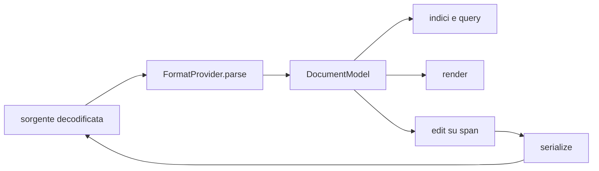
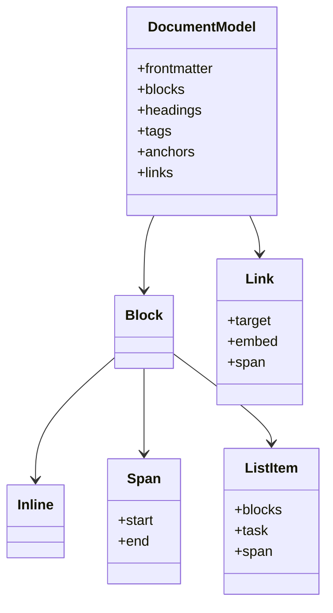
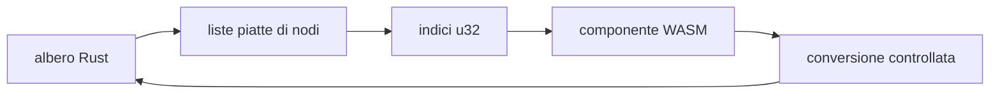

# Modello del documento

> **Domanda:** come rappresenta Fub documenti di formati diversi senza perdere
> la sorgente?
> **Fonti autorevoli:** `crates/fub-abi/src/model.rs`,
> `crates/fub-abi/src/arena.rs`, `crates/fub-abi/src/format.rs`.

## In breve

`DocumentModel` è una lettura strutturata e agnostica del formato. Non sostituisce
la sorgente: span, revisioni e serializzazione continuano a riferirsi ai byte
del file.

Il provider del formato trasforma `DocumentSource` in modello e resa. Il kernel
consuma il contratto comune.

## Flusso

## Tipi principali

Il diagramma mostra le relazioni concettuali, non tutti i campi delle enum Rust.

## Sorgente e span

La sorgente è la stringa decodificata integralmente:

- BOM conservato;
- terminatori di riga conservati;
- nessuna normalizzazione implicita.

`Span` usa intervalli `[start, end)` in byte UTF-8. Nel codice nativo gli offset
sono `usize`; nel WIT sono `u64` per avere larghezza fissa.

Un edit calcolato su un modello vale per la revisione da cui quel modello
proviene. Il kernel non applica la posizione a un testo diverso senza rilevare
il conflitto.

## Blocchi e inline

Il modello distingue blocchi e contenuto inline. Tra le forme comuni esistono:

- paragrafi e heading;
- liste e task;
- quote e codice;
- tabelle;
- link, tag e testo;
- estensioni `Custom` namespaced.

Una forma entra nel modello comune quando più consumatori devono interrogarne la
struttura o quando l'escape hatch perderebbe dati necessari. Un'estensione
specifica del formato può restare `Custom`: un disegno di FubDraw, per esempio,
è un blocco `fub.scene.summary` che contiene titolo, descrizione e testi come
heading e paragrafi comuni, così ricerca, backlink e grafo lo leggono senza
conoscere il formato ([formato della scena](../reference/scene-format.md), §9).
Le annotazioni di un PDF aggiungono blocchi custom per pagine e note, e il PDF
annotato è un collegamento come gli altri ([formato delle
annotazioni](../reference/annotation-format.md), §5).

## Identità interne

- gli heading hanno slug e possono avere un'ancora esplicita;
- i blocchi possono avere ancore;
- link e tag conservano lo span nella sorgente;
- `DocId` identifica un documento nel vault, non un nodo del modello;
- l'embed è una proprietà del riferimento, non del bersaglio;
- un documento fatto di un solo blocco `Custom` può dichiarare sezioni nominate
  in `attrs.sections` (`fub_abi::custom::SECTIONS_ATTR`): per lui `[[Doc#Nome]]`
  sceglie una sezione dichiarata invece di un heading, e il kernel consegna la
  scelta al renderer in `attrs.section`. Le viste di un file `.base` sono
  sezioni nominate; il kernel non conosce il formato.

## Proprietà

Il frontmatter grezzo resta JSON e rimane l'autorità del valore.
`PropertyValue` è una proiezione ricostruibile per valori comuni: testo, liste
piatte, numeri, checkbox, date, date-ora, tag e link. Il registro
`PropertyTypes` associa facoltativamente un tipo al nome in tutto il vault; è
metadato di interpretazione, non una copia dei valori.

Un frontmatter che non si proietta su una mappa JSON resta nel modello come
blocco `frontmatter-unparsed`, verbatim e col motivo, e non diventa un
frontmatter vuoto. Fra i motivi c'è uno YAML che il parser pagherebbe oltre il
tetto di `fub_abi::rules::yaml`: troppe `[` e `{` per la sua lunghezza. Lo
stesso tetto rifiuta un `.base` o un template prima del parser.

Senza dichiarazione restano valide le convenzioni `aliases`/`alias`,
`tags` e `cssclasses`/`cssclass`. Una dichiarazione incompatibile, un valore
annidato o uno schema futuro non viene convertito: resta JSON autorevole e si
modifica dalla sorgente. Chi interroga, ordina, conta faccette o mostra colonne
usa la stessa proiezione tipizzata; assente, `null` e lista vuota restano casi
distinti.

## Cartella di Excel `.xlsx`

Un `.xlsx` si apre nella famiglia `grid` con la versione 2 del protocollo, su
una sorgente a byte che resta nell'host. Il testo della sua `DocumentSession`
non è il file ma il **giornale** delle celle cambiate (`text_kind`
`grid_journal`): `read_document` dà il giornale vuoto con la revisione dei
byte, e la griglia apre la superficie `fub.grid.xlsx` sui byte con quel
giornale. `crates/fub-format-xlsx/src/grid.rs` legge la cartella con il
codec di GridCraft e dà le finestre che la shell mostra: per ogni cella
l'input, il valore già scritto nel formato numerico del file, l'aspetto, il
blocco e lo stato. I valori sono quelli salvati nel file, comprese le celle
versate dalle matrici, e niente si ricalcola: una formula che legge una cella
cambiata tiene il valore del file, segnato come vecchio.

`apps/client/src/editors/grid/workbook.ts` controlla sessioni e finestre
campo per campo e le trasforma nel modello che
`GridEngine` disegna, con le schede dei fogli visibili, la formula nella barra
e un avviso per ciò che la griglia non mostra o non ricalcola. La griglia
disegna lo stile risolto di ogni cella (carattere, bordi, allineamento,
rotazione, barre e icone della formattazione condizionale), le celle unite, i
commenti, il testo che passa nelle celle vuote accanto e la vista del foglio
(riquadri bloccati, zoom, griglia e intestazioni). Modificare una costante
scrive una voce del giornale; le celle bloccate (matrici, formule condivise,
tabelle, celle unite, pivot, fogli protetti) lo dicono già nella finestra.
Una formula, un comando del catalogo (anche dalle scorciatoie di Excel,
`editors/grid/shortcuts.ts`) o un giornale che ha già comandi portano la
sessione ai **comandi**: da lì il giornale lo scrive il provider, la griglia
pubblica quello che lui conferma, e annulla e ripeti sono del documento
(`edit.undo`, `edit.redo`).

Salvare è dell'host: `write_document` del giornale rilegge i byte alla base,
innesta le voci a livello di riga (il resto del file resta byte per byte),
rilegge il risultato e lo scrive con il CAS. Un giornale di comandi
(`fub-format-xlsx`, [ADR
0219](../decisions/0219-la-cartella-si-modifica-con-i-comandi-di-gridcraft.md),
in proposta) si rifà sui byte, e si salva per
innesto quando cambia soltanto l'input di costanti, altrimenti riscrivendo la
cartella con il codec, se l'inventario del pacchetto dice che la riscrittura
non perde niente. Il giornale salvato si ribasa
nella `DocumentSession`; `resource_write` crea una cartella ma non la copre.

Una cartella cade così in una di tre classi, che
`crates/fub-format-xlsx/tests/corpus.rs` prova su un corpus scritto a mano e,
con `FUB_XLSX_CORPUS`, su uno esterno: **modificabile** (i comandi si
servono, e salvare due volte non cambia i byte), **preservabile** (la
riscrittura perderebbe qualcosa: i comandi che la chiedono si rifiutano con
il perché, l'input delle celle entra per innesto e le altre parti restano
byte per byte), **rifiutata** (cifrata o illeggibile: non si apre). Le celle
bloccate di un foglio protetto non prendono né comandi né input. Ciò che una riscrittura
può non portare senza contare come perdita, ciascuno con la sua ragione, sono
le `NORMALIZATIONS` di `inventory.rs` (la catena di calcolo, le dimensioni,
gli stili che nessuna cella usa, il percorso del salvataggio).

Il perché è nell'[ADR
0216](../decisions/0216-protocollo-grid-2-sorgente-a-byte.md), che sostituisce
la proiezione dell'[ADR
0214](../decisions/0214-gridcraft-motore-del-foglio-di-calcolo.md); la forma
del documento nel [contratto IPC](../reference/ipc-contract.md).

## Arena al confine WASM

WIT non ammette tipi ricorsivi. Gli alberi `Block`, `Inline` e `UiNode`
attraversano il confine come arena piatta:

La conversione vive in `fub_abi::arena` e viene riusata dal proxy WASM. Limiti
di profondità e indici fuori range producono un errore; non si ricostruisce un
albero malformato.

## Invarianti

- il modello non importa Markdown;
- gli span si riferiscono alla sorgente esatta;
- parse e serializzazione non normalizzano dati senza dichiararlo;
- gli alberi ricorsivi hanno una sola conversione al confine;
- un nuovo campo pubblico rispetta l'additività del WIT;
- una regola comune vive nel contratto, non in due provider;
- un workbook a celle conserva autorità e identità fuori da `DocumentModel`;
- i byte di una cartella di Excel restano all'host, e il file cambia soltanto dal giornale: per innesto delle celle cambiate, o con una riscrittura misurata che non perde niente.

## Dove si trova

- `crates/fub-abi/src/model.rs`
- `crates/fub-abi/src/arena.rs`
- `crates/fub-abi/src/format.rs`
- `crates/fub-format-markdown/src/parse.rs`
- `crates/fub-format-markdown/src/render.rs`
- `crates/fub-format-markdown/src/serialize.rs`
- `crates/fub-format-xlsx/src/grid.rs`
- `crates/fub-format-xlsx/src/graft.rs`
- `crates/fub-format-xlsx/src/inventory.rs`
- `crates/fub-format-xlsx/tests/corpus.rs`
- `apps/client/src/editors/grid/workbook.ts`
- `crates/fub-format-svg/src/parse.rs`
