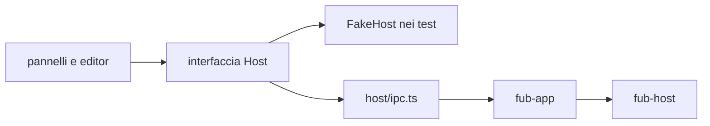
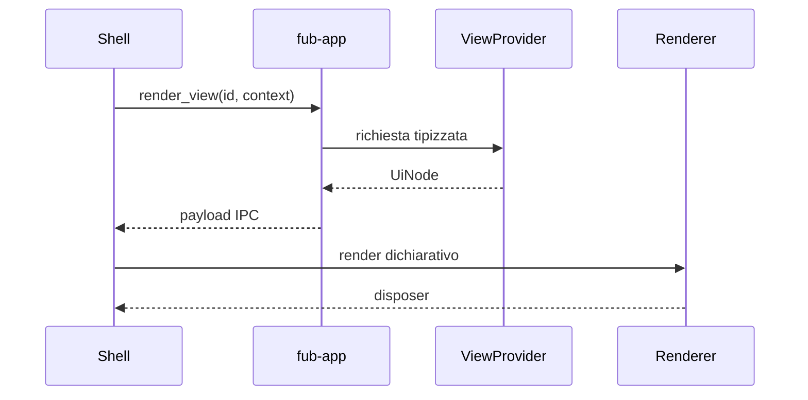

# Frontend e IPC

> **Domanda:** come comunica la shell TypeScript con il core senza diffondere
> Tauri e senza duplicare il contratto?
> **Fonti autorevoli:** `apps/client/src/host/`, `apps/client/src/platform/`,
> `apps/client/src/desktop-shell.ts`, `apps/client/src/state/document-session.ts`,
> `crates/fub-app/src/lib.rs`, `crates/fub-abi/src/ipc.rs`.

## Il seam

`apps/client/src/host/` contiene:

- tipi del confine;
- interfaccia usata dalla shell;
- implementazione IPC reale;
- dialoghi desktop;
- fake host per i test;
- enum generati e fixture di conformità.

Soltanto `host/ipc.ts` e `host/dialog.ts` importano `@tauri-apps`. Un pannello
parla con l'interfaccia host, non con `invoke` direttamente.

Una domanda sì/no all'utente passa sempre da `confirm` di
`platform/confirm.ts`: nessun pannello ne disegna una propria. Di serie risponde
il dialogo di sistema di `host/dialog.ts`; una shell può dichiarare un
presentatore che la disegna nella finestra, e in quel caso un guasto, Esc o lo
smontaggio valgono «no». I dialoghi della shell in `ui/dialogs.ts` coprono ciò
che il sistema non offre, cioè un nome da scrivere e una scelta in un elenco
lungo.

## Contratto TypeScript

`contract.ts` rispecchia le forme che attraversano IPC. Gli enum senza payload
sono generati dai tipi Rust; le fixture serializzate verificano le forme più
complesse.

Il mirror non è una seconda implementazione della logica. Contiene soltanto:

- nomi e tipi serializzati;
- commenti sul significato;
- helper di lettura che non cambiano la semantica.

## Interi

JSON non preserva tutti gli interi `u64`. Identità, revisioni e hash che possono
superare `2^53 - 1` attraversano IPC come stringhe.

Un valore temporale in millisecondi può restare `number` quando il proprio
dominio è dimostrabilmente sicuro e viene usato per aritmetica.

## Porte generiche

Preferisci:

| Esigenza | Porta |
|---|---|
| dati indicizzati | `query_index` |
| elenco comandi | `list_commands` |
| esecuzione comando | `invoke_command` |
| elenco view | `list_views` |
| resa view | `render_view` |
| azione su view | `view_action` |

Le porte dedicate restano per operazioni autorevoli che non sono semplici
provider, come apertura del vault, scritture, bozze e lifecycle desktop.

## UI dichiarativa

Una view restituisce `UiNode`, non DOM. Ogni nodo ha una specie, una chiave
stabile e, quando serve, un'azione con payload opaco.

Una view dell'area principale non si monta all'avvio: la ospita un riquadro,
come una linguetta accanto alle note, e l'istanza è il riquadro. La apre la
palette, con una voce per ogni view che non ha parametri obbligatori, oppure un
comando che restituisce `CommandEffect::OpenView`. Gli argomenti restano sulla
linguetta e il kernel li convalida contro i `ParamSpec` della view a ogni resa.
Una view di barra laterale non si apre così: la monta la shell, e l'effetto
che la nomina viene segnalato come non eseguibile.

Le icone (`spec.icon` di una view, il nodo `icon`) sono nomi del repertorio
della shell in `ui/icons.ts`, lo stesso che disegna rail e ispettore. Il
repertorio è aperto ai moduli della shell: `registerIcon` accetta soltanto
tracciati SVG col costrutto del set, non ridefinisce un nome già disegnato e
restituisce il teardown. Un nome sconosciuto non disegna niente.

I renderer custom sono namespaced e posseduti da un bundle. Lo smontaggio
rimuove renderer, listener e stato. Oltre al payload e alla porta delle azioni,
un renderer riceve il contesto del montaggio (`CustomRenderContext`), cioè il
documento nella cui resa sta il nodo, oppure `null` in una view. Lo passa chi
monta l'albero, e lo riceve allo stesso modo un renderer di qualunque `ns`.
Il renderer del grafo si registra in modo sincrono, ma carica il motore
soltanto quando monta una superficie. Uno smontaggio durante il caricamento
impedisce il mount tardivo; canvas, pannello fisico e sottoscrizioni restano
posseduti dalla stessa superficie.

## Stato della shell

La shell possiede:

- layout e riquadri;
- tab e focus;
- cursore, scroll e modalità;
- tema visuale;
- animazioni;
- preferenze locali della resa;
- lo stato autorevole in memoria dei documenti aperti, tramite le sessioni
  documento.

Il core possiede:

- documenti persistenti e revisioni;
- policy e permessi;
- indici;
- esito dei comandi;
- eventi;
- dati persistenti dichiarati dal contratto.

La `DocumentSession` è l'autorità della shell per il testo in memoria e per la
scrittura del documento aperto; il core resta l'autorità del file persistente e
della revisione verificata dalla scrittura.

Per i temi, la selezione autorevole passa dalla porta settings; la cache browser
è soltanto bootstrap del primo fotogramma. `previewTheme` monta invece una
selezione effimera senza IPC di scrittura: `cancelThemePreview`, la chiusura
delle Impostazioni o un'applicazione esplicita terminano la preview. Solo
`selectTheme` persiste la scelta.

Le linguette sono pulsanti nativi, posseduti dal `tablist` tramite `aria-owns`;
il pulsante di chiusura è un controllo fratello, non un elemento interattivo
annidato. Frecce, Home ed End spostano il focus, Invio e Spazio attivano la
linguetta, Delete la chiude. Gli aggiornamenti di stato preservano il nodo a
fuoco; una chiusura trasferisce il focus a una linguetta vicina o al menu del
riquadro rimasto vuoto. Una linguetta nella vista sorgente lo dice nel testo,
nel suggerimento e nel nome accessibile («vista sorgente»); aprire o chiudere
la vista porta il focus sulla superficie montata al posto della precedente.

I divisori espongono ruolo, limiti e dimensione corrente. Tastiera e
trascinamento modificano la stessa misura in pixel CSS; lo zoom della shell
non altera il rapporto fra movimento del puntatore e larghezza risultante.

## La finestra: lo Scrittoio

La finestra è lo Scrittoio ([decisione 0208](../decisions/0208-la-finestra-e-lo-scrittoio.md)):
la scrivania è il piano di fondo, i documenti sono fogli appoggiati sopra e gli
strumenti stanno in due cassetti. Le pagine `index.html`, `mobile.html` e
`document.html` ne portano il markup, e `main.ts` avvia
`shells/scrittoio/bootstrap.ts`. Non esiste una seconda shell da selezionare.

Sopra la shell comune (`desktop-shell.ts`: sessioni, riquadri, comandi,
pannelli) lo Scrittoio compone:

- `shells/scrittoio/`: cornice (barra del titolo, binario, banda di stato),
  fogli e linguette, lanciatore, preferenze, presentatore della conferma,
  mobile e finestra documento. La shell comune trova per id i manici che le
  pagine le lasciano;
- `kit/`: le primitive di interfaccia senza framework (pulsante, campo,
  elenco, schede, popover, dialogo, divisore, scheda al passaggio). Ogni
  primitiva ha un owner e un disposer per ciò che registra;
- `moto/`: molle, FLIP, presenza e gesti. Le animazioni sono fotogrammi
  chiave WAAPI di sola `transform` e `opacity`; il livello `appearance.motion`
  e la preferenza del sistema decidono quanto movimento esiste, e lo stato
  finale è lo stesso con e senza movimento;
- `theme/scrittoio/`: la serie di serie (motore `theme-2`), con ricetta dei
  colori, fogli, struttura e pelle a pezzi. La pelle passa dal sanitizer CSS
  del motore, e ogni classe di un pezzo è un hook dell'anatomia di quel pezzo.

I predefiniti dell'aspetto (accento, carattere, corpo, interlinea, giustezza)
li dichiara l'host e coincidono con quelli della serie; un test Rust lo
verifica. I divisori dei cassetti sono il divisore del kit: sidebar da 208 a
400 px, ispettore da 248 a 440 px. Un tema `theme-1` installato non si monta, e
la diagnosi del catalogo nomina il motore.

### Comportamenti della shell

Ciò che la shell fa sopra le porte generiche, senza contratti propri:

- **Avvisi.** I toast si impilano (al più tre visibili), portano azioni e un
  «Annulla» generico quando l'esito del comando dichiara `outcome.undo`; il
  centro attività tiene lo storico dei lavori. Cestinare più note insieme non
  ha un «Annulla» unico: l'annullamento del vault disfa l'ultima operazione, e
  le note tornano dal cestino una a una.
- **Scrittura.** Con la barra di formattazione spenta
  (`chrome.formatbar.visible`) compare la bolla di selezione; il menu «/» è
  ancorato al cursore e passa per l'interfaccia della superficie testuale,
  mai per oggetti CodeMirror. Sui collegamenti una scheda al passaggio mostra
  la destinazione (`render_embed`) con apri, di fianco e nuova linguetta; un
  collegamento irrisolto offre «Crea». In Live le azioni della scheda non
  sono raggiungibili da tastiera.
- **Cerca.** Il cassetto espone le opzioni che la porta regge (maiuscole,
  regex, tolleranza, parola intera) e «Sostituisci nel vault»: prima il piano
  (`vault.replace` in `dry_run`), poi «Applica». La sostituzione è letterale e
  sensibile alle maiuscole, solo sulle note dei risultati. Una ricerca si
  salva come segnalibro.
- **Scrivania.** Il riquadro vuoto offre nota nuova, nota del giorno, da
  modello (solo se il comando è nel registro), recenti, bozze da recuperare e
  «Da sistemare» (una riga per nota con collegamenti rotti, da
  `vault_health`; se la query fallisce il gruppo manca).
- **Albero.** Ctrl/Cmd-clic e Ctrl-Spazio aggiungono o tolgono una nota dalla
  scelta, Maiusc-clic sceglie l'intervallo fra le note visibili, Esc la
  azzera. Una barra sopra l'albero dice quante sono e offre «Sposta in…»,
  «Cestina» e «Deseleziona»; la scelta è solo su ciò che l'albero mostra, e
  ciò che esce dal DOM esce dalla scelta.
- **Binario.** Riordino e nascondimento sono `chrome.rail.order` e
  `chrome.rail.hidden`; la voce «Ripristina ordine e icone predefiniti» li
  riporta a `[]`.
- **Grafo.** La tela ha i comandi di zoom e «Inquadra tutto»; la legenda è un
  insieme di interruttori di visibilità per gruppo, che si compone con la
  maschera della linea del tempo.
- **Linguette.** Rilasciata sul corpo di un foglio, una linguetta si
  divide (quattro bordi) o si sposta in coda al riquadro (centro);
  `splitWithTab` in `state/layout.ts` è la regola pura. Fuori dalla finestra
  una linguetta di nota diventa finestra, solo con
  `platformSupports("multipleWindows")` e dove il motore consegna `dragend`
  fuori finestra. Ogni gesto ha il suo comando nel menu della linguetta.
- **Menu contestuale estendibile.** Le view sulla superficie `context_menu`
  (`ui/context-views.ts`) si aggiungono in coda al menu di una nota, di una
  cartella o di un file dell'albero. Il bersaglio del clic non è nel contesto
  di sessione: viaggia nei `params` di `render_view` e `view_action`, e la
  shell manda solo le chiavi che la view dichiara fra i propri `ParamSpec`
  (`target`, l'id cliccato; `target_kind`, `note`, `folder` o `file`). Dall'albero
  restituito si prendono i `button` e i `list_item` con un'azione, al più
  quattro view e otto voci per view, con trecento millisecondi per rispondere:
  una view che sbaglia o tarda non compare e il menu resta quello della shell.
- **Ricerca nel menu dell'applicazione.** «Cerca» è il sesto menu del
  marchio (`ui/app-menu-search.ts`): un campo con elenco che filtra, senza
  accenti né maiuscole, le voci di tutti gli altri menu, ciascuna col nome del
  suo menu e la sua scorciatoia. Non ha un elenco proprio: legge quelli dei
  menu.
- **Cartelle che si aprono sostando.** Trascinando una nota, una cartella
  chiusa si apre dopo 700 ms sopra di lei (`scheduleHoverOpen` in
  `panels/explorer.ts`); il timer è uno solo, e passare oltre, lasciare o
  finire il trascinamento lo azzera.
- **Rinomina nell'albero.** Un nome rifiutato (non valido, già in uso, errore
  del kernel) riapre il campo con ciò che è stato scritto e la frase accanto,
  `role="alert"`, che sparisce alla prima battuta; il toast non serve.
- **Avvisi dentro il foglio.** Sotto il banner del conflitto (`drawNotices` in
  `panels/document.ts`) il foglio tiene una riga per avviso: errore di
  salvataggio con «Riprova» (`shell.doc.save`), sola lettura mentre una
  cancellazione aspetta la risposta, bozza ritrovata, nota cambiata o
  riscritta su disco con buffer sporco, nota ricaricata, e la modalità
  limitata dei componenti, che è del vault. Quelli derivati dalla sessione
  durano quanto il suo stato; gli altri sono fatti del controllore
  (`state/sheet-notices.ts`) che restano finché non si chiudono, e un
  salvataggio riuscito toglie «cambiato su disco» ma non la bozza. Una nota
  rimossa da fuori chiude la sua linguetta: l'avviso resta sul riquadro che la
  mostrava, con «Ricrea» se c'era testo non salvato, finché non si chiude.

## Shell e piattaforma

La shell comune (`desktop-shell.ts`) è la stessa su desktop e su mobile. Ogni
shell dichiara all'avvio le proprie capacità di piattaforma (`declareShell` in
`platform/capabilities.ts`), e la shell comune le interroga per capacità con
`platformSupports`, mai confrontando l'id della shell: controlli finestra,
divisori trascinabili, finestre multiple.

La cartella di un vault la sceglie il selettore della shell attiva
(`platform/vault-picker.ts`). Sul desktop è il selettore di cartelle del
sistema. Su mobile è il pannello dello spazio, dove la scelta fra spazio
privato e cartella condivisa è esplicita. Su mobile il backend monta soltanto
il vault privato, di cui risolve da sé il path; una cartella condivisa chiede
una verifica nativa del permesso che non esiste ancora, e resta da concedere.

Gli appunti passano da una porta sola (`platform/clipboard.ts`): di serie sono
quelli della webview, e una shell che ne ha di propri li dichiara con
`declareClipboard`. `writeClipboardText` non lancia mai in modo sincrono, e
l'assenza degli appunti è un errore tipizzato (`ClipboardUnavailable`), non un
controllo ripetuto in ogni pannello. Il disegno scrive più tipi insieme, l'SVG
e il suo PNG, con `writeClipboardData`, dopo aver chiesto a
`clipboardSupports` se servono, e dal menu legge gli appunti con
`readClipboard`; una shell che dichiara i suoi appunti dichiara anche questi,
o il disegno resta agli eventi di copia e incolla del browser.

## Superfici di editing

Sessione documento, superfici, motori e profili, insieme al confine di
CodeMirror e al suo guard, sono in [Superfici dell'editor](editor-surfaces.md).

## Guard del frontend

Oltre al confine di CodeMirror, i guard del frontend impediscono:

- nuovi import Tauri fuori dal seam;
- usi degli appunti della webview fuori da `platform/clipboard.ts`;
- listener globali senza owner;
- attese concorrenti senza il primitivo di cancellazione;
- mirror TypeScript non aggiornati.

## Dove si trova

- `apps/client/src/host/contract.ts`
- `apps/client/src/host/ipc.ts`
- `apps/client/src/ui/intents.ts`
- `apps/client/src/ui/primary-views.ts`
- `apps/client/src/platform/capabilities.ts`
- `apps/client/src/platform/vault-picker.ts`
- `apps/client/src/platform/clipboard.ts`
- `apps/client/src/desktop-shell.ts`
- `apps/client/src/state/document-session.ts`
