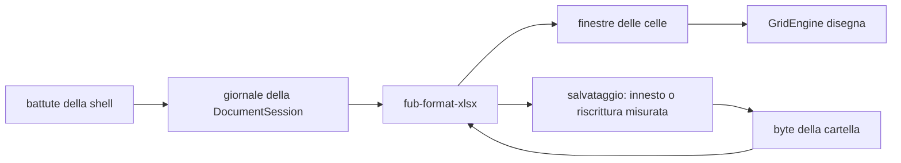

# Superficie dei fogli

> **Domanda:** come la shell apre, mostra e modifica una cartella di Excel,
> e che cosa resta al provider?
> **Fonti autorevoli:** `apps/client/src/editors/grid/`,
> `crates/fub-format-xlsx/`.
> **Decisioni:** [ADR 0219](../decisions/0219-la-cartella-si-modifica-con-i-comandi-di-gridcraft.md),
> [ADR 0220](../decisions/0220-gli-oggetti-dei-fogli-viaggiano-con-le-finestre.md).

## La griglia

Il confine della pagina in una figura: i byte non lasciano il provider, e la
shell parla soltanto col giornale e con le finestre.

Il salvataggio riparte sempre dai byte del file, non dalla griglia: il
giornale non è una copia della cartella.

La famiglia `grid` ha un profilo, `workbook`, che apre una cartella di Excel
con la versione 2 del protocollo: la sorgente a byte resta nell'host, e il
testo della `DocumentSession` è il **giornale** della cartella, con le celle
cambiate e i comandi dati. `GridEngine`
(`apps/client/src/editors/grid/engine.ts`) sceglie la prima superficie
dichiarata con famiglia, versione e formato giusti, apre una sessione sul
giornale e sulla revisione dei byte, e chiede soltanto le finestre che lo
schermo mostra, al massimo 256 righe per 128 colonne l'una. Righe e colonne
sono virtualizzate; le coordinate stabili `SheetId + RowId + ColumnId`
vengono dalle finestre.

Editor in-cell e formula bar usano due istanze di `TextEngine` con
`FormulaProfile`, e nessuna battuta attraversa IPC. Un commit scrive le voci
nel giornale, lo pubblica subito alla sessione e lo consegna al provider, che
controlla le preimmagini sulla revisione, rifiuta le celle bloccate e risponde
con le celle da rileggere. Le modifiche in coda partono una dopo l'altra.
Finché il giornale ha soltanto celle l'undo è locale alla superficie; in
modalità a comandi annulla e ripeti sono del documento (`edit.undo`,
`edit.redo`). Un giornale cambiato altrove (un altro
riquadro, un salvataggio, una ricarica) riapre la sessione e chiude la
precedente; la bozza aperta resta, con il cursore e il fuoco. Se la sua cella
è cambiata sotto, un avviso chiede «Tieni la tua» o «Prendi quella nuova»; se
il foglio non c'è più, la bozza si chiude e l'avviso lo dice. Se non c'è una
superficie compatibile,
la sessione non si apre o una finestra fallisce, la superficie dichiara
`data-grid-protocol="unavailable"`, lo dice nell'avviso e non scrive; il
linguaggio delle formule non si duplica in TypeScript.

La shell non riceve DOM, callback JavaScript o oggetti CodeMirror: possiede
rendering, input, clipboard, selezione e stato visuale, mentre il provider
possiede lettura, formule, blocchi e innesto. Limiti, coordinate, fallback e
parità nativo/WASM sono normati in [ABI e WIT](../reference/abi-and-wit.md) e
nel [contratto IPC](../reference/ipc-contract.md).

Nei tre strati
([ADR 0222](../decisions/0222-tre-strati-e-l-aspetto-del-contenuto.md)) le
intestazioni di righe e colonne e la barra sono cornice, la griglia e le celle
contenuto. La modalità `sheet` offre `file`, il predefinito, e `adattato`. In
`file` le celle stanno sulla carta chiara del file anche di notte, con i
riempimenti e i colori del file; in `adattato` stanno sulla carta del tema, e
riempimento e testo vi si portano in coppia con `theme/adapt.ts`. Il testo
automatico è l'inchiostro della carta, i fili della griglia sono quelli della
carta (`--doc-rule`). `editors/grid/paint.ts` mette i colori sulla cella come
variabili di dato (`--file-fill`, `--file-color` e le versioni `-a`), e la
regola dell'aspetto sta in `theme/scrittoio/structure.css`. Una pelle non veste
le celle: il gate del contenuto rifiuta `.grid-cell` e `.no-gridlines`, e i
segni (selezione, cella attiva, valore non ricalcolato, conflitto) si scrivono
dalla riga, `.grid-row .selected`. Gli oggetti del foglio non sono ancora sotto
il gate.

## Scrivere nelle celle

Come in Excel e LibreOffice, una battuta apre la cella in «Inserisci»:
Invio e Maiuscolo+Invio confermano e scendono o salgono, Tab e Maiuscolo+Tab
confermano e vanno a destra o a sinistra, le frecce confermano e si
spostano. Invio dopo una serie di Tab torna alla colonna da cui la serie è
partita. F2 e il doppio clic aprono in «Modifica», dove le frecce muovono il
cursore; F2 alterna i due modi, e la banda di stato dice il modo
(«Pronto», «Inserisci», «Modifica»). Alt+Invio va a capo, Ctrl+Invio scrive
la bozza in tutta la selezione, Esc annulla. Un clic su un'altra cella, o il
fuoco che lascia l'editor, conferma; dalla cella alla barra della formula la
bozza passa con il fuoco. Sulla selezione Invio e Tab spostano la cella
attiva senza aprirla, dentro l'intervallo se è più di una cella. La regola
pura di dove andare sta in `apps/client/src/tabella/navigation.ts`, quella
del riempimento in `tabella/selection.ts` (`fillRange`): sono le regole di
ogni tabella ([ADR 0225](../decisions/0225-tabella-un-componente-per-tutte-le-tabelle.md)).

Una battuta vera (stampabile, un tasto morto o una composizione dell'IME)
mette il fuoco nel campo della cella durante il `keydown` e non si ferma: il
carattere lo scrive il browser, come lo manda il sistema. Una battuta
sintetica, che il browser non scrive, apre la cella col suo carattere
(`typingOpens`). PagSu e PagGiù scorrono di una schermata di righe vere, con
le loro altezze, e la cella attiva resta allo stesso punto dello schermo;
Alt+PagSu e Alt+PagGiù fanno lo stesso di lato, Ctrl+Backspace riporta in
vista la cella attiva. Le frecce senza Maiuscolo partono dalla cella attiva.

Nelle formule si punta come nei fogli di calcolo. Dove la formula aspetta un
operando (`operandSlot` in `profiles/formula.ts`: dopo `=`, un operatore,
`(`, `,` o `;`), un clic su una cella scrive il suo riferimento, un
trascinamento lo allarga a un intervallo, e un altro clic lo sostituisce
finché il cursore resta alla sua fine. La cella aperta e la selezione non
cambiano, e il fuoco resta nel campo. In «Inserisci» le frecce muovono il
riferimento puntato, partendo dalla cella aperta, e con Maiuscolo lo
allargano. F4 alterna i `$` del riferimento al cursore. Ogni riferimento ha
uno di sei colori (`--doc-author-1…6`), lo stesso nel testo e nel contorno
del suo intervallo sulla griglia; un riferimento a un altro foglio si
contorna solo su quel foglio. Puntare celle di un altro foglio non c'è
ancora: il riferimento si scrive a mano.

Il disegno riusa gli elementi che non cambiano (`#reconcile`): una cella
uguale a quella di prima resta lo stesso nodo e cambia soltanto le classi
della selezione, così il doppio clic arriva e l'editor aperto non perde il
fuoco. Lo scorrimento disegna al più una volta per fotogramma.

La riga delle intestazioni, l'angolo, i numeri delle righe e le righe
bloccate stanno fermi con `position: sticky`: sono nel flusso del riquadro,
davanti al canvas che dà la misura, e li tiene a posto il compositore nello
stesso fotogramma dello scorrimento, non il disegno che segue. Le colonne
bloccate e i fili del blocco si rimettono ancora a posto nel disegno.

## La selezione e il riempimento

Il puntatore seleziona trascinando: da una cella un intervallo, da
un'intestazione colonne o righe intere, dall'angolo il foglio; Maiuscolo
estende dall'àncora, che resta la cella attiva. Fuori dal bordo la griglia scorre da sé, più svelta
quanto più il puntatore è lontano. Con righe o colonne intere la cella
attiva resta sulla prima colonna o sulla prima riga.

Un intervallo si disegna con un rettangolo solo, a bordo d'accento, sopra le
celle velate; la cella attiva resta senza velo, con un filo. Con una cella
sola il bordo è quello della cella attiva. Il riquadro non ha un anello,
salvo quando nessuna cella si vede: il fuoco è la cella attiva, che la
griglia indica con `aria-activedescendant`.
Le intestazioni della selezione prendono il velo e un filo d'accento verso
le celle; quella che segue righe o colonne nascoste ha una tacca doppia.

Il bordo fra due intestazioni, preso a 4 px, si tira quando la cartella
serve `home.columnWidth` (o `home.rowHeight`): il cursore cambia, una guida
segue il puntatore con la misura nelle unità di Excel e in pixel del file, e
al rilascio parte un solo comando. Il doppio clic sul bordo dà
`home.autofitColumnWidth` (o `home.autofitRowHeight`). Se la colonna sta fra
quelle scelte intere, la misura vale per tutte. Senza il comando servito il
bordo non si prende.

Ctrl+clic e Ctrl+trascina aggiungono un intervallo a quelli scelti;
Maiuscolo estende l'ultimo, un clic semplice ricomincia. Da tastiera
Maiuscolo+F8 tiene ciò che è scelto mentre ci si sposta, finché non si
ripete o si preme Esc. I comandi ricevono tutti gli intervalli, separati da
virgole come in GridCraft, che spegne col suo motivo quelli che non li
reggono. Canc li svuota tutti; copia e taglia li rifiutano e lo dicono, e il
quadratino di riempimento non c'è.

In una cartella a comandi che serve `edit.autoFill` la selezione ha il
quadratino di riempimento nell'angolo in basso a destra. Tirato fuori dalla
selezione mostra il bersaglio lungo l'asse su cui il puntatore è uscito di
più e, al rilascio, dà un solo `edit.autoFill` con sorgente e bersaglio
(con Ctrl tenuto, nel modo alternato di Excel). Il doppio clic riempie in giù
fin dove arriva la colonna accanto, nelle righe che la griglia ha letto. Le
serie le calcola il provider; Ctrl+D e Ctrl+R restano i riempimenti da
tastiera.

## Gli appunti

Copia scrive il TSV degli input, formule comprese, e una tabella HTML di ciò
che si vede, segnata `data-fub-table`. Incolla legge la tabella HTML di
Excel, LibreOffice, Sheets o Word quando c'è (le celle unite lasciano celle
vuote), altrimenti il TSV; quella di Fub cede al TSV accanto, che porta gli
input. Si incolla dall'angolo in alto a sinistra della selezione: un valore,
o un blocco che la selezione contiene un numero intero di volte, la riempie,
e dopo la selezione è ciò che si è scritto. Taglia non svuota: segna
l'intervallo con le formiche, e l'incolla che segue sposta gli input e
svuota ciò che resta fuori in un passo solo di Annulla; Esc, una copia o
una scrittura tolgono il segno. Le regole pure stanno in
`apps/client/src/tabella/clipboard.ts`.

Dentro una cartella a comandi l'incolla che trova negli appunti il testo
appena copiato dalla cartella non scrive gli input: dà il comando composto
`fub.pasteFrom` con la sorgente, il suo foglio e `move` per un taglio, sulla
selezione di arrivo. Il provider lo esegue con `edit.copy` (o `edit.cut`) e
`edit.pasteSpecial` della facciata in un passo, senza appunti che restano,
così formule con i riferimenti relativi, formati e unioni seguono come in
GridCraft, e il giornale lo rifà. Un taglio si incolla una volta; Esc, una
scrittura o un altro comando dimenticano la sorgente, e l'incolla torna agli
input. `fub.copyHtml` legge il testo e la tabella HTML di GridCraft di un
intervallo senza cambiare niente. Senza `fub.pasteFrom` nel catalogo gli
appunti portano gli input.

Il bordo della selezione, preso a 3 px fuori dal quadratino, si tira quando
la cartella serve `fub.pasteFrom`: il contorno segue il puntatore e al
rilascio un solo `fub.pasteFrom` sposta l'intervallo (con Ctrl tenuto lo
copia), e la selezione è dove lo si è lasciato. Righe o colonne intere e
più intervalli non si tirano.

## La barra multifunzione

Sopra la barra della formula di una cartella a comandi sta la barra
multifunzione (`apps/client/src/editors/grid/ribbon/`), che il bootstrap
carica a parte. La barra è quella del kit (`kit/ribbon/`); la griglia le dà
la sua vista, le sue schede e le due specie di controllo sue, la tavolozza e
le gallerie. `tabs.ts` descrive schede, gruppi e controlli (pulsanti,
pulsanti divisi, menu, colori, elenchi, caselle, gallerie, campi); ogni
controllo nomina un id del catalogo del provider, e la barra mostra
soltanto quelli che il catalogo serve, spegne quelli spenti con il motivo
nel suggerimento e dà il comando con i parametri della facciata. Lo stato
viene dallo stile della cella attiva, dalle tabelle e dalla vista del foglio
e dal libro della cartella; la scheda della tabella compare con la selezione
dentro una tabella. La tavolozza disegna i colori del tema con le sfumature
di ECMA-376 (`palette.ts`), le gallerie gli stili di tabella e di cella.

La barra si percorre con le frecce (un solo controllo per scheda sta nel
Tab), Esc torna alla griglia, Alt o F10 mostrano le lettere di Excel. Quando
la barra è stretta i pulsanti piccoli perdono il nome, poi i gruppi si
raccolgono da destra in un pulsante che li apre in un riquadro. Il testo
della barra è in un catalogo suo (`strings.ts`), in italiano e in inglese.

Il tasto destro sceglie come Excel: fuori dalla selezione sceglie la cella,
la riga o la colonna sotto il puntatore, dentro la lascia. `ribbon/context.ts`
dichiara le voci per cella, intestazione di riga e di colonna, angolo,
scheda del foglio e oggetto con gli stessi controlli di `tabs.ts`, e
`GridRibbon.contextMenu` le dà al menu dell'editor (`editors/grid/menu.ts`),
che aggiunge gli appunti in TSV e «Copia il riferimento». Una voce che il
catalogo non serve non si vede. La mini-barra sopra il menu
(`MINI_CONTROLS`) riusa i controlli della scheda Home: carattere,
dimensione, grassetto, corsivo, percentuale, separatore delle migliaia e
decimali. In sola lettura restano le voci che non scrivono.

## Le finestre dei fogli

Le finestre della cartella (`apps/client/src/editors/grid/dialogs/`, elencate
in `catalog.ts`) si aprono da un controllo della barra, spento con il comando
che la finestra darebbe, o dall'esito di un comando che chiede una finestra
(`GridDialog`). Ognuna legge con le letture del provider (`cell.get`,
`formulas.nameManager`…) e, confermata, dà un solo comando del catalogo
(la finestra di un commento uno per ciò che è cambiato); un rifiuto resta
scritto nella finestra aperta. Formato celle dà soltanto ciò
che è cambiato, e l'esempio del formato lo calcola il provider con `TEXT`.

## Gli oggetti dei fogli

Grafici, grafici sparkline, immagini e forme arrivano con le finestre che
toccano (`GridObject`), e la griglia li disegna sopra le celle, nell'ordine
del file (`apps/client/src/editors/grid/objects.ts`). Un grafico arriva già
disegnato in SVG dal provider (GridCraft, patch 0009) e si mostra in un
``, che non esegue niente; un'immagine arriva con la sua impronta, una
volta sola: la shell la tiene in `GridMediaCache` e la richiesta della
finestra elenca le impronte che ha (`known_media`). Una forma arriva come
aspetto (figura, colori, testo) e la disegna la shell in SVG.

Gli oggetti sono `aria-hidden`: un riassunto nascosto, legato al viewport,
li elenca con il tipo e il testo alternativo, e la selezione si annuncia.
Un clic o Ctrl+Alt+5 seleziona un oggetto, Tab passa al successivo, Esc
torna alle celle. Un oggetto selezionato si sposta con le frecce (Maiuscolo
per dieci pixel) o trascinandolo, si misura con le maniglie, si cancella con
Canc; Invio o F2 aprono il testo di una casella di testo, che Ctrl+Invio o
l'uscita scrivono ed Esc lascia. Lo spostamento si mostra subito e diventa un
solo comando `object.move` (cella dell'angolo, scarto e misura nei pixel del
file); se il comando non entra l'oggetto torna dov'era. Con un oggetto
selezionato la barra mostra le schede contestuali del grafico e della forma.

## La revisione

Una cella con una nota o un commento ha il segno nell'angolo (spento per un
thread risolto) e, al passaggio del puntatore, la scheda di
`apps/client/src/editors/grid/comment-card.ts`: il thread con gli autori e,
se la griglia accetta comandi, Rispondi, Risolvi o Riapri, Modifica,
Mostra/Nascondi per una nota ed Elimina. Ogni gesto è un comando del catalogo
(`review.*`) con la cella nei parametri, perché vale per la cella indicata e
non per quella attiva. A chi usa la tastiera il thread lo dice la cella attiva
(`aria-description`), e Maiusc+F2 apre la finestra della nota o del commento,
che mostra le risposte e con lo stesso OK cambia il testo, risponde e risolve.
Una finestra aperta su una cella che ha già l'altro tipo apre quello: una nota
scritta su un commento lo sostituirebbe. Modificare il testo tiene le
risposte, lo stato e la casella della nota (GridCraft, patch 0010).

Proteggi foglio e Proteggi cartella chiedono la password due volte; Rimuovi
protezione, e Proteggi cartella su una cartella protetta, provano senza
password e la chiedono soltanto se il provider ne vuole una.

## La stampa

Le impostazioni di pagina sono del provider: la scheda Layout di pagina dà i
comandi di GridCraft (`pageLayout.*`), e Imposta pagina
(`dialogs/page.ts`) legge `pageLayout.pageSetup` dato senza parametri, che non
cambia niente, e scrive le quattro schede di Excel con un solo comando; i
margini si mostrano in centimetri, e uno non toccato torna in pollici con il
valore del file. L'anteprima di stampa legge `file.printPreview` (le pagine) e
`file.exportPdf` senza percorso (il PDF in base64), due comandi che il
provider serve anche se GridCraft li mette nel gruppo File e che non entrano
nel giornale; la finestra disegna una pagina alla volta con il lettore dei PDF
della shell, intera o con lo zoom. Un PDF oltre 1 MiB di risultato non
arriva: la finestra lo dice e lascia l'esportazione.

L'esportazione in PDF è l'export dell'host `xlsx.copy.pdf`
(`crates/fub-format-xlsx/src/export.rs`, bundle `fub.xlsx`), che la
superficie dichiara fra i suoi export: il pulsante della barra e il menu del
riquadro salvano, chiedono `export.run` e aprono il centro attività. Stampa i
byte salvati, non la sessione, e il rapporto conta ciò che il PDF non porta.

## Dove si trova

- `apps/client/src/editors/grid/engine.ts`
- `apps/client/src/editors/grid/workbook.ts`
- `apps/client/src/editors/grid/objects.ts`
- `apps/client/src/editors/grid/comment-card.ts`
- `apps/client/src/editors/grid/ribbon/ribbon.ts`
- `apps/client/src/kit/ribbon/ribbon.ts`
- `apps/client/src/editors/grid/ribbon/tabs.ts`
- `apps/client/src/editors/grid/dialogs/host.ts`
- `apps/client/src/editors/grid/dialogs/catalog.ts`
- `apps/client/src/editors/grid/dialogs/page.ts`
- `apps/client/src/editors/grid/dialogs/notes.ts`
- `apps/client/src/editors/grid/dialogs/protect.ts`
- `crates/fub-format-xlsx/src/grid.rs`
- `crates/fub-format-xlsx/src/export.rs`
- `crates/fub-format-xlsx/src/objects.rs`
