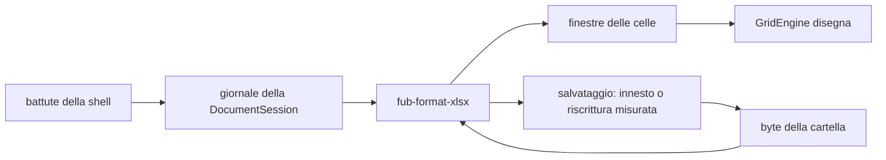

# Superficie dei fogli

> **Domanda:** come la shell apre, mostra e modifica una cartella di Excel,
> e che cosa resta al provider?
> **Fonti autorevoli:** `apps/client/src/editors/grid/`,
> `crates/fub-format-xlsx/`.
> **Decisioni:** [ADR 0219](../decisions/0219-la-cartella-si-modifica-con-i-comandi-di-gridcraft.md),
> [ADR 0220](../decisions/0220-gli-oggetti-dei-fogli-viaggiano-con-le-finestre.md).

## La griglia

Il confine della pagina in una figura: i byte non lasciano il provider, la
shell parla soltanto col giornale e con le finestre, e il salvataggio riparte
dai byte del file, non dalla griglia (il giornale non è una copia).

La famiglia `grid` ha un profilo, `workbook`, che apre una cartella di Excel
con la versione 2 del protocollo: la sorgente a byte resta nell'host, e il
testo della `DocumentSession` è il **giornale** della cartella, con le celle
cambiate e i comandi dati. `GridEngine`
(`apps/client/src/editors/grid/engine.ts`) sceglie la prima superficie
dichiarata con famiglia, versione e formato giusti, apre una sessione sul
giornale e sulla revisione dei byte, e chiede soltanto le finestre che lo
schermo mostra, al massimo 256 righe per 128 colonne l'una. Righe e colonne
sono virtualizzate; le coordinate stabili `SheetId + RowId + ColumnId` vengono
dalle finestre.

Editor in-cell e formula bar usano due `TextEngine` con `FormulaProfile`, e
nessuna battuta attraversa IPC. Un commit scrive le voci nel giornale, lo pubblica
alla sessione e lo consegna al provider, che controlla le preimmagini, rifiuta le
celle bloccate e risponde con le celle da rileggere; le modifiche in coda partono
in fila. Su una cartella annulla e ripeti sono del provider, celle e comandi in
una pila anche oltre il salvataggio
([contratto](../reference/ipc-contract.md#cartelle-di-excel)). Annulla e ripeti
dati mentre il giornale si scrive aspettano la scrittura
(`DocumentSession.writing`), con le modifiche dopo di loro in fila, e vanno
alla sessione riaperta sui byte scritti: un comando tolto da un giornale che il
disco ha già non si potrebbe più riportare sul file; senza provider
l'undo è locale, e si svuota con avviso se altri cambiano una sua cella. Un
giornale cambiato altrove riapre la sessione; la bozza resta col cursore e il
fuoco e segue la sua riga. Se la sua cella è cambiata sotto, un avviso chiede
«Tieni la tua» o «Prendi quella nuova»; un'altra cella cambiata lo dice l'avviso;
senza la riga la bozza va negli appunti, senza il foglio si chiude con l'avviso.
La cella aperta è testo [in sospeso](frontend-and-ipc.md#il-testo-in-sospeso): va
nelle bozze, e si conferma prima di salvare, di chiudere o di un cambio da fuori
(che diventa un conflitto). Se i byte di base del giornale non sono più sul disco,
la griglia lo apre su quelli di adesso (come «Tieni il mio testo»). Senza
superficie compatibile, o se sessione o finestra non si aprono, la griglia è
`data-grid-protocol="unavailable"`, lo dice nell'avviso e non scrive.

La shell non riceve DOM, callback JavaScript o oggetti CodeMirror: possiede
rendering, input, clipboard, selezione e stato visuale, mentre il provider
possiede lettura, formule, blocchi e innesto. Limiti, coordinate, fallback e
parità nativo/WASM sono normati in [ABI e WIT](../reference/abi-and-wit.md) e
nel [contratto IPC](../reference/ipc-contract.md).

Nei tre strati ([ADR
0222](../decisions/0222-tre-strati-e-l-aspetto-del-contenuto.md)) le
intestazioni di righe e colonne e la barra sono cornice, la griglia e le celle
contenuto. La modalità `sheet` offre `file`, il predefinito, e `adattato`. In
`file` le celle stanno sulla carta chiara del file anche di notte, con i
riempimenti e i colori del file; in `adattato` stanno sulla carta del tema, e
riempimento e testo vi si portano in coppia con `theme/adapt.ts`. Il testo
automatico è l'inchiostro della carta, i fili della griglia sono quelli della
carta (`--doc-rule`). `editors/grid/paint.ts` mette i colori sulla cella come
variabili di dato (`--file-fill`, `--file-color` e le versioni `-a`), e la
regola dell'aspetto sta in `theme/scrittoio/structure.css`. Una pelle non
veste le celle: il gate del contenuto rifiuta `.grid-cell` e `.no-gridlines`,
e i segni (selezione, cella attiva, valore non ricalcolato, conflitto) si
scrivono dalla riga, `.grid-row .selected`. La pelle di casa disegna la
selezione e la cella attiva coi pezzi del motore dei segni («La selezione e il
riempimento»), e dalla riga solo il valore non ricalcolato e il conflitto. Gli
oggetti del foglio non sono ancora sotto il gate.

Il piano (`.grid-plane`) è grande quanto il foglio: testa (intestazioni,
righe bloccate) e colonna ferma (numeri delle righe, colonne bloccate) restano
a posto col solo `sticky`, nello stesso fotogramma dello scorrimento. Ogni
zona ha un livello di segni: `marks.ts` taglia un rettangolo per zona.

Le righe restano (`#drawRow`): ognuna ricorda per indice la sua misura e le
sue celle, e una cella si rifà solo quando cambia ciò che mostra; se l'HTML è
lo stesso resta lo stesso nodo e cambiano le sole classi della selezione,
così il doppio clic arriva e l'editor aperto non perde il fuoco. Si disegna
un riquadro intero di margine per lato (`GRID_OVERSCAN` è solo il margine
del caricamento): lo scorrimento aggiunge e toglie righe ai bordi, un salto
le rifà tutte, la cella aperta resta anche fuori. Le disegna il gestore
dello scorrimento, con le misure lette prima di scrivere (anche per una
finestra arrivata): un giro mette il riquadro, una fascia di un decimo e al
più tre righe nuove del margine (`GRID_FRAME_NEW_ROWS`), rifà al più 48 celle
(`GRID_FRAME_REFILLS`); il resto, segni, oggetti e misura delle celle, va
nei fotogrammi. Sotto c'è la carta (`.grid-paper`, copiata nelle fasce
ferme), grande e ferma quanto il riquadro: fili delle righe sull'altezza di
serie (`--grid-row`), un filo per colonna, celle opache, e la griglia vuota
dove lo scorrimento precede il disegno. In G2 (quattro giri) la fascia
uniforme più alta è 1 px; p90 (peggiore) del gestore 6–9 ms (17–20), del
fotogramma 11–13 ms (15–17).

## Scrivere nelle celle

Come in Excel e LibreOffice, una battuta apre la cella in «Inserisci»: Invio e
Maiuscolo+Invio confermano e scendono o salgono, Tab e Maiuscolo+Tab (anche
`Unidentified` da GTK) confermano e vanno a destra o a sinistra, le frecce
confermano e si spostano; Invio dopo una serie di Tab torna alla colonna di
partenza. F2 e il doppio clic aprono in «Modifica» (le frecce muovono il
cursore); F2 alterna i modi, che la banda di stato dice («Pronto»,
«Inserisci», «Modifica»). Alt+Invio va a capo, Ctrl+Invio scrive in tutta la
selezione, Esc annulla; un clic altrove o il fuoco che esce conferma, e verso
la barra della formula la bozza passa col fuoco. Sulla selezione Invio e Tab
spostano la cella attiva senza aprirla, dentro l'intervallo. Dove andare sta
in `apps/client/src/tabella/navigation.ts`, il riempimento in
`tabella/selection.ts` (`fillRange`): regole di ogni tabella ([ADR 0225](../decisions/0225-tabella-un-componente-per-tutte-le-tabelle.md)).
Ciò che si conferma si vede prima della risposta (`writtenValue`): un numero
semplice va a destra, una formula resta scritta e tenue (`.pending`) finché
il valore compare in `DURATION.state`; vince la risposta, un no torna com'era.

La cella aperta è la cella: il campo sta nel livello «lift» della sua zona,
con carta, inchiostro, carattere (`--field-font`), allineamento e margini
della cella; la cornice (2 px di `--grid-mark`) compare in `DURATION.state` e
la maniglia se ne va. A ogni bozza cresce a colonne intere fino al bordo
(`openSpan`), poi va a capo e scende fino a metà riquadro, poi scorre dentro.
Per chi legge lo schermo il campo sta nella sua cella (`aria-owns`), e il
suo livello «lift» è leggibile solo finché la cella è aperta: gli altri
livelli restano `aria-hidden`.

Una battuta vera (stampabile, un tasto morto, una composizione dell'IME) porta
il fuoco nella cella durante il `keydown` e il carattere lo scrive il browser;
una sintetica apre la cella col suo carattere (`typingOpens`). PagSu e PagGiù
scorrono di una schermata di righe vere e la cella attiva resta allo stesso
punto dello schermo; Alt+PagSu e Alt+PagGiù fanno lo stesso di lato,
Ctrl+Backspace riporta in vista la cella attiva, da cui partono le frecce
senza Maiuscolo.

Nelle formule si punta. Dove la formula aspetta un operando (`operandSlot`
in `profiles/formula.ts`: dopo `=`, un operatore, `(`, `,` o `;`) un clic
scrive il riferimento della cella, un trascinamento lo allarga, un altro clic
lo sostituisce finché il cursore resta alla sua fine; cella aperta, selezione
e fuoco non cambiano. In «Inserisci» le frecce muovono il riferimento (con
Maiuscolo lo allargano), F4 alterna i `$`. Ogni riferimento ha uno di sei
colori (`--doc-author-1…6`), nel testo e nel contorno sulla griglia, solo sul
suo foglio; le celle di un altro foglio si scrivono a mano.

## La selezione e il riempimento

Il puntatore seleziona trascinando: da una cella un intervallo, da
un'intestazione colonne o righe intere, dall'angolo il foglio; Maiuscolo
estende dall'àncora, che resta la cella attiva. Fuori dal bordo la griglia scorre da sé, più svelta
quanto più il puntatore è lontano. Con righe o colonne intere la cella
attiva resta sulla prima colonna o sulla prima riga.

I segni restano e scivolano (`grid-motion.ts`): rettangolo (2 px sul filo),
anello della cella attiva, velo e quadratino sono pezzi creati una volta per
zona e mossi col `transform` da dieci numeri che vanno al bersaglio con la
molla `GLIDE`, mai oltre né all'indietro, anello e velo dentro il bordo; con
«ridotto», cambio di foglio o scelta dall'host saltano. La molla la sceglie
`editor.grid.selection-speed` (`selectionMotion`): `quick` `GLIDE_QUICK`,
`normal` `GLIDE`, `soft` `SLIDE`, `none` a scatti (un bersaglio nuovo si
vede subito, lo stesso lascia finire la corsa); le colonne che scivolano
portano i segni con `SLIDE` con ogni scelta. La griglia legge le due
preferenze all'apertura e le rilegge a ogni `setting_changed` delle loro
chiavi; un valore sconosciuto vale quello di serie. Colore `--grid-mark`,
in colori forzati `Highlight`; il quadratino si prende dove si vede (6 px). Il
fuoco è la cella attiva (`aria-activedescendant`). Le intestazioni scelte
hanno velo e filo d'accento, e dopo righe o colonne nascoste una tacca doppia.

Col dito (`pointerType` `touch`) trascinare scorre e basta: la griglia dice
`touch-action: pan-x pan-y` e non sceglie niente oltre 8 px (`TAP_MOVE`). Un
tocco sceglie la cella, la colonna, la riga o il foglio come un clic, e
conferma una cella aperta; due tocchi sulla stessa cella entro 300 ms la
aprono; un tocco lungo (450 ms, fermo) la sceglie, se non è già scelta, e
mette due maniglie agli angoli della selezione, che si tirano per
allargarla. Le maniglie sono pezzi del motore dei segni (`grid-mark-touch`,
`data-handle` `a` e `b`): crescono dal centro con la molla `SLIDE` (con
«ridotto» si dissolvono), seguono la selezione e, come il quadratino, sono
intere nel livello della zona del loro angolo. Non prendono il puntatore: la
presa è un cerchio di 9 px attorno all'angolo che si vede, anche dove una
fascia ferma copre metà maniglia, e un `touchstart` sulla presa ferma lo
scorrimento. Un tocco altrove, il mouse o la penna le tolgono. Col dito il
quadratino non c'è (il riempimento si fa dal menu) e il tocco lungo non apre
menu. Il mouse e la penna fanno ciò che fanno sempre.

Il bordo fra due intestazioni, preso a 4 px, si tira quando la cartella serve
`home.columnWidth` (o `home.rowHeight`): una guida (`--grid-mark`) segue il puntatore con la
misura nel riquadro. Al rilascio parte un comando e la misura vale già
(`SizePreview`): ciò che segue scivola con `SLIDE`, su un no torna e l'avviso
lo dice, una risposta vecchia non toglie un gesto più nuovo. Il doppio clic dà
`home.autofit…`; con una colonna fra le scelte intere la misura vale per tutte.

Ctrl+clic e Ctrl+trascina aggiungono un intervallo, Maiuscolo estende
l'ultimo, un clic semplice ricomincia; Maiuscolo+F8 tiene ciò che è scelto
mentre ci si sposta, finché non si ripete o si preme Esc. I comandi ricevono
gli intervalli separati da virgole, come in GridCraft, che spegne col motivo
quelli che non li reggono. Canc li svuota; copia e taglia li rifiutano e lo
dicono, e il quadratino non c'è.

Con `edit.autoFill` la selezione ha il quadratino in basso a destra: tirato
fuori, il bersaglio a formiche ferme segue l'asse su cui il puntatore è uscito
di più, e il rilascio dà un `edit.autoFill` (con Ctrl nel modo alternato di
Excel). Il doppio clic riempie in giù fin dove arriva la colonna accanto;
Ctrl+D, Ctrl+R e Serie riempiono da tastiera, le serie le calcola il provider.
Finché il foglio non risponde le formiche camminano (`ANTS_STEP` px ogni
`ANTS_MS`, ferme con «ridotto»), la selezione resta sulla sorgente e il
quadratino non c'è; poi le formiche svaniscono, la selezione scivola sul
riempimento e i valori nuovi entrano sfalsati; un no lo dice l'avviso.

## Gli appunti

Copia scrive il TSV degli input, formule comprese, e una tabella HTML di ciò
che si vede, segnata `data-fub-table`. Incolla legge la tabella HTML di
Excel, LibreOffice, Sheets o Word quando c'è (le celle unite lasciano celle
vuote), altrimenti il TSV; quella di Fub cede al TSV accanto. Un valore, o un
blocco che la selezione contiene un numero intero di volte, la riempie
dall'angolo, e dopo è selezionato ciò che si è scritto. Copia lascia un
tratteggio largo e un battito (`editor.grid.copy-mark`: `dash-pulse`, `dash`
o `pulse`, letta alla copia); Taglia non svuota, segna con un tratteggio
fitto, e l'incolla dopo sposta gli input e svuota il resto in un passo di
Annulla. Il segno resta sul suo foglio e segue l'ultima copia; Esc, una
scrittura, un comando o un incolla lo tolgono, ma non un'altra app che cambia
gli appunti di sistema. Regole pure: `apps/client/src/tabella/clipboard.ts`.

In una cartella a comandi l'incolla che trova negli appunti il testo appena
copiato dalla cartella dà il comando composto `fub.pasteFrom` (sorgente, suo
foglio, `move` per un taglio) sulla selezione di arrivo. Il provider lo esegue
con `edit.copy` (o `edit.cut`) e `edit.pasteSpecial` in un passo, senza
appunti che restano: formule relative, formati e unioni seguono come in
GridCraft, e il giornale lo rifà. I valori si vedono subito come anteprima
(regole di «Scrivere nelle celle»), la risposta del provider vince e un no
rimette le celle; un taglio ha le formiche attorno alla sorgente finché il
foglio non risponde, e si incolla una volta. Esc, una scrittura o un altro
comando dimenticano la sorgente. `fub.copyHtml` legge testo e tabella HTML di
un intervallo; senza `fub.pasteFrom` gli appunti portano gli input.

Con `fub.pasteFrom` il bordo della selezione, preso a 3 px fuori dal
quadratino, si tira: il contorno segue il puntatore, il rilascio dà un
`fub.pasteFrom` che sposta l'intervallo (con Ctrl lo copia) e lo seleziona.
Righe o colonne intere e più intervalli non si tirano.

## La barra multifunzione

Sopra la barra della formula di una cartella a comandi sta la barra
multifunzione (`editors/grid/ribbon/`, sulla barra del kit), con «Comandi»
e il menu del tasto destro: tutto nella
[barra multifunzione dei fogli](grid-ribbon.md).

## Le finestre dei fogli

Le finestre della cartella (`apps/client/src/editors/grid/dialogs/`, elencate
in `catalog.ts`) si aprono da un controllo della barra, spento con il comando
che la finestra darebbe, o dall'esito di un comando che chiede una finestra
(`GridDialog`). Ognuna legge con le letture del provider (`cell.get`,
`formulas.nameManager`…) e, confermata, dà un solo comando del catalogo (la
finestra di un commento uno per ciò che è cambiato); un rifiuto resta scritto
nella finestra aperta. Formato celle dà soltanto ciò che è cambiato, e
l'esempio del formato lo calcola il provider con `TEXT`. Crea tabella dà
l'area di dati della cella e dice che senza intestazioni i dati scendono;
ordinare da una cella sola allarga prima la selezione a quell'area.

## I comandi nella tavolozza

Con una cartella nel riquadro col fuoco, la tavolozza dei comandi (e il
lanciatore dello Scrittoio) mostra ogni comando del catalogo che il motore
serve, nel gruppo «Foglio», col titolo tradotto e la scheda della barra in cui
lo si trova (`editors/grid/palette/`). La superficie li dà con
`paletteCommands()` di `EditorSurface`. Un comando che il motore dice spento
resta in elenco col suo motivo e non parte.

Scelto, un comando si dà come lo darebbe la barra: con la finestra scritta a
mano se ne ha una (`OWN_DIALOGS` in `palette/commands.ts`, controllata dai
test contro la barra); altrimenti, se chiede un parametro obbligatorio, con
una finestra costruita dai campi del catalogo (`palette/form.ts`), in cui una
cella o un intervallo partono dalla selezione e un rifiuto del motore resta
scritto dentro; altrimenti subito sulla selezione. I titoli e i nomi dei campi
stanno in un catalogo dei testi a parte (`palette/strings.ts`), caricato con
la superficie e non con la shell.

Gli stessi comandi stanno nel menu «Comandi» della barra. Barra, menu e
tavolozza danno un comando da un solo punto (`GridPalette.give`), che sceglie
fra la finestra scritta a mano, quella costruita e il risultato.

Il test di copertura (`palette/palette.test.ts`) vuole che ogni comando del
catalogo si trovi nel suo albero e che ogni scheda e gruppo che il menu
mostra abbia un nome, nella barra o fra quelli del solo menu
(`fogli.menu.tab.*`, `fogli.menu.group.*`).

### La sola lettura per effetto

Ogni comando del catalogo ha un effetto: `cambia`, `legge` o `mostra`. In
sola lettura si spengono soltanto quelli che cambiano, col perché
`fogli.palette.read_only`; quelli che leggono o mostrano restano accesi nella
barra, nel menu «Comandi» e nella tavolozza. La barra resta visibile
(`servesCommands()` del motore), coi controlli che cambiano spenti. Il motore
ne è il presidio: la palette gli dice l'effetto di ogni comando
(`setCommandEffects`), e in sola lettura lascia partire soltanto quelli che
leggono o mostrano, e soltanto le finestre scritte a mano dei comandi che non
cambiano (trova, vai a, vai a formato, anteprima di stampa, gestione nomi).
Un esito che porta comunque delle modifiche non si applica: il motore lo
scrive nel registro e riapre la cartella del provider dal testo confermato.
Le scorciatoie, i gesti sulla griglia e il menu del tasto destro restano
quelli della sola lettura.

### Il risultato dei comandi che leggono

Un comando che legge e non ha una finestra scritta a mano apre la finestra del
risultato (`editors/grid/risultato.ts`, sulla finestra del kit): una sola alla
volta, e lo stesso comando dato di nuovo ritrova quella aperta. Se il comando
chiede un parametro obbligatorio, prima la finestra costruita, poi il
risultato. Mentre legge dice «Sto leggendo il risultato…» sopra delle righe
segnaposto; poi una tabella, con la testata che resta ferma mentre il corpo
scorre, i numeri allineati a destra nella lingua dell'interfaccia e i
riferimenti a una cella come pulsanti che chiudono la finestra e scelgono la
cella (un foglio che non c'è più lo dice nella nota). La tabella scorre in una
scatola alta al più 14rem, e un valore lungo va a capo. «Copia» mette negli
appunti il risultato in TSV, e un rifiuto degli appunti lo dice nella nota; un
rifiuto del provider dice il suo perché, con «Riprova». Esc chiude e rende il
fuoco a chi l'aveva; la finestra si chiude anche con la cartella. Le forme che
il provider restituisce e le parole da tradurre sono in
`risultati.generated.json`, scritto da
`crates/fub-format-xlsx/tests/ts_risultati.rs`.

### I perché

Il motore e l'adattatore spengono o rifiutano un comando con una frase
inglese. `editors/grid/motivi.ts` dà a ogni frase che possono dire
(`motivi.generated.json`, dallo stesso test) la sua chiave `fogli.motivo.*`:
i parametri passano nella traduzione, il nome di un comando diventa il suo
titolo, un perché dentro un perché si traduce a sua volta, e una frase che
non si conosce resta citata in una frase generica. La barra, il menu, la
tavolozza, la finestra costruita e il risultato passano tutti di qui.

## Gli oggetti dei fogli

Grafici, grafici sparkline, immagini e forme arrivano con le finestre che
toccano (`GridObject`), e la griglia li disegna sopra le celle, nell'ordine
del file (`apps/client/src/editors/grid/objects.ts`). Un grafico arriva già
disegnato in SVG dal provider (GridCraft, patch 0009) e si mostra in un
``, che non esegue niente; un'immagine arriva con la sua impronta, una
volta sola: la shell la tiene in `GridMediaCache` e la richiesta della
finestra elenca le impronte che ha (`known_media`). Una forma arriva come
aspetto (figura, colori, testo) e la disegna la shell in SVG.

Gli oggetti sono `aria-hidden`: un riassunto nascosto, legato al viewport,
li elenca con il tipo e il testo alternativo, e la selezione si annuncia.
Un clic o Ctrl+Alt+5 seleziona un oggetto, Tab passa al successivo, Esc
torna alle celle. Un oggetto selezionato si sposta con le frecce (Maiuscolo
per dieci pixel) o trascinandolo, si misura con le maniglie, si cancella con
Canc; Invio o F2 aprono il testo di una casella di testo, che Ctrl+Invio o
l'uscita scrivono ed Esc lascia. Lo spostamento si mostra subito e diventa un
solo comando `object.move` (cella dell'angolo, scarto e misura nei pixel del
file); se il comando non entra l'oggetto torna dov'era. Con un oggetto
selezionato la barra mostra le schede contestuali del grafico e della forma.

## La revisione

Una cella con una nota o un commento ha il segno nell'angolo (spento per un
thread risolto) e, al passaggio del puntatore, la scheda di
`apps/client/src/editors/grid/comment-card.ts`: il thread con gli autori e,
se la griglia accetta comandi, Rispondi, Risolvi o Riapri, Modifica,
Mostra/Nascondi per una nota ed Elimina. Ogni gesto è un comando del catalogo
(`review.*`) con la cella nei parametri, perché vale per la cella indicata e
non per quella attiva. A chi usa la tastiera il thread lo dice la cella attiva
(`aria-description`), e Maiusc+F2 apre la finestra della nota o del commento,
che mostra le risposte e con lo stesso OK cambia il testo, risponde e risolve.
Una finestra aperta su una cella che ha già l'altro tipo apre quello: una nota
scritta su un commento lo sostituirebbe. Modificare il testo tiene le
risposte, lo stato e la casella della nota (GridCraft, patch 0010).

Proteggi foglio e Proteggi cartella chiedono la password due volte; Rimuovi
protezione, e Proteggi cartella su una cartella protetta, provano senza
password e la chiedono soltanto se il provider ne vuole una.

## La stampa

Le impostazioni di pagina sono del provider: la scheda Layout di pagina dà i
comandi di GridCraft (`pageLayout.*`), e Imposta pagina
(`dialogs/page.ts`) legge `pageLayout.pageSetup` dato senza parametri, che non
cambia niente, e scrive le quattro schede di Excel con un solo comando; i
margini si mostrano in centimetri, e uno non toccato torna in pollici con il
valore del file. L'anteprima di stampa legge `file.printPreview` (le pagine) e
`file.exportPdf` senza percorso (il PDF in base64), due comandi che il
provider serve anche se GridCraft li mette nel gruppo File e che non entrano
nel giornale; la finestra disegna una pagina alla volta con il lettore dei PDF
della shell, intera o con lo zoom. Un PDF oltre 1 MiB di risultato non
arriva: la finestra lo dice e lascia l'esportazione.

L'esportazione in PDF è l'export dell'host `xlsx.copy.pdf`
(`crates/fub-format-xlsx/src/export.rs`, bundle `fub.xlsx`), che la
superficie dichiara fra i suoi export: il pulsante della barra e il menu del
riquadro salvano, chiedono `export.run` e aprono il centro attività. Stampa i
byte salvati, non la sessione, e il rapporto conta ciò che il PDF non porta.

## Dove si trova

- `apps/client/src/editors/grid/`: `engine.ts`, `engine-geometry.ts`,
  `engine-host.ts`, `dom-sync.ts`, `marks.ts`, `grid-motion.ts`,
  `workbook.ts`, `objects.ts`, `comment-card.ts`, `menu-comandi.ts`,
  `risultato.ts`, `motivi.ts`, `ribbon/` (`tabs/`), `dialogs/`, `palette/`
- `apps/client/src/kit/ribbon/`; `crates/fub-format-xlsx/src/`: `grid.rs`,
  `export.rs`, `objects.rs`
- la pelle: `apps/client/src/theme/scrittoio/structure.css` (il piano, le
  zone, la carta, i livelli dei segni, la cella aperta),
  `theme/scrittoio/skin/editors.css` (sezione «Il foglio di calcolo»: i
  colori dei segni, delle formiche e della cella aperta) e gli hook in
  `theme/scrittoio/anatomia/editors.ts` (voce `grid-surface`)
- il banco: le scene `grid-*` di `apps/client/bench/scene.mjs` (sulla
  cartella grande `?workbook=large`, gli stati del prototipo delle celle nel
  foglio pieno: l'intervallo, oltre la riga bloccata, la cella aperta e la
  colonna tirata, anche a 700 px; il riempimento in attesa, la copia nelle tre
  scelte del segno e il taglio; `mobile-grid-tocco-lungo` al telefono), i
  controlli dei gesti G1–G7 in `bench/grid-gestures.mjs` (`npm run
  bench:grid`) e le coreografie `griglia-*` in `bench/motion-rules.mjs`
