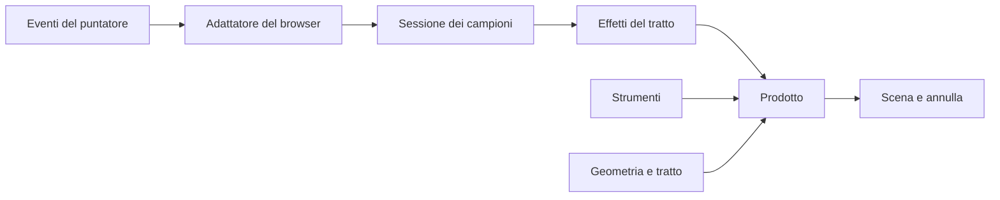

# Inchiostro e strumenti

Questa pagina spiega come Fub raccoglie l'inchiostro e dove vivono penna,
evidenziatore e gomma, perché più prodotti possano usarli senza copiarli.

> **Ambito:** `crates/fub-ink`, `apps/client/src/ink/` e il loro uso da parte di
> FubDraw.
> **Fonte autorevole:** il codice e i test di quei percorsi.
> **Decisione:** [ADR 0204](../decisions/0204-nucleo-inchiostro.md).

## Regola

Penna, evidenziatore, gomma, gestione del puntatore e geometria dei tratti
sono **componenti di sistema**. Non appartengono a FubDraw né a un futuro
editor: ogni prodotto che raccoglie inchiostro li usa e nessuno ne ha una copia
propria. Un prodotto mette il suo: dove scrive il tratto, come lo annulla, che
cosa annuncia.

## Livelli

Il percorso va dall'evento del browser al tratto scritto. Ogni livello ignora
quelli a destra.



Gli eventi arrivano all'adattatore, che riempie un campione per evento. La
sessione trasforma i campioni in effetti. Il prodotto sceglie lo strumento,
scrive il tratto nella sua scena e lo annulla con il suo storico. Gli strumenti
e la geometria sono funzioni che il prodotto chiama.

| Livello | Percorso | Contiene |
|---|---|---|
| nucleo, Rust | `crates/fub-ink` | campione, ruoli, pressione, inclinazione, stabilizzatore, sessione |
| nucleo, TypeScript | `apps/client/src/ink/input/` | le stesse regole, per il percorso caldo |
| formato dei campioni | `apps/client/src/ink/sample.ts` | `fub:ink`, quantizzazione, limite dei campioni |
| pennello | `apps/client/src/ink/brush.ts`, `pf1.ts`, `pf1-live.ts`, `nib1.ts` | `fub:brush`, contorno, contorno che cresce, punta piatta |
| penne | `apps/client/src/ink/pens.ts` | le sette ricette del pennello con un nome, misura, opacità, fusione |
| geometria | `apps/client/src/ink/geometry.ts` | trasformazioni dei campioni, tratto dritto |
| strumenti | `apps/client/src/ink/tools/` | contratto, registro, penna, evidenziatore, gomma, taglio dei tratti (`split.ts`) |
| adattatore del browser | `apps/client/src/ink/dom/` | `attachInkInput` |

## Un nucleo in due lingue

Il percorso caldo gira a ogni evento del puntatore. Un passaggio per IPC o per
WASM a ogni battuta è escluso dalle regole del frontend, e il client non ha una
toolchain WASM. Il nucleo è quindi scritto due volte.

- **Rust fa fede.** `fub-ink` non dipende da niente, nemmeno da `fub-abi`, e
  compila per `wasm32-wasip2`: è la forma di un nucleo che un giorno può
  diventare un componente.
- **TypeScript lo ripete.** Le due copie sono legate da una fixture generata:
  `apps/client/src/ink/__fixtures__/ink-samples.json`, scritta da
  `UPDATE_MIRROR=1 cargo test -p fub-ink --test ts_mirror`. Il test Vitest
  `mirror.test.ts` passa gli stessi scenari alla copia TypeScript e pretende
  le stesse risposte. Cambiare una regola da un lato solo rende rosso un test.

La fixture non si modifica a mano.

## Il campione e la sessione

L'unico tipo in ingresso è il `PointerSample`: posizione nella scena, tempo,
pressione, inclinazione, tasti, e la vista (angolo e scala) con cui è stato
letto. L'unico tipo in uscita è l'`Effect`. La `Session` è un riduttore puro:
lo stesso scenario dà gli stessi effetti.

Le regole che la sessione garantisce:

- i campioni nuovi si consegnano dentro l'evento che li porta;
- gli eventi coalescenti entrano tutti, nell'ordine in cui sono avvenuti; un
  doppione o un evento più vecchio dell'ultimo accettato si scarta;
- un evento con posizione o tempo non finiti non diventa un campione, nemmeno
  il primo, un predetto o quello dell'alzata: un tempo infinito farebbe
  scartare come vecchi gli eventi dopo;
- gli eventi predetti vanno solo all'anteprima, ogni volta al posto dei
  precedenti, e non entrano mai nel tratto;
- un tratto si conclude alzando il puntatore o chiudendosi al limite dei
  campioni; ogni altra fine lo annulla per intero, con un motivo
  (`pointercancel`, perdita della cattura, finestra senza fuoco, pagina
  nascosta, palmo, secondo dito, richiesta esplicita, distruzione);
- una penna con pressione 0 non comincia un tratto, e una penna sospesa non
  disegna;
- mouse e dito non hanno il canale di pressione, e il pennello la simula;
- un tocco senza movimento è un segno di due campioni nello stesso punto;
- oltre il limite dei campioni il tratto si chiude e ne comincia un altro dallo
  stesso punto, senza buchi: l'ultimo campione del primo è il primo del
  secondo, con tempo 0. Il primo finisce con `split`, il secondo comincia con
  `continued`.

### Chi disegna

`roles` decide che cosa fa ogni puntatore: disegna, muove la vista o è
ignorato. La punta della penna disegna; la penna girata (`button` 5) e il
tasto laterale (`button` 2) fanno anch'essi un tratto, coi ruoli `erase` e
`barrel`, che `StrokeStart.role` porta a chi disegna. Ogni tratto vive finché
è premuto il suo bit di `buttons` (1, 32, 2). Il mouse disegna col tasto
principale.
Un dito non disegna mentre una penna tocca lo schermo o è sospesa: è il palmo, e
un suo tratto già cominciato si annulla quando la penna arriva. Con due dita
giù il gesto è di navigazione. Altrimenti decide la politica del tocco
(`auto`, `ink`, `navigate`): `auto` fa disegnare il dito finché su quella
superficie non si è vista una penna.

### Pressione, inclinazione, stabilizzatore

- La **curva della pressione** ha tre manopole (morbidezza, minimo, pieno) ed è
  della macchina, non del documento: il file conserva la pressione già
  curvata, e lo stesso disegno si vede uguale ovunque.
- L'**inclinazione** si riduce ad altitudine e azimut; l'azimut si misura dall'asse
  x della scena, e su un foglio girato si toglie l'angolo della vista. Un
  tratto senza inclinazione vera non la porta.
- Lo **stabilizzatore** è la media pesata dal tempo o la corda tirata, derivato
  da codice MIT di terzi (vedi
  [`THIRD_PARTY_NOTICES.md`](../../THIRD_PARTY_NOTICES.md)). Quando è acceso i
  campioni del tratto sono quelli del pennino e non quelli del puntatore, e la
  predizione non si consegna. L'adattatore lo legge a ogni `pointerdown`
  (`stabilizer`, con `scale` per la corda in pixel dello schermo). In FubDraw si
  sceglie in «Penna e dita» (levigatura e corda), è della macchina come la curva
  e vive nella griglia ricordata (`steady`); assente, è spento.

## L'adattatore del browser

`attachInkInput(element, options, owner)` è l'unico punto che conosce il DOM.
Ascolta in fase di cattura, così ruoli e stato sono aggiornati quando gli
ascoltatori della camera, in bolla sullo stesso elemento, li leggono. Ogni
ascoltatore ha un owner e un disposer (`ui/lifetime`).

Le callback del prodotto possono rientrare: una `onSamples` può chiamare
`cancel()`. La sessione calcola tutti gli effetti prima di consegnarli;
l'adattatore tiene un contatore di generazione, e un'interruzione dentro una
consegna rende non più valida la lista in corso, di cui esegue solo i
`release`. Il prodotto non riceve mai un tratto annullato come concluso né due
volte lo stesso tratto.

Dopo gli effetti di un evento l'adattatore chiama `onSettled(id)` una volta, se
il tratto aperto `id` ha ricevuto campioni o una predizione, anche vuota: è il
momento di rifare l'anteprima, una volta per evento anche quando l'evento porta
molti coalescenti. Al limite dei campioni arriva al tratto che continua. Non
arriva dopo la fine o l'annullamento del tratto, né dopo una consegna
interrotta.

Dove il browser lo dà, l'adattatore ascolta anche `pointerrawupdate`, che
arriva prima del `pointermove` del fotogramma: i suoi campioni vanno subito
alla sessione, e il `pointermove` che segue non ripete quelli già arrivati.
L'anteprima resta incrementale (`pf1-live.ts`) e non usa
`requestAnimationFrame` (DEC-26).

Un evento nello stesso punto dello schermo dell'ultimo evento vero dello stesso
puntatore riprende il suo punto nella scena, invece di rileggere la vista con
`toScene`. Se la vista si muove sotto un puntatore fermo, alzarlo non aggiunge
un tratto che non ha fatto, e la gomma non cancella ciò che non ha toccato.

L'elemento deve avere `touch-action: none` e `user-select: none`: sono regole
di presentazione e le mette la superficie.

## Gli strumenti

Uno strumento è **dati più funzioni pure**: un id stabile, ciò che sa fare e la
ricetta del tratto. Non ha stato, non conosce scena, camera o formato di file.

| Genere | Campi | Strumenti |
|---|---|---|
| `stroke` | `id`, `opacity`, `capabilities`, `brush(width, input, pen?)` | `pen`, `highlighter` |
| `erase` | `id`, `radius(pointer)` | `eraser` |

Le capacità (`pressure`, `straightWithModifier`, `symmetry`, `holdsToShape`,
`stabilizes`) sono le domande che un prodotto si faceva con
`if (tool === "pen")`. Lo spessore dell'evidenziatore non segue la pressione e
il suo tratto va dritto con il tasto di raddrizzamento. La gomma è più larga
con il dito.

`InkToolRegistry` registra gli strumenti. Rifiuta un id che il file non
scriverebbe, un'opacità fuori da (0, 1] e un id già presente; ogni
registrazione torna un disposer. `INK_TOOLS` è il pacchetto di sistema: penna,
evidenziatore e gomma, registrati all'avvio, in sola lettura. Non sono un
plugin installabile. Il contratto non tocca il DOM e passa solo numeri e oggetti
semplici, quindi può un giorno stare dietro un componente senza cambiare forma.

Il registro degli strumenti dell'inchiostro dice **che cosa fa** uno strumento.

### Le penne

Una penna (`ink/pens.ts`) è una ricetta del pennello con un nome: sei sono
`pf1` con altri numeri, la Calligrafia è `nib1`, la punta piatta
([ADR 0227](../decisions/0227-le-penne-e-la-punta-piatta.md)). Lo strumento
`stroke` riceve la penna scelta in `brush(width, input, pen)` e scrive il suo
nome nel pennello come `pen=<id>`; una penna che non segue la pressione non la
simula nemmeno col mouse. La penna dice anche quanto copre e come si fonde
(`penLook`): l'evidenziatore moltiplica. La forma è in
[`scene-format-pens.md`](../reference/scene-format-pens.md).

La gomma precisa usa `ink/tools/split.ts`: i campioni di un tratto si tagliano
dove il cerchio della gomma tocca l'inchiostro, e ogni pezzo resta un tratto
coi suoi campioni, il suo pennello senza rastremazione ai tagli e il suo tempo.
Il registro della barra di FubDraw (`editors/spatial/tools/registry.ts`) dice
**come lo offre**: icona, etichetta, tasto, livello. Usano gli stessi id e il
test `ink-tools.test.ts` li lega: uno strumento presente da una parte sola è
un pulsante senza comportamento o un comportamento senza pulsante.

### Tratto e gomma

In `ink/tools/stroke.ts` due funzioni pure e una classe valgono per ogni
strumento che scrive:

- `previewOutline` è il contorno del tratto in corso, a ogni movimento. Non
  lancia mai: un campione che l'inchiostro non scrive dà un'anteprima vuota.
  Rifà il contorno intero, quindi il suo costo cresce con la lunghezza del
  tratto: è la definizione, non il percorso caldo.
- `StrokePreview` dà, per gli stessi argomenti, lo stesso contorno di
  `previewOutline`, ed è ciò che un prodotto usa mentre il tratto cresce.
  Quantizza ogni campione una volta sola e affida il contorno a `Pf1Live`
  (`ink/pf1-live.ts`), che ripete i due passi di `getStroke` di
  perfect-freehand (avviso in
  [`THIRD_PARTY_NOTICES.md`](../../THIRD_PARTY_NOTICES.md)) e congela il
  prefisso che nessun campione futuro cambia. Una chiamata rifà la coda e copia
  il poligono in un vettore che si riusa. `local` può soltanto crescere in
  coda: se si accorcia, o se cambia l'ultimo campione già letto, l'anteprima
  ricomincia. I campioni più indietro non si ricontrollano, e chi ne cambia
  uno crea uno `StrokePreview` nuovo. Il contorno vale fino alla chiamata dopo,
  che può riscriverlo. L'uguaglianza è esatta, numero per numero, e dipende
  dagli interni della versione fissata della libreria: `pf1-live.test.ts` la
  prova a ogni prefisso.
- `buildStroke` è il tratto finito: inchiostro quantizzato, contorno e le
  copie portate da altre trasformazioni (la simmetria). Una copia che esce dai
  numeri dell'inchiostro non c'è, le altre sì. Il fallimento ha due motivi:
  `failed` (campioni non scrivibili) ed `empty` (nessun contorno).

`EraseSweep` in `ink/tools/sweep.ts` è il gesto della gomma: percorre il
cammino a segmenti e segna una volta sola ogni unità che il prodotto trova a
meno del raggio. Il prodotto implementa `EraseSource` con il suo indice e
cancella ciò che è stato segnato quando il puntatore si alza. A ogni segmento
`EraseSource.along` riceve anche ciò che la gomma ha già segnato (`marked`):
un'unità che vi sta sotto la sua chiave, lo stesso oggetto, il prodotto può
non riprovarla.

## Come lo usa FubDraw

FubDraw è il primo consumatore e non il proprietario.

- `tools/editor/curvature-tool.ts` attacca `attachInkInput` alla superficie,
  passa la curva della pressione, l'angolo della vista e la politica del tocco,
  e rifà l'anteprima in `onSettled`, una volta per evento.
- `tools/editor/guide-drag.ts` (`begin`, `drawInk`) sceglie lo strumento da
  `INK_TOOLS`, ne prende il pennello e crea per ogni tratto uno
  `StrokePreview`, con cui `drawInk` rifà l'anteprima e la disegna subito
  sullo strato sopra la scena (`painter/overlay.ts`), dentro il gestore
  dell'evento e senza aspettare il fotogramma.
- `tools/editor/text-tool.ts`, il cursore da tastiera, chiama gli stessi
  gestori senza l'adattatore, e chiama da sé `onSettled` dopo i campioni.
- `tools/editor/node-gestures.ts` (`writeInk`, `eraseAlong`) costruisce il
  tratto con `buildStroke`, lo scrive in un'unica operazione nello storico e fa
  correre la gomma con `EraseSweep` sull'indice della scena.
- `tools/hit.ts` (`SceneIndex.along`) è la fonte della gomma e non riprova ciò
  che `marked` ha già segnato. Da 256 oggetti in su (`TREE_FROM`) prova
  soltanto quelli che l'albero dei riquadri (`tools/box-tree.ts`) dà
  vicini al segmento. L'albero è un R-tree impacchettato una volta per indice,
  alla prima domanda, e dà gli oggetti che il confronto dei riquadri darebbe:
  il risultato è quello della scansione.
- `tools/edit.ts` (`strokeElem`) scrive nel file l'opacità dello strumento.

Restano del prodotto il livello di destinazione, gli id, la simmetria, gli
annunci per lo screen reader, il passo di annulla e il formato della scena.

## Confini e verifica

| Regola | Chi la verifica |
|---|---|
| `fub-ink` non dipende da niente e compila per `wasm32-wasip2` | `dependency_invariant.rs` e la CI |
| Rust e TypeScript rispondono uguale | `ts_mirror` e `ink/mirror.test.ts` |
| `src/ink/` non importa prodotti, editor, Tauri o CodeMirror | `ink/boundary.test.ts` |
| il nucleo non usa globali del DOM | `ink/boundary.test.ts` |
| ogni ascoltatore ha owner e disposer | `check-listeners.mjs` |
| barra e registro dell'inchiostro coincidono | `tools/ink-tools.test.ts` |
| l'anteprima che cresce dà il contorno di `getStroke` | `ink/pf1-live.test.ts`, `ink/tools/stroke.test.ts` |
| con l'albero dei riquadri la gomma prende ciò che prenderebbe la scansione | `tools/box-tree.test.ts`, `tools/hit.test.ts` |
| la gomma non riprova ciò che ha già segnato | `ink/tools/sweep.test.ts`, `tools/hit.test.ts` |
| un ridisegno per evento | `ink/dom/pointer-adapter.test.ts` |
| un puntatore fermo resta fermo nella scena se la vista si muove | `ink/dom/pointer-adapter.test.ts`, `tools/editor.test.ts` |

Il percorso caldo ha due banchi:

```bash
cargo bench -p fub-ink
npm run bench:ink      # da apps/client/
```

Misurano nanosecondi per evento e non asseriscono tempi. Il budget è quello
dell'input: a 240 Hz un evento ha circa quattro millisecondi. Il riduttore ne
costa una piccola frazione. `StrokePreview` costa pochi microsecondi a cento
campioni e decine a novemila, dove il contorno intero di `previewOutline` costa
millisecondi: ordini di grandezza da confrontare fra versioni. I banchi non
misurano il riempimento sul canvas, che cresce col tratto.
La procedura manuale per mouse, tocco e penna è in [Prova manuale
dell'inchiostro](../development/ink-input-smoke-test.md).

## Aggiungere uno strumento

1. Definisci l'oggetto dello strumento in `ink/tools/` con id, capacità e
   ricetta, e registralo in `systemInkTools()`.
2. Aggiungi la voce alla barra del prodotto con lo stesso id.
3. Scrivi i test della ricetta e, se cambia il byte scritto nel file, quelli
   dell'editor.
4. Se cambia un confine, aggiorna questa pagina e l'ADR.

Uno strumento non ha il suo ciclo di vita del puntatore, la sua curva della
pressione o la sua geometria. Se gli serve una regola nuova di questi livelli,
la regola va nel nucleo.

## Fuori dall'ambito

Nessun prodotto ha una penna propria. Gli editor PDF e le annotazioni sono
sospesi: non hanno profili, modalità o rotte di inchiostro in più, e un
prodotto futuro userà questi stessi strumenti.
