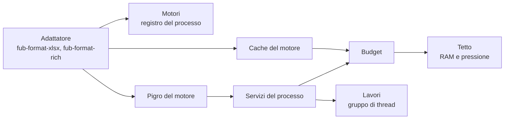

# Lo strato dei motori

Questa pagina spiega come Fub costruisce i motori copiati (GridCraft per i
fogli, WordCraft per i documenti, e quelli che verranno) soltanto quando
servono, come li fa lavorare e come ne tiene le cache sotto un tetto comune.

> **Ambito:** `crates/fub-motori` e il modo in cui un adattatore di formato vi
> iscrive il suo motore.
> **Fonte autorevole:** il codice e i test di `crates/fub-motori/`.
> **Decisione:** [ADR 0236](../decisions/0236-lo-strato-dei-motori.md).

## Regola

Un motore è una cosa cara: memoria, tabelle, dizionari, thread. Fub li tratta
tutti nello stesso modo, da un posto solo:

1. **niente all'avvio**: aprire Fub o un vault non costruisce nessun motore,
   non avvia thread e non legge file per conto dei motori; il motore nasce alla
   prima richiesta;
2. **un lucchetto mai tenuto** mentre un motore si costruisce o lavora, o
   mentre si chiama una cache: si prende l'`Arc`, si lascia il lucchetto, poi
   si chiama;
3. **un budget comune**: le cache di tutti i motori stanno sotto un tetto, e
   quando lo superano si libera dalla meno usata di recente;
4. **chiudere libera**: quando l'ultimo documento di un motore si chiude, le
   sue cache si svuotano e la memoria torna al sistema.

`fub-motori` non nomina nessun motore e non dipende da nessun adattatore. I
motori di terzi si nominano soltanto dai loro adattatori
(`check-engine-boundary.mjs`, `WORDCRAFT_OWNERS` e `GRIDCRAFT_OWNERS` in
`dependency_invariant.rs`): sono gli adattatori a dipendere da `fub-motori`
e a iscrivervi il loro motore.

## I pezzi

| Pezzo | Percorso | Che cosa fa |
|---|---|---|
| `Pigro<T>` | `src/pigro.rs` | il motore costruito alla prima richiesta, una volta sola |
| `Lavori` | `src/lavori.rs` | il gruppo di thread dei motori, costruito al primo lavoro |
| `Cache`, `Budget` | `src/memoria.rs` | le cache dei motori come le vede il budget, e il budget |
| `Tetto` | `src/pressione.rs` | il tetto della memoria e la pressione che lo abbassa |
| `Servizi` | `src/servizi.rs` | ciò che i motori hanno in comune: `lavori()` e `memoria()` |
| `Motori`, `Voce` | `src/registro.rs` | il registro dove ogni adattatore iscrive il suo motore |
| `importa`, `verifica_copertura` | `src/catalogo.rs` | i comandi di un motore come comandi di Fub, e la prova che nessuno resta fuori |
| `Modulo`, `Campo`, `Tipo` | `src/modulo.rs` | il modulo dei parametri di un comando, letto dallo schema del motore |
| `ErroreMotore` | `src/lib.rs` | lucchetto avvelenato, creazione fallita, motore sconosciuto, iscrizioni doppie |



## Il motore pigro

`Pigro::nuovo(crea)` non costruisce niente; è `const`, quindi un adattatore
può tenere il suo motore in uno `static`. Lo stato è uno fra tre:

- **Vuoto**: il primo `prendi` segna In costruzione, lascia il lucchetto e
  chiama `crea`;
- **In costruzione**: chi chiama `prendi` intanto aspetta su una `Condvar`,
  senza lucchetto tenuto mentre `crea` lavora, e riceve lo stesso esito di chi
  costruisce, lo stesso `Arc` o lo stesso errore;
- **Pronto**: `prendi` dà una copia dell'`Arc`.

Se `crea` fallisce lo stato torna Vuoto, e il `prendi` dopo riprova. Se `crea`
va in panico, il panico diventa `ErroreMotore::CreazioneFallita` con il suo
messaggio, si scrive nel log, e lo stato torna Vuoto: nessuno resta ad
aspettare per sempre.

`libera` toglie il motore dal `Pigro`, ma non lo distrugge sotto i piedi di
nessuno: chi tiene già un `Arc` continua a usarlo, e il motore se ne va con
l'ultimo `Arc`. Il motore non cade mai a lucchetto tenuto. Durante una
costruzione `libera` non fa niente e dà falso: la costruzione arriva in fondo.

`scalda` avvia `prendi` sul gruppo di thread dei motori e torna subito; un
motore già acceso o in costruzione non avvia niente. `se_acceso` dà il motore
soltanto se c'è già: serve a contare o svuotare le cache di un motore senza
accenderlo.

## Il gruppo di thread

`Lavori` è un `rayon::ThreadPool` suo, non quello globale di `rayon`, che
anche altre dipendenze del workspace possono usare. Nasce al primo lavoro: un
Fub che non apre mai un motore non ha un thread in più. I thread si chiamano
`fub-motore-{n}` e sono `available_parallelism() - 1`, almeno 1 e al più 8,
così il thread di chi chiede resta libero.

- `in_sottofondo(lavoro)` avvia e torna subito. Un panico dentro il lavoro si
  scrive nel log (`panic_handler`) e non chiude il processo.
- `installa(lavoro)` esegue dentro il gruppo e aspetta il risultato; il
  parallelismo di `rayon` usato dentro resta nel gruppo. Un panico torna a chi
  ha chiamato.

Se il gruppo non si può costruire, `installa` esegue sul thread di chi chiama
e `in_sottofondo` scrive l'errore nel log; il lavoro dopo riprova a costruirlo.

## Il budget delle cache

Una cache di un motore implementa `Cache`: `nome`, `byte` (una stima onesta,
la capacità delle strutture), `libera(quanto)` (libera almeno `quanto` se può,
anche tutto, e dice quanto ha liberato) e `ultimo_uso`. Il motore la iscrive
nel budget dei suoi servizi con `registra`.

Il budget tiene delle `Weak`: una cache che il suo motore lascia cadere esce
dall'elenco da sola. Il lucchetto dell'elenco copre soltanto l'elenco: il
budget prende gli `Arc` vivi, lo lascia, poi chiama le cache, che quindi
possono chiamare il budget anche da dentro `libera`.

- `usati()` somma i byte delle cache vive; `tetto()` è il tetto adesso.
- `rispetta()` ordina le cache dalla meno usata di recente e chiede a ognuna
  ciò che manca per stare sotto il tetto, finché ci si sta. Conta i byte che
  la cache tiene dopo, non quelli che dice di aver liberato. Una cache che
  libera meno, o niente, fa passare alla seguente. Con il tetto a zero si
  svuota tutto ciò che si può. Due `rispetta()` insieme non lavorano due
  volte: la seconda torna subito (`saltato`), e la prima ripassa una volta in
  più alla fine.
- `svuota_tutto()` svuota ogni cache senza guardare il tetto: è la chiusura.
- `rilascia_al_sistema()` rende al sistema la memoria che l'allocatore tiene
  libera.

Chi chiama `rispetta()` è l'adattatore, quando una cache cresce o un documento
si chiude; il budget non ha un thread suo.

## Il tetto della memoria

Il tetto parte da un ottavo della RAM installata, fra 256 MiB e 2 GiB. Su
Linux la RAM è `MemTotal` di `/proc/meminfo`; se non si legge, e su macOS e
Windows, il tetto parte da 1 GiB.

Su Linux il tetto scende con la pressione della memoria
(`/proc/pressure/memory`, PSI): a metà con `some avg10 ≥ 10`, a un quarto con
`full avg10 ≥ 5`. Senza PSI (kernel vecchio, container) il tetto resta quello
di partenza. Su macOS e Windows non c'è un segnale di pressione: il tetto
resta quello di partenza.

La pressione si legge quando si chiama `rispetta()` o `tetto()`, senza un
thread in più, e al più una volta al secondo: chiamate fitte non rileggono il
file. La RAM si legge una volta sola, alla prima domanda. La lettura dei file è
separata dal significato: `pressione::mem_totale` e `pressione::psi` sono
funzioni pure sul testo, e la `Sorgente` del testo si sostituisce nelle prove
(`Tetto::da_sorgente`).

## Chiudere libera

glibc trattiene le pagine liberate: chiudere un motore non abbassa la memoria
del processo finché non si chiede di renderla
([misure di K0](../misure/motori-2026-10-31-linux-ryzen.md)).
`rilascia_al_sistema()` su Linux con glibc chiama `malloc_trim(0)`; altrove non
fa niente. Un adattatore la chiama dopo aver svuotato le cache, quando l'ultimo
documento del suo motore si chiude.

## Servizi e registro del processo

`Servizi::processo()` e `Motori::processo()` sono uno solo per processo, e
crearli non avvia niente. Per le prove `Servizi::nuovi(config)` dà servizi
separati, con il numero di thread e il tetto che la prova sceglie
(`Tetto::fisso`), e `Motori::nuovi(servizi)` un registro separato.

`Servizi` ha i campi privati e un metodo per servizio (`lavori()`,
`memoria()`): un servizio nuovo, come la scheda grafica o l'archivio comune
dei caratteri, si aggiunge con il primo motore che lo usa senza cambiare chi
usa quelli che ci sono.

## Come un adattatore iscrive il suo motore

1. Tiene il motore in un `Pigro`, con una `crea` che prepara ciò che il motore
   prepara alla prima apertura.
2. Implementa `Voce` per il motore: `acceso`, `scalda(servizi)`, `svuota`
   (le cache, senza spegnere), `libera` (spegne) e `byte`. Un motore spento ha
   zero byte e niente da svuotare: per guardarlo usa `Pigro::se_acceso`.
3. Lo iscrive in `Motori::processo()` con il suo spazio e le estensioni dei
   file che apre, la prima volta che il suo provider si crea, non all'avvio:

   ```rust
   motori.registra("fogli", &["xlsx", "xlsm"], voce)?;
   ```

   Uno spazio si iscrive una volta sola e un'estensione appartiene a un motore
   solo: un secondo `registra` dà `SpazioGiaIscritto` o `EstensioneContesa`.
   L'adattatore che si crea più volte nello stesso processo iscrive una volta
   sola, per esempio dietro un `OnceLock`.
4. Iscrive le sue cache nel budget dei servizi con `registra`, chiama
   `rispetta()` quando una cache cresce o un documento si chiude, e alla
   chiusura dell'ultimo documento `svuota` più `rilascia_al_sistema()`.

Il registro dà `scalda_per(estensione)` (l'estensione con o senza punto, in
qualunque maiuscola), `voce(spazio)` (o `MotoreSconosciuto`) ed `elenco()`,
con spazio, acceso e byte di ogni motore. Non tiene lucchetti mentre chiama
una voce.

## I fogli

`fub-format-xlsx` porta GridCraft (`src/motore.rs`):

- `MotoreFogli` sta dietro un `Pigro`. Costruirlo prepara il catalogo dei
  comandi della facciata e l'elenco delle funzioni di GridCraft; la prima
  apertura di una cartella lo prende, crearsi il provider no.
- `Fogli::processo()` tiene il `Pigro`, i servizi del processo e il conto
  delle istanze aperte, e si iscrive in `Motori::processo()` con lo spazio
  «fogli» e le estensioni `xlsx`, `xlsm`, `xltx`, `xltm` la prima volta che
  un `XlsxGridProvider` si crea, una volta sola per processo.
- Le cache nel budget sono due, una per processo come i dati di GridCraft che
  contano: `fogli.ortografia`, il dizionario dell'ortografia (i suoi byte
  stimati da GridCraft), e `fogli.formati`, i formati dei numeri letti (le
  voci contate per difetto: la voce della tabella, senza il testo del codice).
  Il loro `ultimo_uso` è l'ultimo comando della barra che le raggiunge: ogni
  comando per i formati, `review.spelling`, `review.changeSpelling` e
  `review.thesaurus` per il dizionario. Dopo un comando che le fa crescere si
  chiama `rispetta()`.
- Il conto è delle istanze, non delle chiusure: ogni istanza aperta tiene una
  presa sul motore. Chiusa un'istanza qualsiasi si chiama `rispetta()`; quando
  cade l'ultima presa (`close`, `shutdown`, il provider che cade) le cache si
  svuotano e si chiama `rilascia_al_sistema()`. Il motore resta acceso
  finché il registro non lo libera. Il salvataggio di `fub-host` apre e
  chiude un'istanza sua: con un foglio aperto non svuota niente.

Il provider non ha lucchetti suoi: l'istanza esce dall'elenco, poi si
chiamano le cache. Il kernel chiama il provider sotto il lucchetto della sua
superficie della griglia, come per ogni altra chiamata della griglia.

## Il motore dei documenti

`fub-format-rich` (`src/motore.rs`) iscrive `MotoreDocumenti` con lo spazio
«documenti» e le estensioni di ogni `Codec` (`docx`, `odt`, `rtf`, `doc`,
`dot`) la prima volta che un `RichProvider` si crea, una volta per processo.
I codec di WordCraft non hanno stato: il motore acceso tiene soltanto la
cache delle prove a vuoto accettate (`documenti.prove`), che l'apertura
ricorda per l'impronta dei byte e il salvataggio degli stessi byte ritrova.

- Restano le regole di prima: al più otto prove, e quelle prima dell'ultima
  entro quattro milioni di voci di peso. Sopra c'è il tetto del budget, che
  toglie dalla più vecchia e può togliere anche l'ultima: una prova che da
  sola supera il tetto non resta. Il salvataggio che non trova la prova la
  rifà, più lento, e scrive gli stessi byte.
- La cache conta i byte di una prova dal suo peso: 100 byte per voce più
  160 KiB per prova, misurati sui documenti del corpus con un allocatore che
  conta i byte vivi (il metodo e i numeri sono accanto a `BYTES_PER_ENTRY`,
  in `src/preservation.rs`). La stima sta sopra ogni misura.
- `remember` chiama `rispetta()` dopo aver ricordato, fuori dal lucchetto
  della cache.

Il correttore (`fub-features`, feature `proof`) iscrive nel budget del
processo i dizionari Hunspell letti dal disco (`correttore.dizionari`), quando
si crea con i dizionari della macchina. Il motore non sa toglierne una lingua
sola: `libera` li lascia cadere tutti, e la parola dopo li rilegge.

`fub-host` svuota le due cache e chiama `rilascia_al_sistema()` quando si
chiude l'ultimo vault (`Host::close_vault` o `Host::close`), dopo aver
ritirato lo slot della sessione e senza lucchetti tenuti. Con un altro vault
aperto, o in chiusura, le cache restano al budget: l'host non sa quale vault
abbia letto quale documento.

## Il catalogo dei comandi

Un motore descrive i suoi comandi con un id, un'etichetta inglese, il percorso
nei suoi menu e uno schema dei parametri scritto a parole (`{range?, on?:
bool}`). `importa(spazio, specifiche, adattamento)` ne fa un `ComandoFub` per
comando:

- l'id in Fub è `<spazio>.<id del motore>` (`fogli.home.bold`), il titolo è la
  chiave `<spazio>.cmd.<id del motore>` dei testi di Fub, e se il comando è
  abilitato lo dice il motore (`Delega::Motore`);
- il posto viene dalla tabella `Adattamento::posti` dell'adattatore, che lega
  un percorso intero dei menu a una scheda e un gruppo della barra
  (`Posto::Barra`) o alla sola tavolozza (`Posto::Tavolozza`); un comando senza
  menu va nella tavolozza;
- i parametri diventano un `Modulo` di `Campo` tipati (testo, numero, sì/no,
  cella, intervallo, foglio, scelta, …): i nomi nudi prendono il tipo dal
  lessico dell'adattatore (`Adattamento::nomi`), che un comando può
  correggere per sé (`Adattamento::nomi_del_comando`).

`importa` non si ferma al primo problema: restituisce tutte le `Mancanza`
(id doppio o non valido, etichetta vuota, percorso che la tabella non conosce,
schema che non si legge). `verifica_copertura(motore, catalogo, perche)`
confronta l'elenco intero del motore con il catalogo: ogni comando del motore
o è nel catalogo o ha un perché, non vuoto, per cui Fub non lo serve; nessun
comando è tutte e due le cose, e il catalogo non ha comandi che il motore non
ha. Se va bene dà i conti (`Copertura`).

L'adattatore dei fogli tiene la sua tabella in
`crates/fub-format-xlsx/src/catalogo.rs` e i perché dei comandi non serviti in
`src/commands.rs`. La shell riceve il catalogo in
`apps/client/src/editors/grid/catalogo.generated.json`, che non si modifica a
mano: si rigenera con
`UPDATE_MIRROR=1 cargo test -p fub-format-xlsx --test ts_catalogo`.

## Prove

- `crates/fub-motori/tests/pigro.rs`: dieci thread insieme e una costruzione
  sola; errore e ritentativo; chi aspettava riceve l'errore; panico in `crea`;
  `libera` mentre un altro tiene l'`Arc`; `libera` durante la costruzione;
  `scalda` sul gruppo dei motori.
- `crates/fub-motori/tests/memoria.rs`: `rispetta()` dalla meno usata fin
  sotto il tetto; cache che liberano meno o niente; tetto zero; `Weak` morte;
  due `rispetta()` insieme senza lucchetti tenuti; i lettori di `meminfo` e di
  PSI sui campioni; `/proc/pressure` assente; letture non ripetute.
- `crates/fub-motori/tests/registro.rs`: iscrizione, `scalda_per`, iscrizioni
  doppie; servizi e registro del processo; nome e numero dei thread; un panico
  in un lavoro.
- `crates/fub-format-xlsx/tests/motore.rs`: il provider non costruisce il
  motore e la prima apertura sì; chiusa l'ultima istanza le cache sono a zero
  byte; due istanze, il salvataggio e `shutdown`; il dizionario mai caricato;
  il budget a tetto basso che libera il dizionario; l'iscrizione nel registro.
- `crates/fub-format-rich/tests/motore.rs` e i test in `src/motore.rs`:
  l'iscrizione con spazio ed estensioni; i byte di una prova ricordata; un
  budget a tetto basso che la toglie e il salvataggio dopo con gli stessi
  byte; una prova sola sopra il tetto.
- `crates/fub-features/tests/proof_dictionaries_budget.rs`: i byte del
  dizionario letto, il tetto basso che lo lascia cadere e la risposta uguale.
- `crates/fub-host/tests/engines_on_close.rs`: con due vault aperti chiuderne
  uno lascia le cache; chiuso l'ultimo sono a zero.
- `crates/fub-motori/tests/modulo.rs`: ogni forma dello schema dei parametri,
  gli errori e il lessico dei nomi.
- `crates/fub-motori/tests/copertura.rs`: `importa` e `verifica_copertura` su
  un motore finto, con ogni `Mancanza` e i conti.
- `crates/fub-format-xlsx/tests/copertura.rs`: ogni comando di GridCraft è
  nel catalogo o ha il suo perché; un comando nuovo senza posto né perché fa
  fallire il test. `tests/ts_catalogo.rs`: il file della shell non è stantio
  e le sue schede e i suoi gruppi sono quelli della barra.
