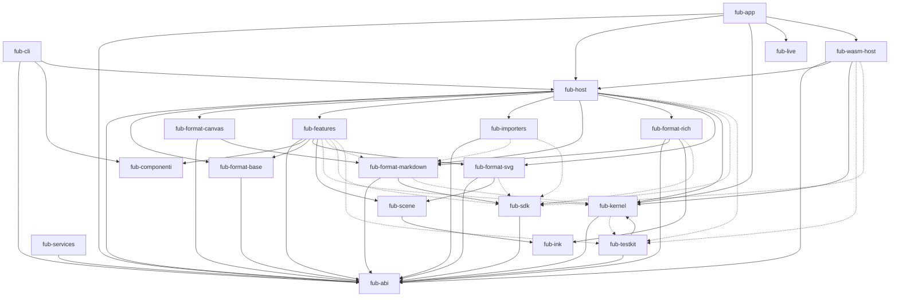
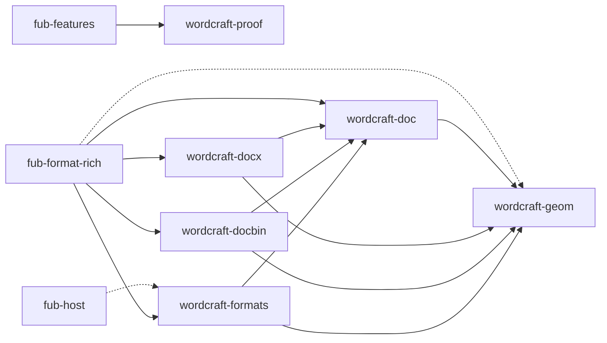
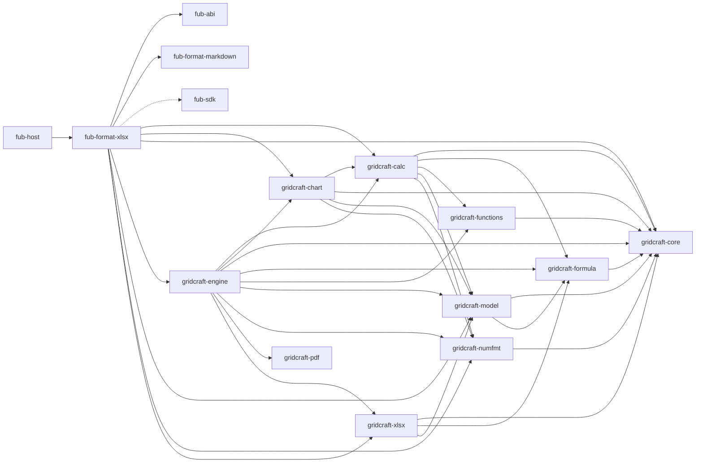
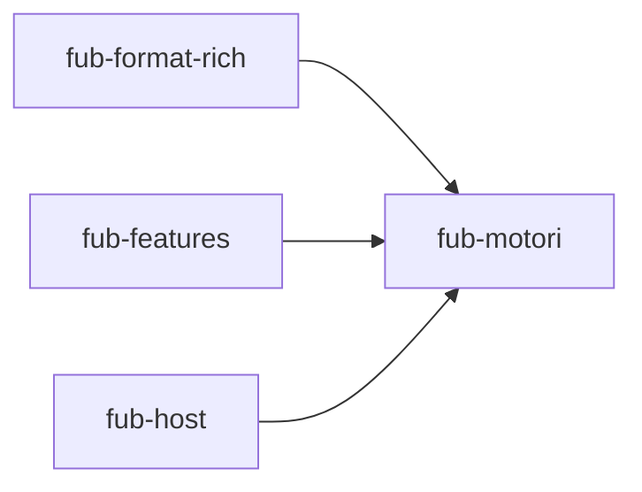
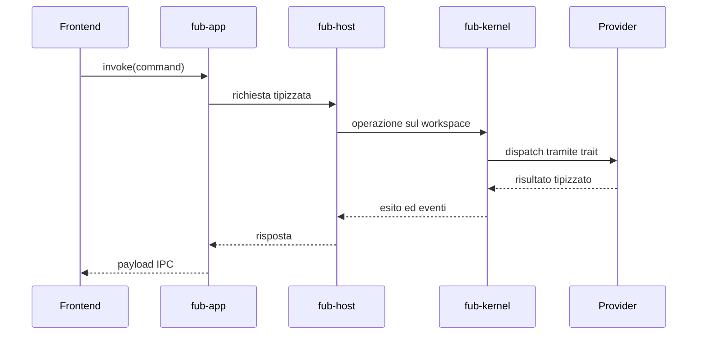

# Architettura di Fub

> **Domanda:** quali confini attraversa una richiesta e dove vive ogni
> responsabilità?
> **Fonti autorevoli:** `Cargo.toml`, `crates/*/Cargo.toml`, `apps/client/src/`.

## In breve

Fub separa:

1. shell e adattamento desktop;
2. composizione e sessioni;
3. kernel indipendente dal trasporto;
4. contratti condivisi;
5. provider di formato e feature;
6. runtime dei componenti di terzi.

Il core non dipende dal formato, dal toolkit desktop o dal motore WASM.

## Dipendenze del workspace Rust

I tre diagrammi seguenti sono, insieme, la fotografia completa delle
dipendenze dichiarate fra i crate del workspace. Le frecce continue indicano
dipendenze normali; quelle tratteggiate esistono soltanto in
`[dev-dependencies]`. Un test confronta l'unione dei blocchi con
`cargo metadata`, quindi un crate o un arco non può restare fuori senza far
fallire la CI.

I crate di WordCraft vendorizzati in `vendor/wordcraft/` sono codice di terzi:
li usano soltanto il correttore della feature `proof` e `fub-format-rich` (più
i test di `fub-host`, che scrivono `.odt` con l'esportatore), e nessuno di loro
dipende da Fub. Hanno un workspace loro, fuori da quello di Fub, e Fub li
prende come dipendenze a percorso. Il secondo blocco è lo stesso grafo,
confrontato con lo stesso test.

I crate di GridCraft in `vendor/gridcraft/` sono codice di terzi allo stesso
modo, con un workspace loro: li usa soltanto `fub-format-xlsx`, che legge le
cartelle di Excel per l'host (feature `xlsx`) e ne innesta i valori cambiati
sui byte del file, e nessuno di loro dipende da Fub. Finché una sessione ha
soltanto celle cambiate, di `gridcraft-calc` l'adattatore usa il grafo delle
dipendenze fra le formule, per dire quali valori del file una modifica rende
vecchi: niente si ricalcola. Dal primo comando la sessione passa a
`gridcraft-engine`, la facciata dei comandi di GridCraft (vendorizzata con
`gridcraft-chart` e `gridcraft-pdf`), che ricalcola ciò che il comando
raggiunge; il salvataggio resta l'innesto o riscrive la cartella con il codec
dopo averla misurata. Da `gridcraft-chart` l'adattatore prende anche il
disegno in SVG dei grafici, che porta alla shell con le finestre. Il terzo blocco è il seguito dello stesso grafo, con
l'adattatore e i crate di Fub da cui dipende.

Il frontend TypeScript non è un crate Cargo. Entra nel sistema attraverso
`fub-app`, che adatta Tauri e IPC. `fub-host` compone provider e sessioni;
`fub-wasm-host` dipende dall'host per montare bundle, ma l'host non dipende da
Wasmtime. `fub-live`, la sessione live di FubDraw, non dipende da nessun altro
crate: non vede il contratto, il kernel, l'host né Tauri. La compone `fub-app`
sul runtime di Tauri e la affaccia alla shell con i comandi `live_*` e un canale
di eventi per sessione.

`fub-ink`, il nucleo dell'inchiostro, non ha frecce in uscita: non dipende da
niente, nemmeno da `fub-abi`, perché deve poterlo usare ogni prodotto che
raccoglie inchiostro e, un domani, un componente `wasm32-wasip2`. Lo
verificano `dependency_invariant.rs` e la compilazione per quel bersaglio nella
CI. Le frecce in ingresso sono quella di `fub-scene`, che ne usa il campione
del tratto, e quella di `fub-format-rich`, che ne scrive e legge l'InkML
dell'inchiostro dei documenti; chi altro può dipenderne è un elenco chiuso,
deciso nell'[ADR 0204](../decisions/0204-nucleo-inchiostro.md) e allargato
nell'[ADR 0226](../decisions/0226-inchiostro-e-disegni-nei-documenti.md).

`fub-componenti`, il risolutore dei componenti, non ha frecce in uscita:
dipende soltanto da `serde`, non vede `fub-abi`, e dice in un posto solo che
cosa è acceso, chi lo richiede e che cosa non serve più. Le frecce in
ingresso sono due. Una viene da `fub-features`, che costruisce la mappa dei
componenti di Fub (`src/componenti.rs`): una riga per componente, dietro la sua
cargo feature, da cui `fub-host` prende anche `uses`, `kind`, `group` e `ui` dei
manifest. L'altra viene da `fub-cli`, che per `fub-cli componenti` e gli
strumenti `fub_components*` usa i tipi del risolutore (`Stato`, `Perche`,
`Errore`, `Effetto`), che `fub-host` non riesporta.

`fub-motori`, lo strato dei motori, non ha frecce verso altri crate di Fub:
dipende soltanto da `rayon`, `thiserror`, `tracing` e, su Linux con la glibc,
`libc`. Dà la costruzione dei motori alla prima richiesta, il loro gruppo di
thread, il budget comune delle cache e il registro dove ogni adattatore iscrive
il suo motore. Non nomina nessun motore: un adattatore che lo usa dipende da
lui, mai il contrario. Le regole stanno in [Lo strato dei motori](motori.md).
Le frecce in ingresso: `fub-format-rich`, che iscrive il motore dei documenti
e ne tiene le prove a vuoto nel budget; `fub-features`, dietro la feature
`proof`, che iscrive nel budget i dizionari del correttore letti dal disco; e
`fub-host`, che alla chiusura dell'ultimo vault svuota quelle cache e
restituisce la memoria al sistema.

`fub-scene`, il lettore delle scene di FubDraw, ha come sola freccia in uscita
`fub-ink`: non dipende da `fub-abi`, dal kernel, da Tauri o da Wasmtime, perché
deve poterlo usare anche un componente `wasm32-wasip2`. Lo verificano
`dependency_invariant.rs` e la compilazione per quel bersaglio nella CI. Lo usa
`fub-format-svg`, il provider del [formato della
scena](../reference/scene-format.md), che `fub-host` monta solo con la feature
`draw`: l'arco `host --> svg` è una dipendenza facoltativa, accesa dal
`default` dell'host. La stessa feature accende in `fub-features` l'export dei
disegni in PNG, JPEG, SVG, PDF, Excalidraw e draw.io, con `resvg`, `svg2pdf`,
i caratteri di Fub incorporati e quelli del vault, e il comando «Nuovo
disegno», che scrive il disegno vuoto con `serialize` del
provider, o parte da un modello o da un disegno del vault e ne cambia il solo
titolo con `retitle`: per questo anche `features --> svg` è un arco
facoltativo, come `features --> base` per le basi. Con la stessa feature
`fub-features` usa `fub-scene` per derivare dal disegno le tavole o la
selezione da esportare, e per leggere le annotazioni dei PDF, da esportare nel
PDF annotato e nel PDF redatto: anche `features --> scene` è facoltativo.

## Flusso di un comando

Un comando non dovrebbe generare una porta Tauri dedicata se può attraversare
il registro generico dei comandi.

## Proprietà stabili

### Dipendenze verso il contratto

`fub-abi` non importa Markdown, Tauri, Wasmtime o Tokio. I crate esterni
implementano o consumano i suoi tipi.

### Composition root fuori dal kernel

`fub-host` sceglie quali provider montare, possiede sessioni e collega servizi.
Il kernel non decide quali feature ufficiali esistono.

### Adattatori sottili

`fub-app` traduce Tauri e serializzazione. Non deve duplicare policy, regole di
path o logica di business.

### Shell dietro un seam

Il frontend importa l'host da `apps/client/src/host/`. Soltanto i moduli di IPC e
dialogo conoscono `@tauri-apps`; i test usano un fake host.

### Un trait, più backend

Un provider nativo implementa il trait direttamente. Un componente WASM viene
adattato da un proxy che implementa lo stesso trait. I registri del kernel non
conoscono il backend.

### Dati autorevoli e derivati

Il vault e alcuni sidecar conservano l'autorità. Indici e cache possono essere
rigenerati. La classificazione è esplicita nel riferimento su disco.

## Approfondimenti

- [Componenti e confini](components-and-boundaries.md)
- [Modello del documento](document-model.md)
- [Storage e identità](storage-and-identity.md)
- [Runtime, eventi e job](runtime-events-and-jobs.md)
- [Frontend e IPC](frontend-and-ipc.md)
- [Superfici dell'editor](editor-surfaces.md)
- [Runtime dei plugin](plugin-runtime.md)
