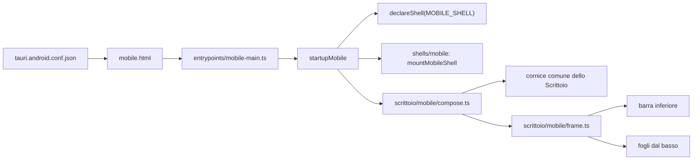

# La cornice del telefono

> **Domanda:** dove sta la cornice dello Scrittoio su un telefono, quando
> parte e che cosa cambia rispetto al computer?
> **Fonti autorevoli:** `apps/client/mobile.html`,
> `apps/client/src/entrypoints/mobile.ts`,
> `apps/client/src/shells/mobile/`,
> `apps/client/src/shells/scrittoio/mobile/`,
> `crates/fub-app/tauri.android.conf.json`, `.github/workflows/mobile.yml`.
> **Contesto:** [Frontend e IPC](frontend-and-ipc.md#la-finestra-lo-scrittoio)
> descrive lo Scrittoio comune; questa pagina descrive soltanto ciò che il
> telefono gli aggiunge.

## Come parte

Il telefono non è una larghezza del desktop: è un'altra pagina, con un altro
ingresso. La figura segue la catena dall'app Android alla cornice montata.

La cornice del telefono sta sopra quella comune e non la sostituisce: i
pannelli, i fogli, il lanciatore e i comandi sono gli stessi del desktop.

- `crates/fub-app/tauri.android.conf.json` apre la finestra `main` su
  `mobile.html`; `tauri.conf.json`, quello del desktop, la apre su
  `index.html`. Vite costruisce le tre pagine (`index.html`, `document.html`,
  `mobile.html`) come ingressi separati (`vite.config.ts`), e la build
  mobile non valuta mai l'ingresso del desktop.
- `mobile.html` porta lo stesso markup di `index.html`, senza i controlli
  della finestra: su un telefono la piattaforma non ne ha.
- `entrypoints/mobile-main.ts` passa il ponte nativo
  (`nativeMobileBridge` di `src/host/ipc.ts`) a `startupMobile` e importa,
  in quest'ordine, `theme/scrittoio/structure.css` e
  `shells/scrittoio/mobile/mobile.css`.
- `startupMobile` (`entrypoints/mobile.ts`) dichiara la shell `mobile` e la
  serie dello Scrittoio prima di caricare la shell comune, monta la shell
  mobile e poi importa in modo dinamico `composeScrittoioMobile`. Lo
  smontaggio toglie la shell mobile, la cornice e per ultima la serie.
- `declareShell` scrive `data-client-shell="mobile"` su `<html>`. Ogni regola
  dei due fogli del telefono comincia da questo attributo, che nessun ingresso
  desktop scrive.

## Le due parti del codice

Il telefono ha due cartelle, con due compiti diversi.

| Cartella | Che cosa fa |
|---|---|
| `shells/mobile/` | ponte nativo, storage privato e condiviso, ciclo di vita, cattura, link aperti dal sistema, viewport e tastiera |
| `shells/scrittoio/mobile/` | la cornice dello Scrittoio su un telefono: composizione, barra inferiore, fogli dal basso, «indietro» |

`shells/mobile/viewport.ts` legge la finestra e la tastiera a schermo e ne
scrive lo stato su `<html>`:

- `--mobile-keyboard-inset`, l'altezza della tastiera quando un campo ha il
  fuoco;
- `data-mobile-keyboard`, `visible` sopra i 100 px di tastiera;
- `data-mobile-form-factor`, `phone` sotto i 600 px di larghezza e `tablet`
  da 600 px;
- `data-mobile-orientation`, `landscape` o `portrait`.

`shells/mobile/mobile.css` dà a `#app` i margini delle aree sicure e della
tastiera, e porta a 44 px il bersaglio minimo di bottoni e caselle senza
deformarli: l'interruttore (`input[role="switch"]`) resta il binario di
32 × 18 della pelle e prende il tocco di 44 px da un `::after` trasparente
(in colori forzati torna nativo, 16 × 16); le schede delle impostazioni non si
stringono e la loro fila scorre di lato coi nomi interi; fra due righe di un
elenco dichiarato (il cestino, le versioni) restano 8 px, perché i bottoni da
44 px non si tocchino; il bottone della modalità che galleggia sulla carta ha
l'anello del fuoco dentro di sé. Le scene `mobile-settings`, `mobile-trash` e
`mobile-document` lo controllano: se una misura cade, la scena non si prepara.

`shells/scrittoio/mobile/compose.ts` fa ciò che `shells/scrittoio/bootstrap.ts`
fa sul desktop, senza le sue dichiarazioni: moto, conferma, comandi,
cornice comune, lanciatore, fogli, poi `mountMobileFrame` e la consegna dello
strato d'avvio. `frame.ts` monta i comportamenti che il foglio di stile non
può dare:

- `bottom-bar.ts` aggiunge al piede del binario il bottone dell'ispettore,
  che sul desktop sta nella barra del titolo. Preme lo stesso comando,
  `shell.inspector.toggle`;
- `bottom-sheets.ts` fa salire i cassetti dal basso, con una maniglia che li
  chiude se trascinata oltre un terzo della corsa, con uno slancio o con un
  tocco. All'apertura il fuoco va alla maniglia e non al campo di ricerca,
  così la tastiera non si alza;
- `back.ts` aggiunge un passo alla cronologia della pagina finché un pannello
  è aperto: il gesto o il tasto «indietro» del sistema chiude il pannello
  invece di lasciare l'applicazione.

Aprire e chiudere un cassetto resta della shell comune (`desktop-shell.ts`):
la cornice del telefono aggiunge il movimento, la maniglia e «indietro».

## Le larghezze

La geometria è di `shells/scrittoio/mobile/mobile.css`. La soglia è una
larghezza e non un orientamento: con la tastiera aperta un telefono in piedi
può avere un viewport più largo che alto, e la finestra non deve ridisporsi
mentre si scrive.

| Larghezza | Disposizione |
|---|---|
| fino a 599 px | una colonna: barra del titolo, foglio, barra inferiore; i cassetti salgono dal basso |
| da 600 px | la disposizione stretta del desktop, binario a sinistra e cassetti di lato, con i bersagli a misura di dito |

La soglia dei 600 px è una sola, scritta in tre posti che devono restare
uguali: `PHONE_BELOW` in `bottom-sheets.ts`, `data-mobile-form-factor` in
`shells/mobile/viewport.ts` e le `@media` di `mobile.css`. Sotto i 600 px
`bottom-sheets.ts` muove i fogli; da 600 px non muove niente.

Le altre larghezze che contano sul telefono vengono dalla shell comune, che
non sa di essere su un telefono:

- sotto i 960 px la barra laterale è un cassetto in sovrapposizione, sotto i
  1200 px lo è l'ispettore (`drawerBelow` in `desktop-shell.ts`). Un telefono
  sta sempre sotto entrambe, e i suoi pannelli sono sempre cassetti;
- sotto gli 860 px `theme/scrittoio/structure.css` riduce la pillola a
  un'icona; `mobile.css` le ridà il titolo fra 700 e 860 px, dove la barra del
  titolo ha posto.

Gli 800 px di `tauri.conf.json` sono la larghezza minima della finestra del
desktop (`minWidth`), non una soglia del telefono: il desktop non scende mai
sotto quella misura, e non passa mai alla shell del telefono.

## Che cosa cambia rispetto al computer

Su ogni larghezza:

- i bersagli sono alti almeno 44 px (`--touch`): barra del titolo, binario,
  linguette, testata del foglio e barra di formattazione si allargano, e lo
  «spazio dell'interfaccia» (`chrome.compactness`) le stringe senza scendere
  sotto il dito;
- la finestra occupa lo schermo meno le aree sicure e la tastiera
  (`100dvh` su `#app`);
- non ci sono controlli della finestra.

In piedi, fino a 599 px:

- la barra del titolo tiene il marchio, la pillola a tutta larghezza e gli
  avvisi; il vault, indietro e avanti, i lavori e l'ispettore passano nel
  menu del marchio, nel lanciatore e nella barra inferiore. I lavori tornano
  a vista finché ce n'è uno in corso;
- il binario diventa la barra inferiore, una fila sotto il foglio; aiuto e
  luce restano nella barra solo finché non c'è un vault;
- il foglio tocca i fianchi dello schermo;
- il velo copre i fogli e non le due barre, così si cambia pannello senza
  chiudere quello aperto;
- l'ispettore e il pannello del documento salgono dal basso come gli altri
  cassetti.

Sdraiato, da 600 px e sotto i 500 px di altezza:

- la banda di stato si ritira, e nel binario restano i pannelli e le
  impostazioni;
- con la tastiera aperta si ritirano anche la barra del titolo e le
  linguette, e del foglio restano la testata, gli strumenti e il testo.

## Il lato Rust

`fub-app` è lo stesso crate sul desktop e sul telefono. Tauri accende
`cfg(desktop)` o `cfg(mobile)` secondo il target, e il codice li usa per ciò
che esiste da una parte sola:

- `cfg(mobile)`: il punto d'ingresso `#[tauri::mobile_entry_point]` in
  `crates/fub-app/src/mobile.rs`, l'apertura del vault privato o della
  cartella condivisa, gli eventi di sospensione e ripresa del sistema, il
  plugin nativo dell'accesso alle cartelle (`tree_access.rs`) che risponde ai
  comandi `mobile_*` di `lib.rs`;
- `cfg(desktop)`: il genitore delle finestre di dialogo e il centro, il fuoco
  e la cornice della finestra del visore (`resources.rs`), che su Android e
  iOS occupa lo schermo;
- il plugin a istanza singola si collega solo fuori da Android e iOS
  (`Cargo.toml`).

Il ponte fra le due parti, i comandi e lo storage del telefono sono descritti
in [Frontend e IPC](frontend-and-ipc.md).

## L'APK di prova

`.github/workflows/mobile.yml` costruisce il telefono, che il ciclo principale
di CI non costruisce:

- **Android:** aggiunge `staticlib` e `cdylib` a `crate-type` (sul desktop la
  libreria è soltanto `rlib`, e `Cargo.toml` spiega perché), genera il
  progetto con `cargo tauri android init --ci`, fonde e verifica i template
  nativi di `crates/fub-app/mobile/install-mobile.sh`, costruisce un APK di
  debug per `aarch64` e lo carica come artefatto `fub-android-debug`;
- **iOS:** compila soltanto il Rust per il dispositivo
  (`cargo check --target aarch64-apple-ios`); nessun `.ipa` esce da qui.

Il workflow non è un controllo richiesto. Gira su `main`, a richiesta e
sulle PR che toccano `crates/fub-app/`, `shells/mobile/`, gli ingressi
`entrypoints/mobile*`, `mobile.html` o il workflow stesso. Una PR che cambia
soltanto `shells/scrittoio/mobile/` o la struttura comune non lo fa partire.
L'APK non è firmato per la distribuzione.

## Il banco

Il banco guarda la cornice del telefono senza un telefono. In
`vite.bench.config.ts` `src/host/ipc.ts` diventa `bench/fake-ipc.ts`, che
riesporta `nativeMobileBridge` da `bench/fake-mobile-bridge.ts`. Quel ponte è
una scenografia: lo spazio privato è già scelto e montabile, non c'è nessuna
cartella condivisa, e il sistema non sospende, non riprende e non apre
indirizzi.

Le scene del telefono stanno in `bench/scene.mjs` su `mobile.html`, in una
finestra di 390 × 844 px; `mobile-landscape` la sdraia.
`bench/scene.test.ts` vieta a una scena del telefono di non dichiarare la
finestra: a 1280 × 800 la shell mobile sarebbe un desktop stretto, senza barra
inferiore. Una foto del banco dice qualcosa sulla resa della cornice, mai sul
comportamento del ponte nativo. Come si usa il banco è in
[test e qualità](../development/testing-and-quality.md).

## Scrittoio 2

Il piano Scrittoio 2 cambia la cornice del telefono insieme a quella del
desktop. Questa pagina descrive la cornice che c'è in `main`, non quella del
piano: ogni task di Scrittoio 2 che cambia la cornice del telefono aggiorna
questa pagina nella stessa PR.

## Che cosa non c'è

- Il telefono è provvisorio. La cornice è la variante che il disegno di
  Scrittoio 2 ha approvato per ora, e avrà un piano suo dopo Scrittoio 2:
  questa pagina è il punto da cui quel piano parte.
- Il tablet non ha una cornice sua: da 600 px il telefono usa la
  disposizione stretta del desktop.
- Non c'è un'app iOS costruita: il progetto Xcode chiede a mano i target
  Share e Widget e una firma.
- Non c'è un APK firmato né un rilascio per il telefono.
- Il banco non prova il ponte nativo: sospensione, ripresa, cartelle
  condivise e link del sistema si vedono solo su un dispositivo.
