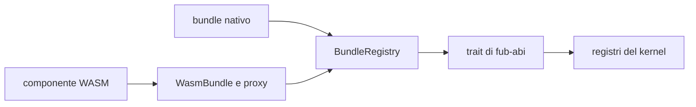

# Runtime dei plugin

> **Domanda:** come usa Fub gli stessi contratti per provider nativi e
> componenti WASM, applicando permessi e limiti in un solo punto?
> **Fonti autorevoli:** `crates/fub-abi/src/traits.rs` (e i suoi moduli in
> `traits/`),
> `crates/fub-host/src/mount.rs`, `crates/fub-wasm-host/src/`.

## Modello

Un bundle fornisce manifest, fiducia, plugin e registrazioni. Il registry monta
le registrazioni e conserva l'ownership necessaria allo smontaggio.

La dichiarazione di un provider è codice esterno: `commands`, `views`,
`interests` e `targets` devono essere chiamati fuori da `Custody<Workspace>`.
`PreparedRegistration` conserva provider e dichiarazioni in un token opaco;
`Workspace::commit_registration` applica namespace, collisioni e fiducia host
senza richiamare il provider. Un rifiuto lascia il provider nel token, da
distruggere dopo aver rilasciato la guardia. Il token è consumabile una sola
volta. La porta copre comandi, view, import, export, handler, sintassi e
renderer.
La famiglia Grid usa la stessa cattura preparata: `surfaces()` viene chiamata
fuori da `Custody<Workspace>`, il commit pubblica soltanto la dichiarazione
verificata e `open/window/apply/close/shutdown` passano da un token
detached. Nessuna chiamata al provider Grid o al guest WASM vive sotto il lock;
il risultato viene finalizzato dopo la riconvalida di workspace, owner e
generazione. Il binding espone famiglia/versione e il registro conserva
fallback e disposer per l'unload. Una famiglia di superficie pubblica non è
considerata consegnata per il solo fatto di esistere nell'ABI: il guard
`public_surface_family_delivery` richiede insieme shell, fallback esplicito,
mirror TypeScript, provider nativo e attraversamento WASM. Aggiungere una nuova
costante pubblica `*_FAMILY` senza questi cinque consumatori rende rossa la CI.
La cattura conserva il corpo fuori dalla rete di panic della dichiarazione:
anche un errore di `Drop` successivo viene isolato, senza un doppio panic.

Per gli indici, `PreparedIndexRegistration` separa cattura delle rotte,
ammissione, attivazione esterna e pubblicazione. Il commit riconvalida le rotte;
un rifiuto mantiene il corpo per `dispose_uncommitted` fuori dalla guardia.
L'errore recuperabile `RegistryError::Activate` conserva la semantica esistente:
l'indice è pubblicato e deve ricostruire lo stato derivato.

Il composition root espone alla closure del bundle un `Registrar` stretto, non
il workspace. Il registrar porta un `RegistrationPermit` opaco legato
all'identità del workspace, all'owner e alla generazione della dichiarazione:
ogni pubblicazione riconvalida il permesso, quindi un mount ritirato o un owner
dichiarato di nuovo non può pubblicare un risultato vecchio. `BundleRegistry`
mantiene un turno di scrittura attraverso le fasi del mount o dello smontaggio,
ma prende le guardie solo per applicare stato già preparato. Preparazione,
attivazione, registrazione, disattivazione, chiusura degli indici e ultimi
`Drop` girano fuori dalle guardie di workspace e registry. Il teardown marca
l'owner in ritiro ed estrae gli indici, li chiude con un `JobHost`, poi estrae
gli altri provider e ritira la dichiarazione in una sola breve mutazione. Gli
owner estratti vengono distrutti soltanto dopo aver rilasciato la guardia.

Il default-deny creato durante il mount restituisce una ricevuta della precisa
scrittura machine-scoped nell'istanza `MachineSettings` condivisa dai vault del
processo. Il rollback rimuove il valore solo se quella revisione è ancora
corrente: una scrittura successiva, anche `false → true → false`, non viene
confusa con il valore provvisorio del mount. Il formato persistente non acquista
un contatore o un token di transazione.

Resta un confine esplicito nelle view. Durante la registrazione
`PreparedRegistration::views` cattura fuori guardia anche `interests` per
l'istanza unica; un panic fallisce la registrazione e non viene sostituito da un
default. Per un'istanza parametrica, l'export WIT `view` alimenta il proxy
`ViewProvider`. Il trait `ViewProvider::interests` è infallibile: se il guest
va in trap, il proxy panica e il confine `Workspace` converte il panic in
`PluginError::Internal`. Non esiste quindi un canale `Result` nell'interesse e
non serve alcun cambiamento al contratto Rust o al WIT.

## Indice delle pagine

- [Provider WASM e confine host](wasm-providers.md): provider nativo, formati,
  componente WASM, istanza, disabilitazione e I/O;
- [Capability, sandbox e UI non fidata](plugin-security.md): capability,
  sandbox, validazione della UI e limiti non promessi.

## Renderer nativi

I renderer nativi `Html`/`Ui` restano sul percorso kernel in
`crates/fub-kernel/src/renderer.rs`: il kernel compone i blocchi del provider
con i renderer registrati e degrada al provider in caso di errore. `Ui` applica
la stessa regola delle view: da chi non è fidato, niente contenuto attivo. Il
kernel aggiunge i marker interni `data-fub-renderer`,
`data-fub-source-start` e `data-fub-source-end` con gli span UTF-8 del modello:
sono metadato interno di arricchimento per la shell, non una nuova API per
plugin. ABI, WIT e IPC restano invariati; il lifecycle dei componenti
(`parts`/`slot`, mount e unmount della shell) resta quello esistente.

La shell registra `fub:diagram` per i payload Mermaid e riusa lo stesso viewer
dei recinti Markdown. I motori non supportati e i payload non riconosciuti
mantengono il fallback dichiarativo; il passaggio fra viewer e fallback
smonta il componente precedente.

## Inventario installato

`InstalledPluginStore` in `fub-wasm-host` fornisce agli host nativi
installazione da un singolo file, inventario persistente, consenso
all'esecuzione, scelta enabled, load verificato e rimozione dell'eseguibile.
Lo store conserva componenti identificati dal contenuto nella configurazione
della macchina. Non salva né scopre componenti installati nello storage
persistente `.fub/plugins/<id>/` del vault e non lo cancella.

L'installazione valida componente, manifest e ABI senza chiamare `activate`.
Listing e load verificano solo inventario e digest: non compilano, istanziano o
chiamano il guest. La validazione attiva esplicita produce un `WasmBundle` con
`Trust::Community` e ricontrolla il manifest. Nessuna di queste operazioni monta
l'istanza o concede capability: `BundleMount` conserva il lifecycle comune e un
solo `Guard` applica permessi e scope. Consenso, scelta enabled e stato del mount
restano tre fatti distinti.

Il bootstrap desktop sceglie una sola directory di configurazione per log,
host e store. Filtra i record con `enabled && consent == granted` prima di
leggere il blob o validare attivamente il componente. I record esclusi restano
metadata nello store: un loro blob corrotto non viene eseguito né diagnosticato
durante l'avvio.

`InstalledPluginManager` implementa `StartupSource`;
`Host::with_startup_source` prepara i bundle e i relativi `BundleClaim` per il
registry comune prima della custodia del workspace. Feature ufficiali, temi e
primo bundle registrato conservano la propria identità; una collisione non li
sostituisce e non trasferisce l'autorità sul claim. Un plugin opzionale fallito
viene diagnosticato senza pubblicare registrazioni parziali né impedire
l'apertura del vault. Il riavvio rilegge le scelte persistite; lo store resta
separato dalle istanze delle sessioni.

`InstalledPluginManager` serve le operazioni IPC desktop: inventario,
installazione da file, consenso, abilitazione e rimozione, il catalogo firmato
(ricerca, installazione, aggiornamento, rollback e revoca, per plugin e temi) e
la lettura dei budget di processo. Persiste le decisioni e riconcilia i vault
aperti. La rimozione richiede prima la disabilitazione, ritira
soltanto i claim posseduti, quindi elimina record e blob senza cancellare
`.fub/plugins/<id>/`.

Schema, atomicità e rimozione sono descritti nel
[layout su disco](../reference/on-disk-layout.md#componenti-wasm-installati).

## Invarianti

- Wasmtime resta in `fub-wasm-host`;
- il kernel non distingue il backend;
- un solo `Guard` applica la policy;
- nessuna famiglia host è concessa implicitamente;
- mount parziale e teardown incompleto sono errori;
- un componente incompatibile viene rifiutato prima dell'attivazione;
- un componente che esporta un'interfaccia che l'host non collega (`syntax`,
  `renderer`, `service`, `importer`, `exporter`) è rifiutato al caricamento
  con `UnservedExports`, come chi importa una famiglia host non servita;
- i comandi che l'host esegue in proprio (`mount.*`, `folder.create`,
  `trash.os`, `vault.snapshot.*`, `vault.export`, `capture.apply`,
  `web.clip`, `settings.import_obsidian`, `connector.token`,
  `connector.tokens`, `uri.pending`, `uri.apply`) sono
  riservati nel registro al mount: un plugin che li invoca con `run_command` riceve `Unserved`, e
  nessun provider può registrarne un omonimo.
