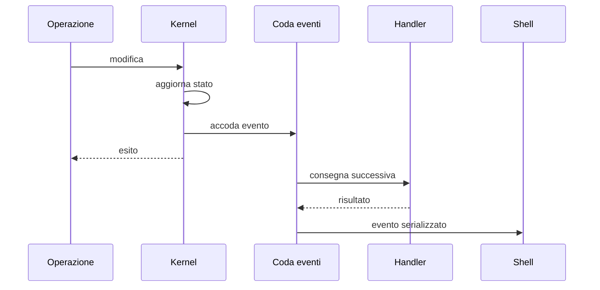
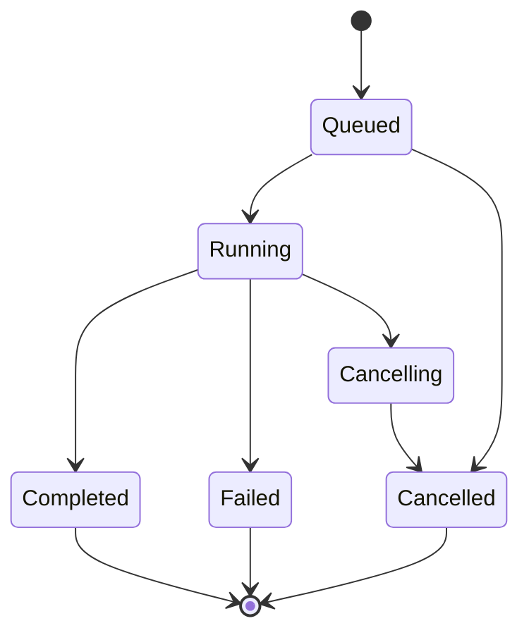
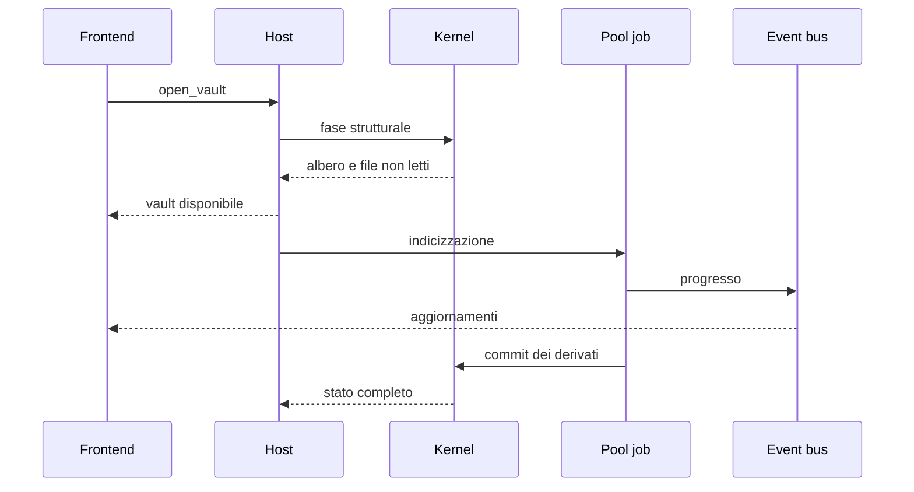

# Runtime, eventi e job

> **Domanda:** come attraversano Fub operazioni brevi, eventi e lavoro lungo
> senza rientranza o lock prolungati?
> **Fonti autorevoli:** `crates/fub-kernel/src/bus.rs`,
> `crates/fub-kernel/src/index/mod.rs`,
> `crates/fub-kernel/src/workspace/removal.rs`,
> `crates/fub-host/src/jobs.rs`, `crates/fub-host/src/session.rs`,
> `crates/fub-host/src/custody.rs`, `crates/fub-host/src/waits.rs`.

## Tre forme di lavoro

| Forma | Uso |
|---|---|
| chiamata breve | lettura, query o comando sincrono e limitato |
| evento | fatto già accaduto, consegnato in coda |
| job | lavoro lungo con progresso, cancellazione e stato |

Una funzione sincrona non diventa un job soltanto perché attraversa IPC. Un
lavoro potenzialmente lungo non deve bloccare il thread che custodisce il
workspace.

## Eventi

Gli eventi descrivono:

- origine e attore;
- soggetto;
- tipo di cambiamento;
- severità o avviso;
- lotto, quando più fatti appartengono alla stessa operazione.

La consegna è accodata. Un handler non viene chiamato mentre il kernel mantiene
un prestito esclusivo o sta ancora mutando lo stesso registro.

Un plugin di terze parti racconta soltanto i fatti suoi: un `custom` nel
proprio spazio di nomi, un `trouble` e un `view-invalidated`. Gli altri eventi
(documenti, voci, job, impostazioni, apertura e chiusura, lotti, sveglie) li
emette chi li ha fatti accadere. Se un plugin li emette, non arrivano a
nessuno, e il rifiuto diventa un `trouble` che nomina il plugin. Un
plugin `Core` parla con la voce del kernel. La regola vive in `KernelHost::emit`,
che vede ogni emissione, nativa o WASM.

## Job

Un job ha un'identità, uno stato e un proprietario. Il suo nome sta nello
spazio di nomi del proprietario come ogni altro id (`<id>:<nome>`), e soltanto
il core nomina senza prefisso. `KernelHost::spawn_job` rifiuta un nome altrui
con `BadArgs` prima della coda: `JobDone` porta quel nome sul bus con la voce
del kernel, e chi lo ascolta, come la shell che offre di salvare l'esito di un
export, se ne fida.

Il lifecycle tipico è:

Il progresso è informativo e può essere compattato. Il risultato finale non
deve essere ricostruito da una sequenza di eventi che potrebbe essere stata
limitata da un budget.

## Apertura del vault

La shell può lavorare prima che l'indice sia completo. Una query risponde con
ciò che l'indice sa in quel momento, e lo stato dell'indicizzazione si chiede a
parte (`IndexQuery::VaultStatus`). Chi non può proseguire con una risposta
parziale aspetta la fine dell'apertura con `Host::wait_indexed`, o con
`Host::wait_indexed_for` per un'attesa che si può interrompere. `fub-cli` lo fa
a ogni apertura, perché un comando secco apre il vault, domanda ed esce.

## Custodia e lock

`fub-host` custodisce il workspace e misura i prestiti esclusivi lunghi. Le
regole sono:

- non chiamare provider con il lock del workspace;
- estrarre i dati necessari, rilasciare il lock, chiamare codice esterno;
- rientrare soltanto per applicare un esito verificato;
- accodare gli eventi;
- non eseguire subito il lavoro appena accodato da un callback.

Il turno di scrittura dell'host può attraversare le tre fasi senza conservare
il prestito esclusivo del workspace:

1. `prepare` valida lo stato e produce dati posseduti e un token;
2. `invoke` chiama il provider con il workspace libero;
3. `finalize` rientra, ripristina il frame e applica l'esito ancora valido.

Il turno tiene in ordine gli altri writer. I reader continuano a progredire
durante `invoke`. Dove l'esito dipende da uno snapshot, il finalizzatore
verifica generazione, revisione o identità del workspace. Un token legato a
un'altra istanza produce un `Conflict` e torna al chiamante: il finalizzatore
sbagliato non chiude il frame originale.

## Turno di scrittura e istanza

I due lucchetti si prendono in ordine opposto da due parti. Un salvataggio tiene
il turno di scrittura del vault attraverso parser, hook, indici e handler di
evento, e per ciascuno chiede l'istanza. Un job (o un handler, o un comando)
tiene l'istanza per tutta la chiamata e, quando usa una capacità che cambia il
vault (`emit`, `spawn-job`, `report-progress`: l'host WASM non serve
`host-vault-write`), chiede il turno. Senza una regola, ciascuno aspetta ciò che
l'altro tiene, con attese native che né la cancellazione né i limiti di
esecuzione interrompono.

Un ordine unico non è imponibile: il turno è tenuto attraverso i provider per
conservare l'unità logica del salvataggio, ed è il guest a decidere quando
chiedere il turno, già dentro l'istanza; il mutex d'istanza non si rilascia
durante una chiamata all'host. La regola è quindi un'altra:

- ogni presa di un'istanza passa da `LockInstance::lock_instance`
  (`fub-wasm-host`, verificato da `tests/instance_door.rs`), che registra chi la
  tiene e chi l'aspetta nel grafo delle attese di `fub_host::waits`;
- chi sta dentro un componente prende il turno da `Custody::write_turn_yielding`
  (`JobHost::turn`, `JobHost::writing_until`; `Custody::write` lo usa da solo se
  il thread tiene un'istanza). Ogni 10 ms l'attesa guarda la cancellazione e se
  il turno è di chi aspetta, direttamente o attraverso altri thread, ciò che
  questo thread tiene;
- se l'attesa chiude un ciclo **cede sempre il lato che sta dentro il guest**,
  perché ha un esito e può ritentare: la capacità risponde `Conflict` con la
  chiave `host.turn.cycle`. Il salvataggio, che è ciò che l'utente sta
  guardando, non fallisce e riparte appena l'istanza torna libera.

`emit` e `report-progress` non hanno un esito: in un ciclo non partono e lo
scrivono nel log (`tracing::warn!` per `emit`). Chi deve esserci a ogni costo
usa `spawn-job`, che dice di no. Il job che riceve `host.turn.cycle` deve uscire
dalla chiamata, restituendo l'istanza, e ritentare.

Anche un ciclo di **sole istanze**, senza un turno di mezzo (A tiene X e aspetta
Y, B tiene Y e aspetta X), si scioglie: `lock_instance` controlla e registra
l'attesa sotto lo stesso lucchetto del grafo (`waits::try_wait_instance`), quindi
di due thread che si chiudono a vicenda l'ultimo a chiedere non si mette in fila
e riceve `Conflict` con la chiave `host.instance.cycle`. Il primo prosegue
appena l'altro restituisce la sua istanza. Un guest che ignora l'errore e
ritenta trova lo stesso ciclo e lo stesso errore finché l'altro lato non ha
restituito: non si ferma per sempre, ma deve uscire dalla chiamata per
sbloccarlo. Un ciclo che passa da un turno resta di chi aspetta il turno (sopra):
il salvataggio non è mai la vittima.

## Callback degli indici

Le query staccate, le fette di apertura, l'alimentazione delle scritture host e
le rimozioni consegnano agli indici una fotografia di handle. Ogni callback
attraversa la rete contro i panici senza una guardia del workspace. Anche
l'ultimo rilascio di un `Arc` può eseguire il distruttore di un provider: gli
handle vengono quindi rilasciati dentro `safety::external`, dopo la guardia del
provider e prima del rientro nel workspace.

Una stessa istanza di indice non è rientrante sullo stesso thread. Una query
verso quell'istanza e una mutazione di documenti che dovrebbe alimentarla
rispondono `Conflict`; la mutazione viene rifiutata prima di cambiare file,
memoria o eventi. Le query verso altri indici e le capacità che non alimentano
documenti restano disponibili.

Per una rimozione, il kernel aggiorna prima il proprio indice, invoca
`on_documents_removed` fuori dal lock e finalizza poi le perdite. Solo dopo il
ritorno di tutti gli indici accoda `DocumentRemoved` e `IndexUpdated`. Se nel
frattempo esiste di nuovo lo stesso `DocId`, conserva la nuova identità e
accoda un conflitto invece di annunciare una rimozione ormai stale. Gli handler
ricevono la coda dopo il rilascio della guardia del finalizzatore.

## Errori

Gli errori attraversano i confini come specie tipizzate: conflitto, permesso
negato, argomenti errati, non trovato, I/O, cancellazione e altre varianti.

La localizzazione della frase avviene prima della presentazione, ma il tipo non
viene perso. La shell non decide il comportamento cercando sottostringhe in un
messaggio.

## Shutdown

Lo spegnimento avviene dal livello proprietario verso l'interno:

1. impedisce nuove registrazioni o richieste;
2. cancella o attende i job secondo la policy;
3. disattiva i bundle;
4. rimuove registrazioni, handler e timer;
5. chiude watcher e sessioni;
6. rilascia il workspace.

Un disposer appartiene all'owner che ha registrato la risorsa. Non si svuotano
mappe globali per tentativi.
