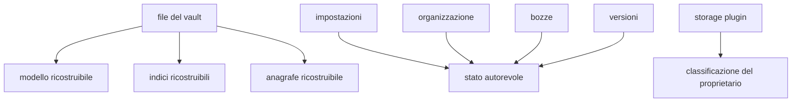
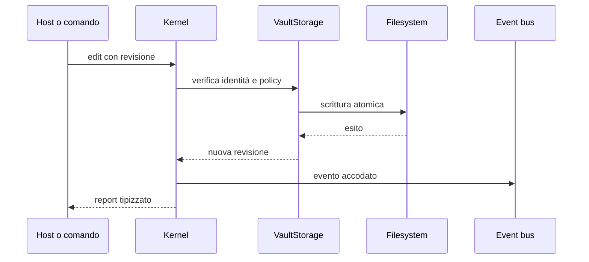
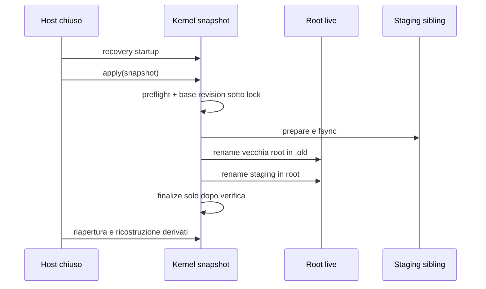
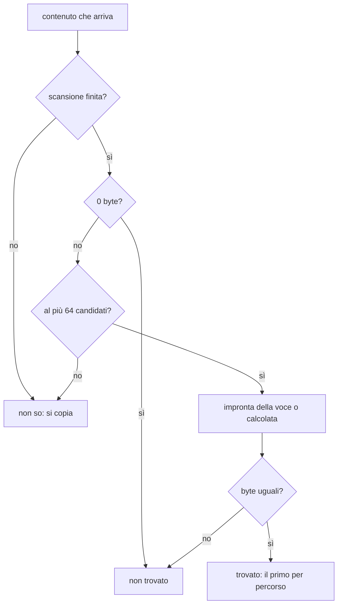

# Storage e identità

> **Domanda:** come rimangono coerenti path, documenti, cache e sidecar durante
> le modifiche?
> **Fonti autorevoli:** `crates/fub-kernel/src/`, schemi persistenti e test di
> integrazione.

## Livelli di identità

| Identità | Significato |
|---|---|
| path assoluto | posizione sul filesystem della macchina |
| `DocId` | path relativo canonico nel vault |
| revisione | impronta della sorgente su cui è calcolata una modifica |
| ancora o heading | posizione indirizzabile dentro un documento |
| id di plugin o view | identità namespaced di una registrazione |

`DocId` non è un UUID indipendente dal path. Rename e move cambiano il path
pubblico e devono aggiornare ogni derivato collegato.

## Dati autorevoli e derivati

Una posizione sotto `.fub/data/` non determina da sola che il dato sia una
cache. Lo schema e il proprietario dichiarano se può essere ricostruito.

## Apertura del vault

L'apertura separa struttura e contenuto:

1. inventaria le voci;
2. rende disponibile l'albero;
3. legge i documenti;
4. aggiorna anagrafe e indici;
5. pubblica avanzamento ed eventuali file non letti.

La prima fotografia del vault viene consegnata senza lasciare una finestra in
cui watcher e scansione possano perdere una modifica.

## Modifiche esterne

Il watcher consegna lotti di path toccati o rinominati. Una cartella spostata
dentro il vault, rinominata o portata via arriva come un path solo: il lotto
riallinea i file che stanno sotto quella cartella con la stessa differenza fra
disco e anagrafe della riconciliazione d'apertura. Se il backend dichiara di
aver perso eventi, per esempio per una coda di notifica piena, la
riconciliazione copre l'intero vault.

Un file del lotto che non si legge, perché non è UTF-8, supera il tetto o il
parser lo rifiuta, è un avviso di quel path: il resto del lotto prosegue. Una
rinomina che non si può convalidare, con la destinazione già spostata di nuovo
o illeggibile, si riconcilia come due path toccati, così l'id vecchio non resta
in anagrafe.

## Lettura e scrittura

Le scritture autorevoli passano dal kernel. Il percorso comune:

Nei percorsi staccati dell'host il chiamante non tiene il lock del workspace
durante codice esterno. Gli eventi vengono pubblicati dopo l'operazione
autorevole.

## Cancellazione

Il cestino dell'app e la rimozione osservata dal watcher condividono la stessa
coda in memoria, ma soltanto il primo sposta il file. Dopo la mossa riuscita il
kernel ritira modello, grafo e contesto attivo, quindi notifica gli indici
esterni senza tenere il lock del workspace. Perdite e panici degli indici
diventano avvisi; non annullano la cancellazione, perché il vault resta la fonte
autorevole e l'indice è ricostruibile.

Il fatto `DocumentRemoved` viene accodato dopo il ritorno degli indici. Il
watcher conserva l'attore del proprio lotto e drena una volta alla fine. Il
cestino elimina anche la bozza, registra la mossa nel journal e restituisce il
nuovo `DocId` della voce cestinata.

I compagni persistenti `.<nome>.lock`, riconosciuti dal protocollo dello storage,
non sono voci cestinate: il catalogo e lo svuotamento li escludono senza
rimuoverli. File utente come `Cargo.lock` e contenuti di directory con nomi
simili restano invece visibili e conservano le normali regole del cestino.

### CAS cooperativa

`RootedFsStorage` coordina i writer Fub tramite un file stabile
`.<nome>.lock` accanto al target, aperto relativamente alla capability.
La creazione è esclusiva; soltanto `AlreadyExists` conduce all'apertura del
lock esistente, senza troncarlo. Il file non viene rimosso al rilascio:
writer concorrenti devono continuare a riferirsi alla stessa identità.

Il lock viene acquisito prima della rilettura e resta detenuto durante il
confronto e la sostituzione atomica. Un errore di apertura o acquisizione
impedisce la scrittura e mantiene la specie I/O originale. La diagnostica
distingue lo stadio del lock dall'operazione protetta.

La CAS è esatta fra writer che rispettano questo protocollo. Con writer
esterni che ignorano il lock la protezione resta best-effort.

### File in sola lettura

La scrittura atomica rinomina un temporaneo sopra il file, e la rename chiede
il permesso della cartella, non quello del file. Per questo `RootedFsStorage` e
`FsStorage` guardano il file che c'è già **prima** di creare il temporaneo: se
non è scrivibile la scrittura si ferma con `io::ErrorKind::PermissionDenied` e
un messaggio che nomina il file, e file e cartella restano come erano. Su
Windows conta l'attributo di sola lettura; su Unix il bit di scrittura della
classe che si applica al processo (proprietario, gruppo effettivo o
supplementare, altri). Root non scavalca il controllo: per lui un file è in
sola lettura quando nessuna classe ha il bit di scrittura. Un file nuovo e un
file scrivibile si scrivono come prima.

Il kernel porta questo rifiuto al contratto come
`PluginError::PermissionDenied`, non come `Io`; lo riconosce dal tipo che lo
storage mette dentro l'errore, quindi gli altri permessi negati del sistema
(una cartella che non si elenca o non si scrive) restano `Io`. La shell lo dice una volta per
documento («è in sola lettura: Fub non lo sovrascrive»), tiene la bozza
sporca e lascia che il salvataggio automatico riprovi in silenzio finché il
file non torna scrivibile o l'utente preme «Riprova».

## Snapshot globale

Lo snapshot globale è una responsabilità del kernel, non del provider di
versioning e non dell'IPC. `fub_kernel::snapshot` enumera soltanto lo stato
autorevole: documenti, allegati e sconosciuti condividono la classe `user`
perché il kernel non possiede il `FormatRegistry`; cestino,
settings/organizzazione/drafts/journal, sidecar autorevoli e storage persistente
dei plugin hanno classi core proprie. La cache `.fub/data/plugins/<id>/` è
derivata soltanto quando contiene `.fub-cache-root`; senza marker è storage
autorevole legacy. La configurazione macchina e gli altri derivati
ricostruibili restano fuori.

La fotografia produce un manifest schema 1 deterministico. Ogni path relativo
normalizzato porta classe, owner, schema quando applicabile, size e SHA-256.
Preflight completo rifiuta prima di scrivere schema futuro, path traversal,
duplicati, symlink/file speciali, entry mancanti e mismatch di size/digest. La
base revision è il digest del manifest live; il kernel la rilegge sotto un lock
sibling stabile immediatamente prima del commit. Non deduce l'autorità dal solo
prefisso `.fub/data/`.

L'applicazione offline usa staging sibling privato e un record persistente
idempotente:

La vecchia root resta disponibile fino a `finalize`; un crash fra le fasi viene
risolto dalla recovery riconoscendo soltanto schema, transaction id e nomi
propri. File ignoti non vengono rimossi. La garanzia all-or-old-or-new vale tra
writer cooperativi; writer esterni e filesystem senza rename/fsync durevoli non
sono coperti da atomicità universale. Il restore per-file di `fub.versioning` e
il drill backup #7 rimangono percorsi separati.

## Rename

Un rename deve considerare:

- collisione con un documento vivo;
- differenze di maiuscole del filesystem;
- aggiornamento del `DocId`;
- sessioni aperte;
- bozze;
- anagrafe e indici;
- organizzazione;
- riferimenti che una feature decide di riscrivere;
- evento unico e ricongiunto.

La validazione dell'identità del nome vive in regole condivise, non in ogni
chiamante.

Su Windows il backend ancorato usa `NtSetInformationFile` con il directory
handle e un nome UTF-16, senza riaprire il path ambientale della root. Il lock
sibling della sorgente precede la sua apertura: due writer Fub concorrenti non
possono dichiarare entrambi lo spostamento, anche verso destinazioni diverse.
La syscall rifiuta atomicamente una destinazione occupata. Inoltre `cap_std`
nega la condivisione della cancellazione sulle directory Windows aperte: la
root non può essere rinominata o cancellata durante il mount.

## Sidecar

Un sidecar contiene informazioni che non appartengono al file principale ma ne
descrivono stato o provenienza. Deve avere:

- schema o forma riconoscibile;
- comportamento su versione futura;
- legame verificabile con il file a cui si riferisce, quando l'omonimia è
  possibile;
- fallback che non distrugga il documento.

## Lo stesso contenuto

Il vault non tiene un indice per contenuto. La domanda «c'è già un file di
questo tipo con questi byte?» si risponde con l'indice vivo del workspace, cioè
le voci dell'anagrafe in memoria con misura, data e impronta, e dove l'indice
non basta la risposta è «non so». Chi copia un contenuto nel vault la usa per
riusare un file che c'è già, anche con un altro nome, invece di duplicarlo.
`Workspace::prepare_same_content` prende i candidati, `PreparedSameContent::invoke`
confronta i byte già in memoria, e l'host la espone come `Host::same_content`.

I candidati sono le voci dell'indice vivo con la stessa misura e la stessa
estensione del nome che si vuole scrivere, fuori dal cestino, da `.fub/` e
dalle cartelle escluse. L'estensione è quella grezza dell'ultimo segmento,
piegata in minuscolo e confrontata uguale: il registro dei formati non si
interroga, quindi `.md` e `.markdown` sono due tipi anche se un formato li
servisse entrambi. È prudente di proposito: chi riusa un file scrive un
collegamento a lui, e quel collegamento non deve cambiare estensione. Un `.txt`
con i byte di una nota `.md` non è quella nota, e un file senza estensione
trova solo un file senza estensione. Un contenuto di 0 byte non si ritrova mai.
La domanda non legge `.fub/data/entries.json`: quella tabella si scrive alla
fine dell'indicizzazione e alla chiusura, mentre l'indice vivo conosce subito
un file scritto o cambiato nella sessione. Prima che la scansione abbia
installato l'anagrafe la risposta è «non so»; l'host però pubblica un vault
solo dopo la scansione, e un rebuild svuota e rimette l'anagrafe nello stesso
prestito, quindi da `Host::same_content` questo «non so» non arriva. Un file
che l'indice non conosce ancora, perché è arrivato da fuori senza il
rilevatore, non è un candidato: la risposta è «non trovato», e chi chiede
copia.

Ogni candidato porta un'impronta: quella della voce, se misura e data del file
sono ancora quelle della voce e l'impronta è nella forma corrente
(`Revision::is_current_form`), oppure una calcolata leggendo il file a pezzi.
Un'impronta FNV-1a di una tabella scritta prima di SHA-256 non dice né sì né
no, e si ricalcola. L'impronta sceglie il candidato, ma solo un confronto dei
byte intero dà «trovato»: un'impronta vecchia può solo far copiare. Un
candidato che non si legge, che cambia mentre lo si legge (misura, data, segno
del cambio o identità) o che non ha più la misura cercata si salta, e della
sua impronta non si impara niente.

Un'impronta calcolata torna all'indice vivo sotto il lucchetto del workspace
(`Workspace::learn_fingerprints`), nello stesso vault a cui si è fatta la
domanda, insieme al **testimone** del file letto (`FileWitness`: segno del
cambio e identità, presi dalla domanda fuori dal lucchetto). Si tiene soltanto
se:

- la data letta è anteriore all'istante della domanda, preso dall'orologio del
  vault (*racily clean*);
- la voce ha ancora la misura e la data lette: una voce cambiata nel
  frattempo, da una scrittura o dal rilevatore, non torna indietro;
- la riga dell'anagrafe con quella misura e quella data, se c'è, descrive lo
  stesso file. Un file sostituito da un altro con la stessa misura e la stessa
  data, senza il rilevatore, ha una voce che descrive ancora quello di prima,
  e l'impronta del nuovo certificherebbe i metadati del vecchio.

Sotto il lucchetto si confronta soltanto: nessuna domanda al supporto, e la
riga dell'anagrafe non si copia. L'indice tiene il testimone accanto
all'impronta finché la voce non cambia. La domanda dopo crede l'impronta solo
se il file appena guardato ha lo stesso testimone, e `store_entries` non la
scrive in una riga il cui file adesso è un altro: alla riapertura quel file si
rilegge invece di essere certificato con i byte di prima. Due testimoni dicono
lo stesso file se ogni campo che entrambi conoscono coincide; un campo che una
parte non conosce non decide, per il segno come per l'identità.

La consegna è un prestito esclusivo breve: `Custody::write` prende il turno di
scrittura prima del lucchetto, quindi non entra a metà del lavoro di un altro
writer, e non drena eventi, perché imparare un'impronta non ne produce.
L'indice non ha un lucchetto suo fuori dal workspace. Su disco la porta
l'anagrafe (`EntryStore`), l'unica che scrive `entries.json`, la prossima
volta che si scrive. Il formato non cambia: l'impronta è il campo che la voce
già porta.

Ci sono due limiti, costanti con nome: `MAX_CANDIDATES`, 64 candidati, e
`MAX_BYTES_READ`, 512 MiB letti per domanda. Oltre questi limiti la risposta è
«non so» e chi chiede copia: nel dubbio si copia. Troppi candidati danno lo
stesso «non so» a ogni domanda con quei byte; il budget finito invece no,
perché le impronte imparate rendono la domanda dopo più economica. Per questo
`Host::same_content` fa da sé un secondo giro, uno solo, quando il primo ha
finito il budget e ha insegnato almeno un'impronta all'indice. Il contenuto
che arriva si confronta dove sta, senza copia.

Il lucchetto del workspace non si tiene mentre si legge. La domanda prende i
candidati, lascia il lucchetto, legge, e rientra solo per consegnare le
impronte imparate. I collegamenti simbolici non si seguono: lo storage è
radicato nel vault, e nessuna lettura ne esce.

## Schemi

Ogni formato persistente ha una propria `SchemaVersion`. Gli schemi non
avanzano tutti insieme.

- un derivato incompatibile può essere eliminato e ricostruito;
- un dato autorevole richiede migrazione o rifiuto;
- un file scritto da una versione più nuova non viene reinterpretato a metà;
- un fallback silenzioso è ammesso soltanto quando non può perdere dati.

Il catalogo preciso è in
[`../reference/on-disk-layout.md`](../reference/on-disk-layout.md).

## Invarianti

- nessun path esterno alla radice viene accettato per errore;
- ogni scrittura autorevole è atomica o lascia intatto il valore precedente;
- un file senza permesso di scrittura non si sovrascrive;
- la revisione impedisce overwrite silenziosi;
- cache e autorità sono classificate per formato;
- rename, watcher e indice convergono sullo stesso `DocId`;
- i file sconosciuti vengono preservati.
