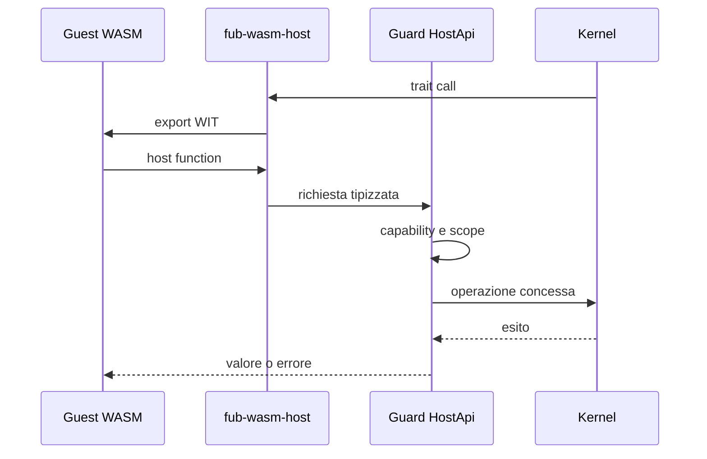

# Provider WASM e confine host

> **Ambito:** come un componente WASM implementa i trait del contratto e
> come l'host lo confine. Parte del [runtime dei plugin](plugin-runtime.md).
> **Fonti autorevoli:** `crates/fub-wasm-host/` e i suoi test.

## Provider nativo

Un provider nativo implementa il trait Rust direttamente. Il composition root
gli consegna un `HostApi` protetto dalla policy.

Essere nativo non significa poter ignorare il contratto: comandi, view ed eventi
devono comunque usare tipi ed errori condivisi.

## Formati e confine host

`FormatSource` è una porta host-agnostica: prepara `FormatProvider` e risorse
prima dell'apertura del `Workspace`. L'host registra i provider prima di
costruire il workspace; le risorse preparate restano vive per la sessione e
vengono rilasciate anche in caso di rollback. I formati di serie (Markdown,
Canvas e Base) si registrano per primi: un provider
esterno che rivendica un'estensione già presa è rifiutato da solo, con una
diagnostica di apertura che nomina chi la tiene, e il vault si apre lo stesso.

L'interfaccia WIT `format` è opzionale. Se il componente la esporta,
`WasmBundle` congela descriptor e capability dichiarati e `fub-wasm-host`
presenta un proxy `FormatProvider` per `parse`, `render_html` e `serialize`.
La validazione del modello in ingresso e in uscita è parte del confine fidato:
modelli malformati e trap vengono restituiti come `FormatError`. La validazione
accetta DAG ordinari e visita il grafo in `O(V+E)`; rifiuta cicli, riferimenti
fuori indice, profondità oltre 64, span non validi, JSON non valido e una
materializzazione oltre il budget documentato di 8 Mi unità pesate.

`InstalledPluginManager` prepara una sola volta, per ogni apertura, lo snapshot
dell'inventario `enabled` con consenso `granted`: da quello stesso passaggio
restituisce bundle e `PreparedFormatSource` sotto la medesima
`StartupValidity`/lease. Il manager è cablato come `StartupSource`, non come
`FormatSource`; ogni bundle selezionato viene caricato una sola volta. Se un
componente selezionato è corrotto o non caricabile, o se un'export `format`
presente è incompatibile, l'apertura conserva una diagnostica tipizzata e
salta quel componente, senza impedire l'apertura del vault. Un bundle caricato
resta utilizzabile per le altre interfacce anche se la preparazione del suo
provider di formato fallisce, con la diagnostica corrispondente. Un'invalidazione
concorrente revoca la validità: l'apertura stantia fa rollback e non pubblica
alcuna sessione.

Il lease e le risorse preparate sono posseduti dalla sessione o dal rollback;
nessuna `Operation` del manager viene trattenuta dalla sessione.

Il registro dei formati di un vault aperto è fisso per la vita del workspace,
quindi un provider di formato non si monta né si smonta a vault aperto. Il
manager tiene un interruttore per ogni provider preparato: disabilitazione,
revoca del consenso o del publisher, aggiornamento e rimozione lo spengono in
tutti i vault aperti, e da lì ogni chiamata (parse, render, serialize,
riscrittura dei link, modifiche di formato) fallisce con un errore di formato
senza eseguire il componente. Gli indici derivati restano quelli dell'ultima
analisi finché il documento cambia o il vault si riapre. Un provider abilitato
o riacceso a vault aperto serve il formato dalla prossima apertura, con
un'istanza nuova.

Il componente non riceve capability host per il solo fatto di esportare
`format`: ogni famiglia resta soggetta al mount e al `Guard`. Il percorso
end-to-end verificato copre parse, render, errore dichiarato dal guest,
modello malformato, trap e serialize; non documenta una parità ulteriore.

### Decisioni sui provider

`FormatProvider` è implementato e ha parità nativo/WASM per le operazioni
coperte `parse`, `render_html` e `serialize`. Errori dichiarati dal guest,
modelli malformati e trap vengono recuperati come `FormatError`, ma non
costituiscono un confronto di parità nativo/WASM.

`IndexProvider` inbound è implementato: un componente reale possiede una route
e prova feed, query, flush, close, `up_to_date` e reconcile nello stesso
registro del nativo, con teardown e rollback del mount su dichiarazione in
trappola (`crates/fub-wasm-host/tests/deferred_providers.rs`). La domanda
`up_to_date` resta un'intersezione su tutti gli indici montati: i provider
nativi conservativi rispondono vuoto, quindi il guest non viene consultato su
un'apertura a freddo e il documento viene sempre alimentato.
`EventHandler` inbound è implementato: un componente reale dichiara la
maschera e riceve `Notice` attraverso lo stesso registro del nativo, con
`Guard` applicato alle letture del guest.

## Provider WASM

`fub-wasm-host`:

1. carica il componente;
2. genera i binding dal WIT vivo;
3. traduce manifest e tipi;
4. implementa i trait Rust come proxy;
5. monta il bundle nella stessa porta del backend nativo.

### ViewProvider WASM

Il componente può esportare facoltativamente l'interfaccia WIT `view`; il proxy
`ViewProvider` viene registrato sulla stessa `Instance` del `Plugin` e degli
altri provider preparati per il mount. Le `ViewSpec` dichiarano i parametri e
l'host ne applica la validazione prima della chiamata al provider.

Il proxy espone:

- `interests`, infallibile: un trap del guest fa paniare il proxy e il confine
  `Workspace` converte il panic in `PluginError::Internal`;
- `render_view`, che legge dal `ReadApi`;
- `on_action`, che usa l'`HostApi` e restituisce un `ViewUpdate`.

Render e aggiornamenti passano dallo stesso `Guard` di fiducia: `Html` e
`WebView` prodotti da provider non fidati (`Trust::Community`) sono rifiutati
prima della shell; i provider `Trust::Core` possono produrli. Il confine
preflight controlla root e riferimenti, cicli, profondità massima 64 e un budget
di 8 Mi unità pesate.
La stessa istanza non è rientrante: una chiamata guest che prova a rientrare
nel proprio provider riceve un errore tipizzato. Un trap invalida il guest ma
lascia vivo l'host; il teardown può riportare il trap come errore osservabile.

Le dichiarazioni inbound (`routes` dell'indice, maschera degli eventi) vengono
lette dentro la closure di mount, dopo `Plugin::activate`: un componente in
trappola fallisce con l'errore di dichiarazione, mai con un errore di istanza
avvelenata dovuto alla lettura anticipata.

La parità dimostrata è limitata a spec/interests/render/`Replace`/`Patch` per
le view e a feed/query/flush/close/`up_to_date`/reconcile/notice per gli
inbound, non implica parità per provider non esercitati.

## Esempio minimo

`esempi/view-wasm/` espone una view con parametri `mode` e `density`: il test
monta il componente, confronta spec, interests e render con un provider
nativo, invoca sia `Replace` sia `Patch`, quindi smonta e verifica che la view
non sia più disponibile.

## Istanza e non rientranza

Plugin e provider dello stesso componente condividono lo stato della medesima
istanza. Un mutex rende esplicita la non rientranza richiesta dal component
model; non offre esecuzione concorrente dentro l'istanza.

Il turno di scrittura dell'host e l'istanza si prendono in ordine opposto da
due parti; chi sta dentro il guest cede, il salvataggio no. La regola sta in
[Turno di scrittura e istanza](runtime-events-and-jobs.md#turno-di-scrittura-e-istanza).

Le host function che accodano lavoro non lo eseguono immediatamente durante la
chiamata guest.

## Disabilitazione, I/O e chiusura

Il toggle utente e la chiusura della sessione preparano il teardown sotto lock,
eseguono `Plugin::deactivate` e `IndexProvider::flush/close` fuori dai guard di
workspace e registry, poi finalizzano sotto lock. Il proxy `JobHost` acquisisce
il workspace per una capacità alla volta e riusa il `Guard` del kernel.

Il token identifica workspace e generazione della dichiarazione: un risultato
obsoleto non ritira un nuovo plugin con lo stesso id. Errori e panic delle
callback vengono raccolti senza saltare le callback di chiusura successive.
Il corpo vede ancora provider e capacità vivi; successivamente vengono ritirate
le rotte degli indici, chiusi gli indici e rimossa la dichiarazione. I dati
persistenti del plugin restano conservati. I disposer del corpo e degli indici
vengono isolati fuori lock; gli altri provider e gli hook dell'owner vengono
estratti durante la finalizzazione e distrutti singolarmente dopo il rilascio
del guard. Un panic del disposer non salta le risorse successive.

Il flush degli indici usa un token che estrae gli snapshot sotto guardia, chiama
i provider con `JobHost` fuori da `Custody<Workspace>` e finalizza dopo la
riacquisizione. `IndexCall` impedisce che un indice rientri sincronicamente nel
proprio `flush`; il suo `Drop` ripristina il frame anche se la callback va in
panic. Fine indicizzazione, watcher, manutenzione e teardown attraversano la
stessa porta staccata.

Scrittura, edit e creazione preparano sorgente, parser e `BeforeWrite` sotto
guardia, ma eseguono parser e hook con handle owned e capacità strette. Ogni
owner registra al più un hook `BeforeWrite`; gli hook girano nell'ordine di
registrazione, ognuno con l'host intestato al proprio owner, e il primo errore
ferma la scrittura e gli hook successivi. Il panic di `BeforeWrite` viene
convertito in errore prima della scrittura: il commit non tocca il documento
quando un hook fallisce o va in panic. Chi viene disattivato porta via soltanto
il proprio hook. L'hook è soltanto nativo: il WIT non ha un export che lo
registri, quindi un componente WASM non ne ha uno. Feed e finalize degli indici
restano fasi successive e staccate.

Il ripristino dal cestino fotografa voce, destinazione, revisione e parser sotto
guardia; poi legge la sorgente, invoca parser e sintassi e compie la mossa
no-replace fuori dalla custodia. Il commit riconvalida workspace e collisioni
senza consultare storage o provider. Side-data, feed, osservazione della
revisione e journal vengono completati fuori guardia. Se il core rifiuta il
risultato, lo stesso token esegue il rollback; l'identità osservata impedisce di
sovrascrivere alla cieca un file cambiato nel frattempo.

Anche le rename esplicite di documenti e asset sono staged. Stat, letture,
parser, riscritture dei link, feed, operazione filesystem, migrazione dei
side-data e journal non vengono nascosti sotto `Custody<Workspace>`; prepare e
commit riconvalidano invece identità, collisioni e generazioni. Il rollback usa
la ricevuta della mossa e resta prudente se un processo esterno ha sostituito il
file: senza rename condizionale o reservation non esiste una transazione globale
contro il filesystem.

Il watcher separa filtro e pianificazione, invocazione di stat/read/parse e
finalizzazione. Le rename tracciate percorrono i token dedicati a documenti e
asset; gli altri eventi ricadono nella sincronizzazione ordinaria. Un lotto che
ha già mutato stato tenta il flush anche se un elemento successivo fallisce, in
modo da non perdere in silenzio un derivato già alimentato.

Il rebuild di manutenzione segue lo stesso schema: autorizzazione e snapshot
sotto guardia, camminata, letture, parser e callback fuori custodia, quindi
finalizzazione e drain degli eventi. Le operazioni globali e il dry run usano
porte tipizzate e non riaprono accesso generico a `Host::workspace`.

L'uscita desktop è in due fasi: prima il manager chiude l'ammissione e revoca
lo snapshot startup; poi `Host` chiude le sessioni e infine il manager attende
il drain dei lease. La sessione ferma watcher e job, consegna `VaultClosed`,
esegue il flush globale e smonta i plugin in ordine inverso; l'anagrafe viene
persistita per ultima. La chiusura consegna gli eventi di `deactivate` mentre
le registrazioni del plugin sono ancora disponibili.

Mount, rollback e chiamate dirette del registry rispettano lo stesso confine:
preparazione, attivazione, registrazione e disposer esterni non conservano i
guard di workspace o registry. Le prove del call graph di produzione e la
certificazione G3 sono riferite nello [stato del progetto](../project/status.md).
