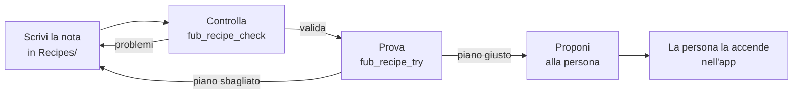

# Costruire su Fub con un'AI

> **Per chi:** chi aggiunge qualcosa a Fub da fuori, a mano o facendolo fare a
> un'AI (un agente con l'MCP, o un assistente che usa la riga di comando).
> **Risultato:** una ricetta controllata e provata da proporre alla persona,
> oppure la scelta motivata di scrivere un componente.
> **Fonti autorevoli:** `crates/fub-cli/src/recipes.rs` (i comandi `ricette` e
> gli strumenti `fub_recipe_*`), `crates/fub-cli/src/mcp/tools.rs`,
> `crates/fub-features/src/recipes/` (il formato, i controlli, la prova).
> **Presidi:** `crates/fub-cli/tests/recipes.rs` (controllo, prova, esempi,
> radici, app aperta) e `crates/fub-cli/tests/mcp.rs`.

Fub cresce in due modi: con una **ricetta**, una nota che mette in fila comandi
che ci sono già, o con un **componente**, codice che porta comandi, pannelli o
indici nuovi. Questa pagina dice quale scegliere, quali porte ci sono, e il
ciclo con cui un'AI scrive una ricetta senza mai accenderla da sola.

## Le porte

Ogni cosa che un componente fa entra in Fub da una porta pubblica, la stessa per
le funzioni ufficiali e per quelle di terzi. Il
[censimento delle porte](../reference/censimento-delle-porte.md) dice, funzione
per funzione, quali porte usa e se un componente di terzi la può rifare. In
breve:

| Porta | Che cosa ci passa | Da fuori |
|---|---|---|
| `query_index` | i dati: documenti, backlink, tag, proprietà, impostazioni | `fub-cli query`, `fub_search`, `fub_query` |
| `list_commands` / `invoke_command` | le azioni, con la prova (`DryRun`) prima di scrivere | `fub-cli command`, `fub_commands`, `fub_invoke` |
| `list_views` / `render_view` / `view_action` | i pannelli, come albero `UiNode` dichiarativo | `fub-cli views` |
| impostazioni | i valori che la persona sceglie | `fub-cli config` |

Una ricetta usa soltanto la seconda: i suoi passi sono comandi del registro.

## Ricetta o componente

| Ti serve | Allora |
|---|---|
| fare in fila comandi che esistono, sulla nota aperta, con un solo «Annulla» | una **ricetta** ([il formato](../reference/ricette.md)) |
| un comando che non c'è, un pannello, un indice, una regola | un **componente** ([creare un plugin](plugin-authoring.md), [ABI e WIT](../reference/abi-and-wit.md)) |
| condizioni, cicli, il risultato di un passo usato dal passo dopo | un componente: una ricetta non è un programma |
| cambiare le impostazioni, o un passo che non si annulla | nessuna delle due da un'AI: una ricetta lo rifiuta (`impostazioni`, `non-si-annulla`) |

Una ricetta non chiede permessi di scrittura suoi: ogni passo scrive col
recinto del comando che lancia. Un componente WASM, invece, dichiara le sue
capacità nel manifest e la persona le accende una per una.

## Il ciclo: scrivi, controlla, prova, proponi

1. **Scrivi** una nota nella cartella delle ricette (`recipes.folder`, di serie
   `Recipes`) con un blocco `fub-recipe`. Gli id dei comandi vengono da
   `fub_commands` (o `fub-cli command --list`), con i loro argomenti.
2. **Controlla.** Il controllo legge il blocco e lo confronta col registro vivo
   del vault: ogni problema ha un codice stabile (`comando-sconosciuto`,
   `argomenti`, `segnaposto-sconosciuto`…), il campo (`steps[1].run`), la riga
   della nota e una frase. Correggi e ricontrolla finché non è valida. Le note
   del controllo dicono anche ciò che non è un errore del blocco ma terrebbe la
   ricetta lontana dall'app: la nota fuori dalla cartella, il componente Ricette
   spento.
3. **Prova** su una nota vera: ogni passo gira in simulazione e la risposta dice
   il riassunto, le note che toccherebbe e le modifiche. Niente si scrive. La
   prova è approssimata quando un passo dipende da un altro: dopo una rinomina
   il passo seguente vede la nota dov'era.
4. **Proponi**: di' alla persona che la ricetta c'è e che cosa fa. **La accende
   soltanto lei**, nell'app, dalla sezione «Ricette» delle impostazioni:
   adottare e scartare non sono comandi del registro né strumenti MCP, e una
   ricetta cambiata dopo l'adozione torna fra le proposte.

## I comandi e gli strumenti

| Gesto | Riga di comando | MCP | Esito |
|---|---|---|---|
| controllare | `fub-cli ricette controlla NOTA` | `fub_recipe_check { recipe }` | uscita 0 se è valida, 1 con i problemi; via MCP `valid` e `problems` |
| provare | `fub-cli ricette prova NOTA [--doc NOTA] [--args JSON]` | `fub_recipe_try { recipe, doc?, args? }` | il piano (`summary`, `docs`, `edits`), senza scrivere |

- `--doc` (o `doc`) è la nota su cui si prova, il `{{doc}}` della ricetta; i
  parametri dichiarati e `selection` vanno in `--args` (o `args`). Gli
  argomenti passano la stessa convalida del comando della ricetta: la prova non
  accetta ciò che l'esecuzione rifiuterebbe.
- Una ricetta con problemi non si prova: la riga di comando esce con 1 e
  stampa i problemi, l'MCP risponde `isError` col primo problema nel testo e
  tutti nei dati.
- Con il vault aperto nell'app, la CLI e l'MCP passano da lei, come per gli
  altri comandi; senza, aprono il vault da sé.
- Le frasi dei problemi e della prova sono in italiano, la lingua di serie dei
  cataloghi; le date dei segnaposto, nella prova, sono quelle del fuso UTC,
  perché la CLI non sa il fuso di chi usa l'app.
- Via MCP la nota della ricetta e quella della prova stanno fra le radici di
  lettura; la prova lancia i comandi dei passi, e come `fub_invoke` vuole tutto
  il vault fra le radici di lettura. Le regole sono nel
  [server MCP](../reference/mcp-server.md).

## Gli esempi

In `esempi/ricette/` ci sono tre ricette che passano il controllo (lo prova
`crates/fub-cli/tests/recipes.rs`):

| Nota | Che cosa fa | Comandi |
|---|---|---|
| `Archivia.md` | segna la data nella proprietà `archiviata` e sposta la nota in `Archivio/` | `note.property.set`, `note.rename` |
| la nota della riunione | crea in `Riunioni/` la nota della riunione del giorno dal template `Riunione` | `note.from_template` |
| `Segna come letta.md` | mette la proprietà `letta` a vero | `note.property.set` |

Si copiano nella cartella delle ricette di un vault, si controllano e si
provano come una ricetta scritta da un'AI.
