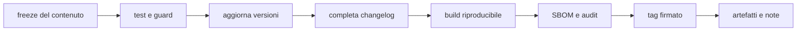

# Versionamento e release

> **Domanda:** quali versioni esistono, chi proteggono e come si prepara un
> rilascio?
> **Fonti autorevoli:** manifest, `ABI_VERSION`, package WIT e `SchemaVersion`.

## Tre promesse

| Versione | Protegge | Fonte |
|---|---|---|
| applicazione e crate | chi compila o installa Fub | `Cargo.toml`, `apps/client/package.json` |
| ABI | plugin già compilati | Rust e `package fub:abi` |
| schema su disco | file che sopravvivono all'app | costanti `SchemaVersion` |

Questi numeri cambiano in momenti diversi.

## Versione dell'applicazione

Il workspace usa una versione comune finché i crate non vengono pubblicati con
cicli indipendenti. Il frontend porta la stessa versione del prodotto.

Prima di `1.0`, una minor può essere incompatibile secondo SemVer, ma una
rottura va comunque dichiarata e motivata.

L'MSRV fa parte della promessa di build. La CI pinna Rust 1.89. Alzarlo è una
decisione deliberata e richiede aggiornamento di manifest, CI e guide.

## Versione ABI

Il contratto corrente è `fub:abi@0.2.0`. La linea `0.2` conserva Grid v1 e
aggiunge soltanto forme additive per le capacità consegnate; le versioni dei
protocolli di superficie restano indipendenti da ABI e formati.

La regola di caricamento:

| Plugin | Host | Esito |
|---|---|---|
| major diversa | qualunque | rifiuto |
| stessa major, minor plugin minore o uguale | più nuovo o uguale | accetto |
| stessa major, minor plugin maggiore | più vecchio | rifiuto |
| versione non valida | qualunque | rifiuto |

La patch non cambia la superficie.

Dopo il freeze, una minor cresce soltanto per aggiunta. Il test confronta il WIT
vivo con gli snapshot in `crates/fub-abi/wit/frozen/`.

Una rottura del contratto non si nasconde aggiornando lo snapshot: richiede la
strategia di compatibilità e, quando necessario, una nuova major.

## Versioni degli schemi

Ogni formato persistente ha una versione propria.

La tabella seguente è l'inventario canonico dei formati persistenti. Il test
[`schemas_on_disk.rs`](../../crates/fub-app/tests/schemas_on_disk.rs) la
confronta in entrambi i versi con le costanti `SchemaVersion`: una riga mancante,
un percorso obsoleto o un numero divergente fanno fallire la CI.

| Schema | Dove | Versione | Contenuto |
|---|---|---:|---|
| registro dei vault | [`crates/fub-host/src/vaults.rs:50`](../../crates/fub-host/src/vaults.rs) | 1 | vault conosciuti dalla macchina |
| organizzazione | [`crates/fub-kernel/src/organization.rs:78`](../../crates/fub-kernel/src/organization.rs) | 1 | albero, icone, spazi e voci appuntate |
| stato di vista | [`crates/fub-kernel/src/viewstate.rs:57`](../../crates/fub-kernel/src/viewstate.rs) | 1 | posizione e stato per esemplare di vista |
| anagrafe | [`crates/fub-kernel/src/entries.rs:147`](../../crates/fub-kernel/src/entries.rs) | 5 | metadati indicizzati delle voci |
| impostazioni | [`crates/fub-kernel/src/settings.rs:102`](../../crates/fub-kernel/src/settings.rs) | 2 | valori per vault e macchina |
| versioning | [`crates/fub-features/src/versioning.rs:402`](../../crates/fub-features/src/versioning.rs) | 1 | snapshot dei file |
| snapshot globale | [`crates/fub-kernel/src/snapshot.rs:27`](../../crates/fub-kernel/src/snapshot.rs) | 1 | manifest autorevole, contenitore e record di recovery |
| indice di ricerca | [`crates/fub-features/src/search.rs:142`](../../crates/fub-features/src/search.rs) | 6 | campi, opzioni e tokenizer dell'indice |
| registro delle mutazioni | [`crates/fub-kernel/src/journal.rs:178`](../../crates/fub-kernel/src/journal.rs) | 1 | mutazioni applicate al vault |
| bozze | [`crates/fub-kernel/src/drafts.rs:110`](../../crates/fub-kernel/src/drafts.rs) | 1 | contenuto non ancora salvato |
| bundle diagnostico | [`crates/fub-kernel/src/maintenance.rs:242`](../../crates/fub-kernel/src/maintenance.rs) | 1 | copia dei fatti raccolti per la diagnostica |
| sidecar del cestino | [`crates/fub-kernel/src/vault.rs:173`](../../crates/fub-kernel/src/vault.rs) | 1 | provenienza di una voce cestinata |

### Derivato

Se il file è ricostruibile:

1. riconosci versione incompatibile;
2. non leggere parzialmente;
3. elimina o isola il derivato;
4. ricostruisci dalla fonte autorevole.

### Autorevole

Se il file contiene dati non ricostruibili:

1. rifiuta una versione futura;
2. migra in una scrittura atomica;
3. conserva il valore precedente in caso di errore;
4. prova upgrade, dati corrotti e interruzione.

Un fallback silenzioso è ammesso soltanto quando la perdita del sidecar non può
perdere il contenuto dell'utente e il comportamento degradato è definito.

## Preparare una release

### Procedura

1. chiudi o sposta fuori dalla release il lavoro incompleto;
2. esegui CI su tutte le piattaforme;
3. verifica WIT e schemi;
4. aggiorna versione del prodotto e lockfile;
5. sposta le voci da `Non rilasciato` alla versione;
6. genera SBOM;
7. spingi il tag `vX.Y.Z`: il workflow costruisce gli artefatti;
8. completa le note della release bozza;
9. verifica installazione e avvio dagli artefatti, poi pubblica la bozza;
10. riapri `Non rilasciato`.

### Coerenza della versione

La versione del prodotto sta in sei posti: `[workspace.package]` di
`Cargo.toml`, le tre configurazioni Tauri (`crates/fub-app/tauri.conf.json`,
`tauri.android.conf.json` e `tauri.ios.conf.json`), `apps/client/package.json`
e il suo lockfile. `node .github/scripts/check-release-version.mjs [vX.Y.Z]` li
confronta fra loro e, se lo riceve, con il tag. La CI lo esegue senza tag; il
workflow di rilascio con il tag che lo ha avviato.

### Artefatti

[`release.yml`](../../.github/workflows/release.yml) parte da un tag `v*`:

1. controlla le versioni e crea la release **bozza**, se non esiste;
2. su Linux (Ubuntu 22.04), Windows e macOS esegue `npm ci` e
   `cargo tauri build --config crates/fub-app/tauri.conf.json`;
3. raccoglie `.deb`, `.rpm`, `.AppImage`, `.dmg`, `.msi` e `-setup.exe`,
   ciascuno con un file `.sha256` accanto;
4. li carica come artefatti della corsa e nella release bozza.

Avviato a mano (`workflow_dispatch`) costruisce gli stessi artefatti senza
toccare le release.

Il mobile ha un workflow suo, [`mobile.yml`](../../.github/workflows/mobile.yml),
che non pubblica niente: su Android genera il progetto
(`cargo tauri android init --ci`), fonde i template nativi con
`crates/fub-app/mobile/install-mobile.sh` e ne verifica la fusione con
`--check`, poi costruisce un APK di debug per aarch64, caricato come artefatto
della corsa. Su iOS compila soltanto `fub-app` per il dispositivo: il progetto
Xcode chiede i target Share e Widget creati a mano e una firma. Non è un
controllo richiesto.

La firma è facoltativa. Il `.dmg` è firmato e notarizzato soltanto se il
repository ha i segreti `APPLE_CERTIFICATE`, `APPLE_CERTIFICATE_PASSWORD`,
`APPLE_SIGNING_IDENTITY`, `APPLE_ID`, `APPLE_PASSWORD` e `APPLE_TEAM_ID`.
Gli installer Windows e Linux non sono firmati, e le note della release lo
dicono.

### Versione visibile e aggiornamenti

La scheda «Informazioni» delle preferenze mostra la versione del binario, la
licenza e il link al codice sorgente.

Il controllo degli aggiornamenti è il comando `updates.check` del bundle
`fub.updates` ([`updates.rs`](../../crates/fub-host/src/updates.rs)), presente
con la feature `http-client` dell'host:

- parte soltanto dal pulsante «Controlla aggiornamenti», mai in sottofondo;
- accoda un job, che chiede a GitHub l'ultima release pubblicata del
  repository e la confronta con `CARGO_PKG_VERSION`;
- il manifest concede la rete al solo `api.github.com`, e il `Guard` chiude ogni
  altro host;
- l'esito è `{current, latest, newer, url}`: `latest` nullo vuol dire nessuna
  release pubblicata, e `url` c'è soltanto se porta alle release del
  repository;
- una risposta che non si usa (altro stato, corpo illeggibile, tag che non è
  una versione) è l'esito `{current, failed, status}`, che la shell dice nella
  lingua di chi guarda; è un errore soltanto la rete che non risponde;
- non scarica e non installa niente.

Come ogni job, il controllo vive in un vault aperto: senza vault la scheda lo
dice. Non c'è un aggiornatore integrato: aggiungerne uno vorrebbe dire una
dipendenza nuova e un canale di firma degli aggiornamenti, due decisioni sulla
supply chain ancora da prendere.

## Changelog

Il changelog parla a utenti e autori di estensioni. Include:

- capacità nuove;
- cambiamenti osservabili;
- deprecazioni;
- migrazioni;
- vulnerabilità corrette;
- cambi ABI e requisiti di sistema.

Non include la cronaca dei refactor o il conteggio dei test.

## Compatibilità del plugin

Un rilascio che aggiunge una capacità host deve:

- aggiungere la forma in coda quando richiesto dal WIT;
- aggiornare la minor ABI;
- lasciare funzionanti i plugin della stessa major più vecchi;
- dichiarare il fallback quando la nuova capacità non è disponibile;
- aggiornare frozen WIT e test secondo la procedura prevista.
