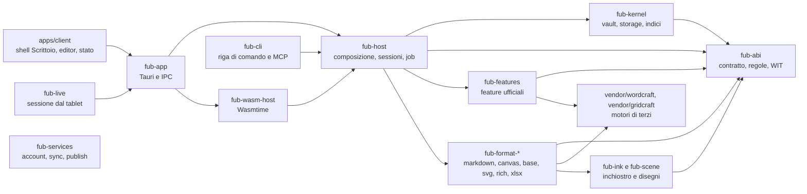
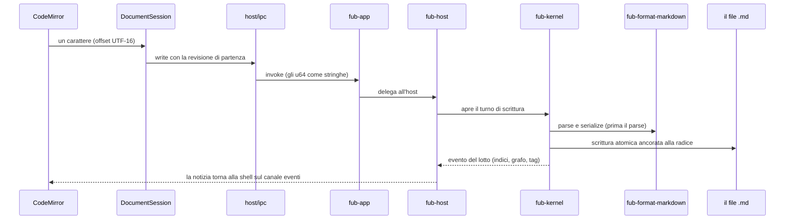

# La mappa del repository

> **Per chi:** chi apre una sessione di lavoro, umano o agente, e deve capire
> in una schermata dove sta ogni cosa e come si prova.
> **Risultato:** scegliere il componente giusto al primo colpo, senza leggere
> prosa.
> **Approfondimenti:** i confini in
> [`components-and-boundaries.md`](../architecture/components-and-boundaries.md),
> il percorso guidato in
> [`repository-tour.md`](../getting-started/repository-tour.md),
> l'inventario completo in `docs-inventario/RIFERIMENTO.md` quando esiste.

## I componenti

Le frecce puntano verso `fub-abi`: è il verso delle dipendenze. I servizi di
supporto alla scrittura (`fub-sdk`, `fub-testkit`, `fub-importers`) stanno
sotto `crates/` con gli altri e non compaiono nel disegno per non superare i
20 nodi: la tabella sotto li copre.

## Le aree, una riga ciascuna

| Area | Percorso | Che cos'è | Come si prova |
|---|---|---|---|
| il contratto | `crates/fub-abi/` | tipi, trait, regole, WIT: l'unica fonte di verità fra core e provider | `cargo test -p fub-abi` |
| il core | `crates/fub-kernel/` | vault, storage a handle, indici, eventi, policy: non sa che formato gira | `cargo test -p fub-kernel` |
| chi monta | `crates/fub-host/` | composition root: sessioni, bundle, job, watcher, impostazioni; niente Tauri | `cargo test -p fub-host` |
| il desktop | `crates/fub-app/` | comandi Tauri sottili, finestre, risorse byte; delega presto all'host | `cargo test -p fub-app` |
| le feature | `crates/fub-features/` | pannelli e comandi ufficiali, una feature Cargo ciascuna | `cargo test -p fub-features --features draw` |
| i formati | `crates/fub-format-*/` | i provider: markdown, canvas, base, svg, rich, xlsx | il test del crate |
| l'inchiostro | `crates/fub-ink/` | campioni, pressione, stabilizzatore, InkML; il gemello caldo sta in `apps/client/src/ink/` | `cargo test -p fub-ink` |
| i disegni | `crates/fub-scene/` | lettura del formato scena e delle annotazioni PDF | `cargo test -p fub-scene` |
| il runtime dei plugin | `crates/fub-wasm-host/` | l'unico crate che nomina Wasmtime | `cargo test -p fub-wasm-host` |
| la riga di comando | `crates/fub-cli/` | automazione senza Tauri e il server MCP | `cargo test -p fub-cli` |
| la sessione live | `crates/fub-live/` | PC host, tablet scrittore, QR e TLS | `cargo test -p fub-live` |
| i servizi | `crates/fub-services/` | backend self-hostable di account, sync e publish | `cargo test -p fub-services` |
| gli autori | `crates/fub-sdk/` | API comode e `MemoryHost` per provare un provider | `cargo test -p fub-sdk` |
| l'integrazione | `crates/fub-testkit/` | banco host/kernel, solo dev-dependency | dentro i test degli altri |
| import ed export | `crates/fub-importers/` | i provider ufficiali di import/export e i comandi di conversione | `cargo test -p fub-importers` |
| il client | `apps/client/src/` | shell Scrittoio, editor, stato, tema, inchiostro caldo | `npm run typecheck && npm test` |
| il seam del client | `apps/client/src/host/` | i tipi del confine, l'unica cucitura Tauri, l'host finto | `npx vitest run src/host` |
| l'estensione | `apps/clipper/` | il clipper del browser (MV3, Firefox, Safari) | `node apps/clipper/smoke-headless.mjs` |
| i motori | `vendor/` | WordCraft e GridCraft copiati, patch numerate, `UPSTREAM.md` | `node tools/vendor-craft/vendor.mjs check` |
| le prove dei motori | `tools/motori-prova/` | le misure di K0: peso, RAM, tempi, librerie doppie | `node tools/motori-prova/misura.mjs --out DIR` |
| i componenti WASM | `esempi/` | un esempio per cosa da dimostrare, fuori dal workspace | li compila il test di `fub-wasm-host` |
| la CI | `.github/` | workflow e i guard Node dell'elenco `ci-required` | `node .github/scripts/<guard>.mjs` |
| i dati di prova | `tests/fixtures/`, `apps/client/src/__fixtures__/` | vault e fixture; i generati si rigenerano con `UPDATE_MIRROR=1` | il test che li usa |

## Il client in una tabella

| Pacchetto | Percorso | Risponde di |
|---|---|---|
| il seam | `src/host/` | la porta verso l'host: `contract.ts`, `ipc.ts`, `fake.ts` |
| lo stato | `src/state/` | sessione documento, riquadri, salvataggio, bozze, layout |
| i pannelli | `src/panels/` | explorer, ricerca, grafo, impostazioni, menu «/» |
| la shell | `src/ui/` | registro comandi, palette, menu, `UiNode`, sanificatore |
| le primitive | `src/kit/` | pulsanti, campi, popover, barra multifunzione |
| il moto | `src/moto/` | molle, FLIP, gesti, i tre livelli di movimento |
| il tema | `src/theme/` | la serie `theme-2`: foglio, pelle, anatomia, contrasti |
| gli editor | `src/editors/` | testo (CodeMirror), ricco (ProseMirror), fogli, media, lavagna, disegni |
| l'inchiostro caldo | `src/ink/` | la copia TypeScript di `fub-ink`, tenuta uguale da una fixture |
| il grafo | `src/graph/` | il motore fisico e il pittore della Graph View |
| le regole | `src/rules/` | le regole di ricerca e sintassi lato shell, gemelle di Rust |
| le tabelle | `src/tabella/` | le tabelle Markdown come griglie |
| la finestra | `src/shells/scrittoio/` | cornice, lanciatore, fogli, preferenze |
| il banco | `bench/` | le scene, l'host finto, i banchi visuali e funzionali |

## Una battuta, dal tasto al disco e ritorno

Tre invarianti del giro: una sola `DocumentSession` per documento; la
sessione è distinta dalla superficie (il buffer è condiviso, cursore e
cronologia locale appartengono alla superficie); il kernel non riscrive mai
un file esistente tramite `serialize`, e la scrittura è atomica rispetto al
parse (`crates/fub-kernel/tests/write_atomicity.rs`).

## I motori di terzi

| Motore | Dove | Chi lo usa |
|---|---|---|
| WordCraft v0.10.0 | `vendor/wordcraft/` (6 crate) | `fub-format-rich` e il correttore di `fub-features` |
| GridCraft v0.11.1 | `vendor/gridcraft/` (10 crate) | `fub-format-xlsx` |
| VectorCraft | `tools/motori-prova/vettori/` | le prove; entra con K5 |
| PhotoCraft, LightCraft | `tools/motori-prova/foto/`, `luce/` | le prove; entrano con K7 e K8 |
| PdfCraft | `tools/motori-prova/pdf/` | le prove; il client usa pdf.js (`editors/media/pdf-view.ts`) |

Le copie in `vendor/` sono derivati: upstream a un commit preciso più le
patch numerate di `patches/`, con `upstream.lock` che ne conserva le impronte.
L'interfaccia (`ui-egui`) e il server MCP dei due motori non sono copiati.

## I sette confini che valgono sempre

| Confine | Presidio |
|---|---|
| nessun crate tranne `fub-app` conosce Tauri | `crates/fub-abi/tests/dependency_invariant.rs` |
| solo `fub-wasm-host` nomina Wasmtime | come sopra, e la radice `Cargo.toml` |
| il kernel non sa che il markdown esiste | come sopra |
| nella shell, solo `host/ipc.ts` e `host/dialog.ts` importano Tauri | `apps/client/src/host/no-tauri-outside-host.test.ts` |
| CodeMirror resta in `editors/text/`, ProseMirror in `scrittura/` | `check-codemirror-boundary.mjs`, `check-prosemirror-boundary.mjs` |
| i motori si nominano solo dai loro adattatori | `check-engine-boundary.mjs` |
| `fub-app` non porta l'interfaccia di un'app Craft, e le librerie in due versioni non crescono | `check-motori.mjs`, tetto in `docs/reference/budgets.json` |
