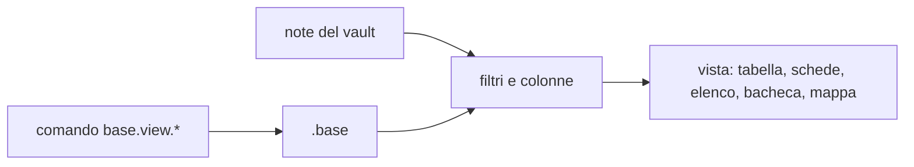

# Basi (file `.base`)

Una Base è un file `.base` che mostra le note del vault come tabella, schede,
elenco, bacheca o mappa. Il file è testo YAML che si legge e si scrive a mano:
Fub lo cambia solo nelle righe che un comando tocca, e lascia il resto com'è.



Le proprietà delle note restano nelle note. Il file `.base` dice soltanto quali
note vedere e come mostrarle.

## Che cosa contiene un file

| Chiave | A che serve |
|---|---|
| `version` | la versione del formato: esiste solo la `1`. Un numero diverso non si legge |
| `filters` | il filtro del file intero, che vale per tutte le viste |
| `formulas` | formule con nome, da usare nelle colonne e nei filtri |
| `properties` | nomi da mostrare per le proprietà (`key`, `display_name`) |
| `views` | la lista delle viste, una per voce |

Le chiavi che Fub non conosce restano nel file e non vengono interpretate.

## Le viste

Ogni voce di `views` ha una chiave `name` (obbligatoria, unica nel file) e una
chiave `type`, che è una fra `table`, `cards`, `list`, `kanban` e `map`. Le
altre chiavi sono facoltative:

| Chiave | A che serve |
|---|---|
| `order` | le colonne da mostrare, in ordine |
| `filters` | il filtro di questa vista, che si somma a quello del file |
| `sort` | l'ordinamento: una lista di `key` con `descending` |
| `group` | il raggruppamento, con una `key` |
| `summaries` | i riepiloghi (conteggio, somma, media, minimo, massimo…) |
| `limit` | quante righe al massimo, da 1 a 10000 |
| `search` | un testo da cercare fra i valori delle righe |
| `map` | le coordinate e il fornitore dei tasselli, per la vista mappa |

## Filtri

Un filtro è `all` (nessun filtro), oppure un albero con `and`, `or` o `not`,
oppure una condizione. Una condizione dice su che cosa agisce (`property`,
`file`, `formula` o `tag`), con quale operatore (`op`) e con quale valore
(`value`).

| Operatore | Vero quando |
|---|---|
| `is`, `is_not` | il valore è uguale, o non è uguale |
| `contains`, `not_contains` | il testo o la lista contengono il valore, o non lo contengono |
| `greater_than`, `less_than` (e le versioni con `_or_equal`) | il confronto fra numeri, date o testi regge |
| `is_empty`, `is_not_empty` | la proprietà è vuota, o non lo è |
| `in_folder` | la nota sta in quella cartella o in una sua sottocartella |
| `has_tag` | la nota ha quel tag |

Un filtro scritto come testo libero, che il modello non legge, rende il file
illeggibile come Base: la Base lo mostra come sorgente e non lo tocca.

## Limiti

Il modello ha dei limiti fissi. Oltre, il file non si legge come Base.

| Cosa | Limite |
|---|---|
| il file intero | 1 MiB |
| le viste | 64 |
| le colonne di una vista | 128 |
| le formule | 256 |
| il filtro del file, e quello di una vista | 64 KiB |
| una vista | 64 KiB |
| i riepiloghi di una vista | 32 |
| la lunghezza di una formula | 8 KiB |

## Come si scrive il file

I comandi cambiano una chiave di una vista, aggiungono una vista o ne tolgono
una. Sono comandi del registro dei comandi di Fub, come gli altri.

| Comando | Che cosa fa | Parametri |
|---|---|---|
| `base.view.set` | scrive una chiave di una vista; senza `value`, o con `null`, la toglie | `doc`, `view`, `key`, `value` (JSON), `base` |
| `base.view.add` | aggiunge in fondo la vista con nome e tipo; `type` è `table` se manca | `doc`, `name`, `type`, `base` |
| `base.view.remove` | toglie una vista con tutte le sue chiavi | `doc`, `view`, `base` |

Il campo `base` è facoltativo: se c'è, il comando scrive solo se il file è
ancora quello della revisione detta. Altrimenti risponde con un conflitto e
non scrive niente. Il valore di `value` è JSON: una stringa va fra virgolette
(`"\"table\""`), un numero no (`5`).

Con l'anteprima (`dry run`) il comando dice che cosa scriverebbe, e non scrive.
Ogni scrittura si annulla in un passo, e l'annulla riporta i byte di prima.

### Che cosa resta com'era

Il comando cambia solo le righe della chiave o della vista che tocca. Il resto
del file resta byte per byte:

- i commenti, anche quelli fra due viste o sulla riga di una chiave;
- l'ordine delle chiavi che non si toccano;
- le virgolette, i rientri e le righe vuote;
- le fini di riga (`\n` o `\r\n`) e l'assenza dell'a capo in fondo al file;
- le chiavi che Fub non conosce.

Una chiave nuova va al suo posto, prima della prima chiave che la segue nella
lista delle chiavi (`name`, `type`, `order`, `filters`, `sort`, `group`,
`summaries`, `limit`, `search`, `map`). Un commento scritto subito sopra quella
chiave resta sopra di lei.

Togliere una vista lascia i commenti che stanno fra le viste. Togliere l'ultima
vista scrive `views: []`, e il commento della riga `views` resta.

Se un file non ha ancora la chiave `views`, aggiungere una vista la crea in
fondo al file.

## Quando il file non si tocca

La scrittura si ferma, e il comando dice il motivo, quando:

- il file non si legge come Base (YAML rotto, versione diversa da `1`, una
  vista senza `name`, un file vuoto);
- una chiave o una vista è scritta in YAML di flusso, come `order: [a, b]`, e
  il comando la vuole cambiare: si cambia dal sorgente;
- il file usa ancore (`&nome`), alias (`*nome`) o etichette (`!tag`), che
  spostare potrebbe rompere;
- ci sono tabulazioni nell'indentazione, o più documenti nello stesso file;
- il nome della vista non c'è, o c'è già;
- la chiave obbligatoria (`name` o `type`) si vuole togliere;
- il valore non ha la forma giusta per la chiave, o supera un limite;
- la revisione detta non è più quella del file.

In tutti questi casi il file resta com'era: la toppa controlla prima di
scrivere che il testo nuovo si rilegga come Base valida e che il suo albero sia
quello atteso, con la sola modifica chiesta.

## Dove si vede una Base

Una Base si mette in una nota con un blocco di codice ```` ```base ```` oppure con
un collegamento `![[Nome.base#Vista]]`. Con il `#` si vede la vista nominata;
senza, la prima vista del file.

## Vedi anche

- [Editor e anteprima](editor-and-preview.md): dove una Base appare nella nota.
- [Tasto destro, mini-barra e «/»](editor-menus.md): i menu della Base.
- [Modello del documento](../architecture/document-model.md): come il formato
  espone le viste di un `.base`.
