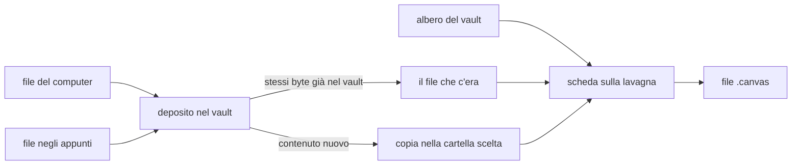

# La lavagna

> **Per chi:** chi mette in fila idee, note, fogli, PDF e immagini su una
> lavagna del vault, e chi deve sapere che cosa la lavagna fa prima di
> cambiarla.
> **Risultato:** sapere che cosa mostra ogni scheda, come ci si entra e ci si
> scrive, come si porta dentro un file e dove finisce, e che cosa la lavagna
> non fa ancora.
> **Fonte autorevole:** il codice in `apps/client/src/editors/canvas/` e le sue
> prove; i dettagli stanno nei riferimenti `canvas-*` linkati in ogni sezione.

Una lavagna è un file `.canvas` del vault, nel formato JSON Canvas: lo stesso
file che apre Obsidian. Si apre nella modalità **Lavagna**, la tela con le
schede; la modalità **Sorgente** mostra il JSON. «Nuova lavagna»
(`canvas.create`) fa nascere una lavagna vuota, «Lavagna» o il primo nome
libero, e la apre; anche una nota creata col nome `Idee.canvas` è una
lavagna ([Operazioni sul vault](vault-operazioni.md)). Le regole di lettura e
scrittura del file stanno nel [formato della lavagna](../reference/canvas-format.md).

Sulla lavagna stanno quattro cose: le **schede** (un testo, un file, una
pagina web), i **gruppi** che le raccolgono, i **fili** che le collegano e
l'**inchiostro** scritto a mano. Ciò che la lavagna aggiunge al formato
(l'inchiostro, gli estratti) sta in campi `fub:` che Obsidian conserva senza
mostrarli.

Il percorso di un file, da dove arriva fino alla scheda:

Un file del vault diventa una scheda senza copie; un file che arriva da fuori
passa dal deposito, che non copia due volte lo stesso contenuto. Nel `.canvas`
la scheda tiene solo il percorso: il file resta quello vero.

## Che cosa mostra una scheda

La specie della scheda viene dall'estensione del file
([le specie](../reference/canvas-cards.md#le-specie)):

| Specie | Che cosa si vede |
|---|---|
| testo | il Markdown scritto nella scheda, che sta nel `.canvas` |
| nota (`.md`) | la nota resa come nell'anteprima, con i link; si scrive dentro |
| documento (`.docx`, `.odt`, `.rtf`…) | il documento reso, in sola lettura |
| foglio (`.xlsx`, `.xlsm`…) | le celle del foglio attivo con le intestazioni; si scorre, si sceglie un rettangolo e si copia, si scrive dentro |
| PDF | una pagina alla volta, intera, con «3 / 24» e ‹ › ai lati; PgSu e PgGiù voltano pagina |
| immagine | l'immagine intera con le sue proporzioni, anche SVG; il doppio clic apre il visore; oltre 64 MiB dice che è troppo grande |
| file Craft (`.vectorcraft`, `.figcraft`, `.pcraft`) | l'anteprima, con «Apri» e «Apri con…» ([la scheda dei file Craft](../reference/canvas-craft.md)) |
| pagina web | l'indirizzo e il dominio; titolo, descrizione e icona solo dopo «Mostra l'anteprima» |
| altro file (CSV, audio, video, ZIP…) | il percorso, che si apre con un clic |
| gruppo | l'etichetta e lo sfondo, sotto le schede che contiene |

La scheda di una pagina web non va mai in rete da sé: ogni richiesta è un
clic su «Mostra l'anteprima». Un renderer legge e basta: sfogliare un PDF o
scorrere un foglio non cambia il file né il `.canvas`.

Il titolo di una scheda di file sta sopra il suo rettangolo, come in
Obsidian. Accanto al titolo due numeri
([le citazioni e le copie](../reference/canvas-view.md#le-citazioni-e-le-copie)):

- **«↩ N»**: quante note citano il file, dall'indice del vault;
- **«×N»**: quante schede di questa lavagna mostrano lo stesso file. È un
  pulsante: al passaggio, o col fuoco, tutte le copie si illuminano, anche
  fuori dalla vista, e la banda di stato le conta; un clic sulla voce della
  banda le inquadra.

Quando un file non c'è più, la scheda dice «File mancante» con **Ritrova…**
(sceglie un altro file del vault, gli omonimi per primi) e **Togli dalla
lavagna**. Se il file torna, la scheda si rimonta da sola
([il file che manca](../reference/canvas-cards.md#il-file-che-manca)).

### Da vicino e da lontano

Le schede in vista, o vicine, sono **vive**: hanno il file aperto e ci si può
entrare. Le altre sono **ferme**: mostrano l'ultima immagine, senza risorse
aperte. Sotto il 35% di zoom nessuna scheda è viva, e al più 40 lo sono
insieme ([quali schede sono vive](../reference/canvas-cards.md#quali-schede-sono-vive)).
Il cambio avviene solo a fine gesto, mai mentre la vista si muove.

Da lontano la lavagna si legge ancora: dal 15% al 35% una scheda vista da
vicino mostra la sua immagine ferma, le altre il titolo grande; sotto il 15%
ogni scheda è un blocco del suo colore col titolo
([da lontano](../reference/canvas-view.md#da-lontano)).

## Entrare e uscire

Una scheda **scelta** si guarda; una scheda **attiva** si usa: il suo
contenuto prende il puntatore, i tasti e la rotella. Una sola è attiva alla
volta ([entrare e uscire](../reference/canvas-input.md#entrare-e-uscire)).

- **Scegliere:** un clic. Il clic su un link di una scheda non attiva sceglie
  la scheda e non segue il link; Ctrl+clic (Cmd+clic su macOS) lo segue
  subito. Maiuscolo o Ctrl+clic fuori da un link aggiungono alla scelta.
- **Entrare:** un clic sulla scheda già scelta, Invio, o il doppio clic su
  una nota, un documento o un foglio. La scheda attiva ha il bordo d'accento
  e «Esc per uscire» nella testata.
- **Dentro:** i clic arrivano al contenuto, la rotella lo scorre, i tasti sono
  suoi. Ctrl+rotella e il pizzico ingrandiscono sempre la lavagna.
- **Seguire un link:** un link a un file che ha una scheda su questa lavagna
  porta la vista lì e la scheda lampeggia; Alt+← torna indietro. Senza scheda
  qui, il file si apre accanto.
- **Uscire:** Esc, un clic fuori, o la scheda che esce dalla vista a fine
  gesto. Con Esc la scheda resta scelta.

Una scheda di file che non si mostra (il file manca, non si legge, è troppo
grande) non apre il campo del percorso: Invio e il doppio clic chiedono il file
come «Ritrova…», o lo aprono come «Apri».

## Scrivere dentro una scheda

Si scrive con l'editor vero del file, sulla stessa sessione di un riquadro:
stesse bozze, stessi conflitti, stesso salvataggio. Ciò che si scrive in una
scheda si vede nei riquadri dello stesso file, e viceversa, senza rileggere il
disco ([scrivere dentro una scheda](../reference/canvas-cards.md#scrivere-dentro-una-scheda)).

- **Una scheda di testo** si scrive col doppio clic, o con Invio, nel Live
  delle note. Il testo resta nel `.canvas`. La scheda cresce col testo fino a
  480 px di larghezza, poi va a capo; Ctrl+Invio apre una scheda nuova sotto,
  Ctrl+Maiusc+Invio a destra con un filo. Una scheda nuova lasciata vuota se
  ne va uscendo ([la scheda di testo](../reference/canvas-input.md#scrivere-in-una-scheda-di-testo)).
- **Una nota** si scrive col doppio clic o con Invio: l'editor Live prende il
  posto della resa, la barra di formato va nella riga delle opzioni e la
  riga del titolo dice «Salvato», «Non salvato», «Cambiato su disco»… come la
  testata di un riquadro. Ctrl+Z annulla solo ciò che si è scritto in quella
  scheda. Uscendo l'editor salva
  ([scrivere in una scheda di nota](../reference/canvas-input.md#scrivere-in-una-scheda-di-nota)).
- **Un foglio** si scrive col doppio clic su una cella, o con Invio: la griglia
  vera, compatta, senza nastro né linguette. Si scrivono valori e formule del
  foglio attivo; righe, colonne, unioni e formati restano dell'editor intero.
  La cella e la sua formula si leggono nella riga delle opzioni; il primo Esc
  chiude la cella, il secondo esce
  ([scrivere in una scheda di foglio](../reference/canvas-cards.md#scrivere-in-una-scheda-di-foglio)).
- **Un documento di Word o ODT** e **un estratto di nota** si leggono e basta.

Ciò che una scheda non fa si fa nell'editor del file aperto accanto, allo
stesso punto: «Apri a lato su B3», «Apri a lato alla pagina 3», «Apri a lato su
«Scopo»» ([apri a lato per questo](../reference/canvas-view.md#apri-a-lato-per-questo)).

## Portare dentro

- **Dall'albero:** si trascinano i file del vault. Nasce una scheda per
  file, senza copie.
- **Dal computer:** si trascinano file sulla lavagna, o «Aggiungi file…»
  della lavagna vuota. I file passano dal deposito (sotto).
- **Dagli appunti:** Ctrl+V incolla schede copiate da una lavagna di Fub, file,
  immagini o testo. Le celle copiate da un foglio diventano una scheda di
  testo con una tabella Markdown.
- **Dalla lavagna vuota:** «Scrivi una scheda», «Aggiungi file…», «Incolla».

Mentre si trascina, rettangoli tratteggiati mostrano dove nasceranno le
schede. Le schede nascono in griglia dal punto del rilascio, in ordine di
nome, ognuna con la misura della sua specie (un foglio 480×300, un'immagine
con le sue proporzioni, un PDF con quelle della prima pagina). Oltre dodici
file un gruppo le raccoglie. Tutto il gesto è un commit, che un solo Ctrl+Z
toglie ([il rilascio e l'incolla](../reference/canvas-cards.md#il-rilascio-e-lincolla)).
Lasciato su una scheda di file, il primo file ne prende il posto.

«Spargi le pagine…», nel menu di una scheda PDF, mette sulla lavagna una
scheda per pagina (`#page=N`), anche solo «3-7, 9», in righe di dieci.

## Dove vanno i file, e quando un file c'è già

Un file che arriva dal computer o dagli appunti si copia nel vault dove dice
«Dove vanno i file trascinati» (`canvas.drop_folder`, Impostazioni ›
Lavagna):

- **Con le note**, di serie: la cartella degli allegati delle note
  (`files.attachment-folder`);
- **Con la lavagna:** una cartella accanto alla lavagna;
- **In una cartella:** sempre la stessa cartella del vault.

La prima copia lo dice con una notifica e «Cambia cartella»; la banda di stato
mostra la cartella, e un clic apre l'impostazione. Se la cartella è esclusa
dalla ricerca, la notifica lo dice a ogni copia.

Un file **c'è già** quando il vault ha un file con gli stessi byte, anche con
un altro nome. Allora non si copia: la scheda punta al file che c'era, e la
notifica «Già nel vault come…» offre «Fanne una copia». L'impronta del
contenuto sceglie i candidati, ma decidono i byte, confrontati uno per uno;
oltre i limiti della domanda, o nel dubbio, si copia. Lo decide il kernel
(`crates/fub-kernel/src/same_content.rs`), non la lavagna.

## L'impianto

- **La colonna degli strumenti**, a sinistra: Selezione (col Lazo), Mano,
  Penna (con l'Evidenziatore), Gomma, Testo, Collega, e in fondo «Righello» e
  «Il dito scrive». Con la finestra fino a 700 px va sotto la lavagna
  ([la colonna](../reference/canvas-input.md#la-colonna-degli-strumenti)).
- **La riga delle opzioni**, in alto: il menu della penna, il colore e la
  misura del testo delle schede scelte, le punte del filo, la Vista; mentre
  si scrive in una scheda, la barra di chi scrive
  ([la riga delle opzioni](../reference/canvas-input.md#la-riga-delle-opzioni)).
- **La barra della selezione**, sopra le schede scelte a fine gesto: Colore,
  Collega…, Raggruppa, «Allinea e distribuisci», Apri, Togli dalla lavagna.
- **Il navigatore**, in basso a destra: la mappa della lavagna col riquadro di
  ciò che si vede. Un clic ci vola, il trascinamento sposta la vista; sparisce
  quando tutta la lavagna sta già in vista
  ([il navigatore](../reference/canvas-view.md#il-navigatore)).
- **L'ispettore** dello Scrittoio: «Schede» in ordine di lettura col filtro,
  «Scheda» con posizione, misura, colore e i campi grezzi, «Fili», e «Fonti»,
  i file della lavagna con le pagine o le sezioni mostrate
  ([l'ispettore](../reference/canvas-inspector.md)).
- **La ricerca**: Ctrl+F apre «Cerca nella lavagna», nel testo delle schede,
  nei nomi dei file, nelle etichette e nel contenuto delle note della lavagna;
  ciò che non c'entra si vela, Invio va al risultato dopo
  ([cercare](../reference/canvas-view.md#cercare)).
- **La banda di stato**: lo zoom col suo menu, le schede scelte, le copie, la
  sola lettura, la cartella dei file trascinati.
- **Completo e Semplice** (`canvas.workspace`): Semplice, di serie solo sui
  dispositivi che hanno soltanto il tocco, ha sei strumenti in caselle da
  44 px, senza tendine, e il navigatore chiuso. Ctrl+. toglie tutta
  l'interfaccia e la riporta, in tutti e due
  ([lo spazio di lavoro](../reference/canvas-view.md#lo-spazio-di-lavoro)).

Il tasto destro su una scheda apre il suo menu: Apri, Apri a lato, Parti…,
Colore, Disponi, Duplica, «Estrai in una nota…», «Copia il testo qui»,
«Sostituisci il file…», e in rosso Togli dalla lavagna e «Sposta anche il file
nel cestino» ([il menu della scheda](../reference/canvas-input.md#il-menu-della-scheda),
[convertire](../reference/canvas-convert.md)). Togliere una scheda non tocca
mai il file, e lo dice: «Tolta dalla lavagna. Il file resta.», con «Annulla».

Muoversi: la rotella sposta la lavagna (o la ingrandisce, con «La rotella del
mouse»), Spazio tenuto trascina, il trascinamento nel vuoto sceglie col
rettangolo (o sposta, con «Trascinare nel vuoto»). Lo zoom va dal 5% al 400%.
Riaprendo una lavagna tornano la vista, la scelta e la pagina di ogni PDF,
ricordate su questo computer senza scrivere nel file
([la vista della lavagna](../reference/canvas-view.md)). Con la penna il
tasto laterale apre il menu radiale; col dito, il tocco lungo.

## L'inchiostro

Penna ed Evidenziatore scrivono sulla lavagna con la penna, col dito se
«Il dito scrive» è acceso, o col mouse con «Scrivi col mouse» (o `D` tenuto).
Mentre si scrive, una cornice e un'etichetta dicono a che cosa il tratto si
attaccherà: «Si attacca a {nome}» o «Libero sulla lavagna»; con Alt resta
libero. Un tratto attaccato segue la scheda quando si sposta o si
ridimensiona; su un PDF segue la pagina, su un foglio la cella. Una penna
tenuta ferma alla fine diventa una forma, Maiusc tira dritto, il righello
guida il tratto, il Lazo sceglie e sposta schede e tratti insieme.

L'inchiostro sta nel `.canvas`, nei campi `fub:ink`: Obsidian non lo disegna
ma lo conserva quando riscrive il file. Il formato sta
nell'[inchiostro della lavagna](../reference/canvas-ink.md), il funzionamento
nell'[inchiostro sulla lavagna](../architecture/ink-on-canvas.md).

## Gli estratti

Un estratto è una finestra sul file vero, non una copia: se il file cambia,
l'estratto lo segue ([gli estratti](../reference/canvas-parts.md)).

- **Le sezioni di una nota:** portando dall'albero una nota sola con almeno
  due titoli si apre «Parti di {nota}», per tenerne solo alcune (Alt la porta
  intera; l'impostazione «Scegli le parti di una nota» lo spegne). «Parti…»
  lo riapre. La testata mostra le sezioni («§ Varianza · § Media») e ↗ apre
  la nota accanto. Una sezione sparita lascia le altre e un avviso con
  «Scegli di nuovo…».
- **Il ritaglio di un'immagine:** «Ritaglia e ruota» prende una zona e la gira
  di un quarto di giro; il file dell'immagine non cambia.
- **Il lettore:** Spazio toccato con una scheda di nota scelta apre la nota
  grande, con le sezioni dell'estratto segnate; «+ Aggiungi all'estratto»
  mette la sezione che si legge.
- **«Mostra tutto il file»** torna al file intero.

Obsidian vede la prima parte di un estratto: il `subpath` la dice.

## Sola lettura

Una lavagna non si cambia quando il pannello è in sola lettura o il file ha
una chiave doppia: la banda lo dice, le voci che scrivono sono spente col
perché, e ci si muove, si sceglie, si entra e si copia come sempre. La sola
lettura della lavagna non tocca le note: una nota che si scrive resta
scrivibile nella sua scheda, perché è un altro file con la sua sessione.

## Che cosa non fa ancora

- **Gli estratti di PDF.** Una scheda PDF mostra una pagina intera alla
  volta, con pdf.js. Scegliere pagine, blocchi o zone di un PDF, la scheda con
  più pagine, il lettore dei PDF, il gesto dal visore alla lavagna e
  l'inchiostro sugli estratti di PDF aspettano il motore dei PDF
  ([stato del progetto](../project/status.md#lordine-di-lavoro), P1 e P4). Un
  `fub:parts` di pagine scritto da un'altra versione si conserva, e la scheda
  mostra la pagina del `subpath`; in «Fonti» un pezzo grigio di un PDF sceglie
  la scheda senza aprire un selettore.
- **I CSV** sono schede di file finché il motore dei fogli non li legge.
- **La scheda di foglio** mostra le celle: grafici e immagini del foglio, e le
  modifiche di struttura, stanno nell'editor intero («Apri a lato»).
- **Gli estratti di nota e i documenti di Word e ODT** non si scrivono nella
  scheda: si aprono a lato.
- **I fili** sono curve che escono in orizzontale e non girano attorno ai
  lati delle schede; la penna non collega.
- **I tasti della lavagna** non si cambiano.

## Le scorciatoie

Tutte le azioni sono comandi del catalogo: Ctrl+/ li cerca per nome, coi
cinque usati da poco in cima. I tasti senza Ctrl né Alt non valgono mentre si
scrive. L'elenco completo sta in [comandi e tasti](../reference/canvas-input.md#comandi-e-tasti).

| Azione | Tasti |
|---|---|
| Selezione, Lazo, Mano | `V`, `Q`, `H` |
| Penna, Evidenziatore, Gomma | `P`, `Maiusc+P`, `E` |
| Testo, Collega | `T`, `C` |
| cerca un comando | `Ctrl+/` |
| cerca nella lavagna | `Ctrl+F` |
| annulla, ripeti | `Ctrl+Z`; `Ctrl+Maiusc+Z`, `Ctrl+Y` |
| scegli tutto, duplica, raggruppa | `Ctrl+A`, `Ctrl+D`, `Ctrl+G` |
| entra o scrivi, esci | `Invio`, `Esc` |
| togli dalla lavagna | `Canc`, `Backspace` |
| sposta di 8, 32, 1 | frecce, `Maiusc`+frecce, `Alt+Maiusc`+frecce |
| porta davanti, porta dietro | `Ctrl+]`, `Ctrl+[` |
| mostra tutto, la selezione | `Maiusc+1` o `Ctrl+0`, `Maiusc+2` |
| ingrandisci, riduci, 100% | `+` o `Ctrl+=`, `-` o `Ctrl+-`, `0` |
| griglia, interfaccia | `Ctrl+'`, `Ctrl+.` |
| indietro, avanti fra i salti | `Alt+←`, `Alt+→` |
| scheda dopo, prima; la più vicina | `Tab`, `Maiusc+Tab`; `Alt`+frecce |
| il lettore di una nota | `Spazio` toccato |
| la penna da ogni strumento | `D` tenuto |

Sulla tastiera italiana `Ctrl+[` si preme con `Ctrl+è`; Porta davanti si fa
dal menu o da `Ctrl+/`. Da tastiera e col lettore di schermo: F6 passa fra la
lavagna, il navigatore, la colonna e la riga; Maiusc+F10 apre il menu della
scheda ([da tastiera](../reference/canvas-view.md#da-tastiera-e-col-lettore-di-schermo)).

## Per chi cambia la lavagna

- il contratto dei renderer e le schede vive: [le schede della lavagna](../reference/canvas-cards.md);
- le toppe e i comandi `canvas.apply` e `canvas.create`, che usano anche la
  palette e il [server MCP](../reference/mcp-server.md):
  [le operazioni sulla lavagna](../reference/canvas-operations.md);
- la prova a mano prima di un rilascio: [la prova manuale della lavagna](../development/canvas-smoke-test.md).
