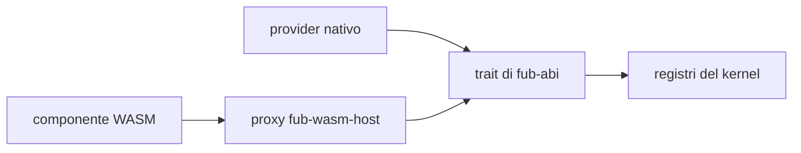

# Plugin ed estensioni

> **Per chi:** chi vuole capire come Fub cresce senza modificare il kernel.
> **Risultato:** distinguere feature ufficiali, provider nativi e componenti WASM.

## Tre livelli

### Feature ufficiali

Vivono in `fub-features` e sono abilitate da feature Cargo indipendenti. Sono
codice fidato distribuito con l'app, ma entrano attraverso gli stessi trait e
registri usati dalle estensioni.

### Provider nativi

Sono oggetti Rust montati dall'host. Hanno accesso soltanto ai servizi forniti
dal contratto, ma condividono il processo e il livello di fiducia del binario.

### Componenti WASM

Sono componenti `wasm32-wasip2` caricati da `fub-wasm-host`. L'adattatore
implementa i trait Rust e reinoltra le chiamate attraverso il component model.

Il kernel riceve il trait, non un enum `Native | Wasm`.

## Cosa può registrare un bundle

Il contratto comprende famiglie per:

- formato;
- comando;
- view;
- indice;
- eventi;
- import ed export;
- sintassi e renderer;
- servizi.

Un bundle dichiara manifest, versione ABI, fiducia, permessi e registrazioni.
L'host possiede mount, attivazione, disattivazione e smontaggio.

## La pagina «Componenti»

Nelle impostazioni, la scheda «Componenti» si apre sulla pagina che dice che
cosa è acceso e perché. In alto i profili (un clic: «Solo note», «Studio»,
«Tutto»…; un profilo che spegne qualcosa lo dice prima, coi nomi; uno «più
avanti» resta grigio e dice perché, al passaggio e al fuoco; una scelta a mano
lo fa diventare «personalizzato»), poi i componenti per gruppo, con la
ricerca. Ogni riga ha l'interruttore e, se serve, «Serve a …» o «Non serve
più»; il nucleo è «sempre acceso». Il gruppo «Di supporto» sta chiuso dietro
«Mostra»: si aggiunge e si toglie da sé.

Accendere un componente accende anche ciò che gli serve, e la pagina lo dice
(«Attivati anche …»). Spegnere ciò che serve ad altri chiede prima, con
l'elenco di chi si spegne insieme. Chi resta senza nessuno che lo usi compare
in un avviso, «Togli» o «Tienili», finché non si risponde. La regola è
dell'host (`components_map`, `components_apply`): la pagina chiede una prova e
applica; la mappa la legge lo stato dei componenti di tutta l'app
(`state/components.ts`), una volta per evento, anche quando la scelta arriva
dalla CLI o da MCP. I permessi dei componenti inclusi restano sotto, in
«Permessi dei componenti inclusi».

Accanto all'elenco (sopra, con la finestra stretta) il riquadro «Fub con questi
componenti» dice che cosa cambia prima di uscire dalla pagina: le voci del menu
«Nuovo» (le stesse dell'esploratore: «Nota», e «Disegno» se i disegni sono
accesi), che cosa si apre dentro Fub (le estensioni di ogni editor che si può
spegnere, con il componente che le apre o «solo come file») e che cosa pesa
(i componenti attivi, quanti di supporto, quanti spenti: Fub non li avvia e
non ne carica il codice; un editor acceso carica il suo codice solo quando si
apre un suo file).

## Il profilo di un vault nuovo

«Crea un vault nuovo…» su una cartella senza file visibili e senza chiavi
`components.*` apre il vault dietro il benvenuto e chiede, in una schermata
sola, «Come userai questo vault?». Ci sono i sei profili della stessa riga
della pagina «Componenti» (tre «più avanti», grigi e col perché), «Studio» già
scelto e «Continua» come tasto principale; sotto, «Si cambia quando vuoi, da
Impostazioni › Componenti». Scegliere un profilo non applica niente: applica
«Continua», ed Esc vale «Studio». Poi il vault si mostra coi suoi componenti;
se il profilo spegne la lavagna, la schermata aspetta che il vault si rimonti.

Un errore nell'applicare, o un rifiuto dell'host, si dice con le parole della
shell e il vault si apre come prima, senza profilo. «Apri vault…», o «Crea» su
una cartella che ha già dei file, non chiede niente. Se l'app si chiude con la
schermata aperta, il vault resta senza `components.*` e vale come un vault di
prima dei componenti: tutto acceso.

## Permessi

I permessi sono capability con namespace e, quando serve, parametri. Il kernel
applica la policy tramite un solo `Guard`.

Un componente WASM non riceve filesystem o rete direttamente. Le host function
inoltrano a un `HostApi` già protetto. Le famiglie non linkate rendono
impossibile il mount e vengono nominate nell'errore.

## Stato del runtime WASM

In `main` sono consegnati:

- caricamento e istanziazione di un componente;
- manifest e lifecycle `Plugin`;
- `CommandProvider`, `FormatProvider`, `ViewProvider` e `GridBytesProvider`
  nei casi esercitati;
- `IndexProvider` ed `EventHandler` inbound reali, con feed, query, flush,
  close, `up_to_date`, reconcile e consegna delle notifiche nello stesso
  registro del nativo;
- lettura del modello ed eventi host;
- inventario macchina, installazione, consenso, enabled/disabled, restart e
  remove tramite il percorso desktop;
- catalogo firmato con installazione, aggiornamento, rollback e revoca;
- errori e permessi tipizzati;
- timeout a epoche e limite di memoria;
- validazione della UI non fidata, teardown e parità nativo/WASM nei casi
  coperti.

Anche un provider consegnato non è montato automaticamente: capability dichiarata, consenso
`granted`, scelta `enabled` e capability effettiva del `Guard` restano fatti
distinti. Il percorso è consegnato in `main`; le famiglie ancora differite
restano elencate nella pagina di stato.

## Compatibilità

Il manifest dichiara la versione ABI. L'host accetta la stessa major e una minor
non superiore, perché il contratto congelato cresce soltanto per aggiunta.

Un plugin più nuovo dell'host viene rifiutato prima dell'attivazione. Una
versione non valida non viene interpretata per tentativi.

## Limiti per gli autori

- un componente non invia DOM, callback o estensioni CodeMirror;
- il lavoro breve deve rispettare la deadline;
- il lavoro lungo usa i job;
- una capability non concessa produce un errore, non accesso parziale;
- UI e payload ricorsivi hanno limiti di profondità;
- lo storage è namespaced per plugin;
- la disponibilità di una famiglia host va verificata prima di assumerla.

La procedura tecnica è in
[`../development/plugin-authoring.md`](../development/plugin-authoring.md).
