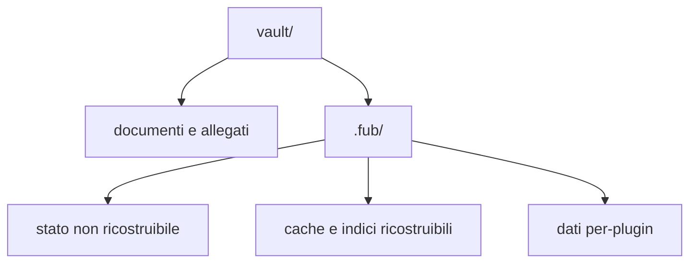

# Vault e file

> **Per chi:** chi vuole capire che cosa Fub legge, scrive e conserva.
> **Risultato:** distinguere documenti, stato autorevole e dati ricostruibili.

## Il vault

Un vault è una cartella scelta dall'utente. I path pubblici sono relativi alla
radice e usano `/`; nel contratto sono rappresentati da `DocId`.

Fub non sposta i documenti in un contenitore proprietario. Un file Markdown
resta un file Markdown e può essere aperto da altri strumenti.

## Apertura

L'apertura procede a fasi:

1. riconosce la struttura del vault;
2. rende disponibili albero e operazioni di base;
3. legge e indicizza i documenti;
4. segnala i file non leggibili senza rendere inutilizzabile l'intero vault.

Durante l'indicizzazione la ricerca espone lo stato del lavoro invece di
restituire silenziosamente un risultato incompleto.

Un file o una cartella il cui nome non si scrive in UTF-8, per esempio un nome
in Latin-1 estratto da un vecchio archivio, resta fuori dal vault: non compare
nell'albero, non ferma l'apertura e il log lo annota. Nessun `DocId` lo sa
nominare, quindi nessun documento del vault può trovarsi lì. Una cartella che
non si lascia elencare invece ferma l'apertura: senza il suo contenuto l'elenco
dei documenti sarebbe incompleto, e gli indici poterebbero ciò che non vedono.
Le cartelle che il sistema scrive nella radice di un disco (`lost+found`,
`System Volume Information`, `$RECYCLE.BIN`) stanno fra le cartelle escluse di
serie, quindi un vault nella radice di una chiavetta si apre.

L'anagrafe ricorda i file dell'apertura precedente: da lì Fub riconosce una
nota rinominata ad app chiusa, per esempio da un client di sync, e le fa
seguire bozza e dati per-documento. Un'anagrafe assente, rotta o di una
versione più nuova si ricostruisce dal vault. Un'anagrafe che il disco non sa
leggere parte vuota allo stesso modo, ma in quella sessione non si riscrive e
la raccolta degli spazi orfani non gira: i dati delle note rinominate restano
dove sono, e le riconosce la prima apertura che torna a leggerla.

La raccolta toglie lo spazio per-documento soltanto di una nota che non c'è più
sul disco. Una nota che le impostazioni escludono dal vault, perché sta in una
cartella di `files.excluded-folders` o perché è un file nascosto, esce
dall'albero e dagli indici ma conserva i suoi dati: togliere l'esclusione la
rimette com'era.

Un documento oltre 64 MiB non si legge per intero. Il parse costa decine di
volte la sorgente, e una nota da qualche centinaio di MB esauriva la memoria a
ogni apertura. Oltre quel limite il documento resta nell'albero e si rinomina,
si sposta, si cestina e torna dal cestino come un allegato, ma non si apre,
non entra negli indici e un salvataggio che lo farebbe crescere oltre è
rifiutato. Il file non viene toccato. La stessa regola vale per ogni formato, e
un formato può averne una più stretta: un foglio si ferma a 16 MiB.

## Modifiche sicure

Le scritture usano una revisione di base. Se il file è cambiato da quando una
modifica è stata calcolata, l'esito è un conflitto, non una sovrascrittura
silenziosa.

Le operazioni principali emettono eventi tipizzati. Rename e cancellazione
aggiornano identità, indici e sessioni attraverso il kernel e l'host, invece di
essere semplici chiamate filesystem dalla UI.

## Indice delle pagine

- [Operazioni sul vault](vault-operazioni.md): destinazione delle note,
  explorer, cattura, `fub://`, bozze, cartelle esterne, import/export;
- [Recupero e versioni](vault-recupero-e-versioni.md): rinomine, cestino,
  versioning, snapshot globale e backup.
## Limiti

- Fub non sincronizza automaticamente il vault con un servizio remoto;
- il backup completo include ogni dato classificato come autorevole;
- eliminare l'intera `.fub/` può perdere impostazioni, organizzazione, bozze,
  versioni e dati di plugin;
- eliminare soltanto una cache è sicuro solo quando il riferimento tecnico la
  dichiara ricostruibile.

La prova del drill storico è tracciata nell'issue
[#7](https://github.com/Fubeo/Fub/issues/7); il suo fixture resta distinto dalla
verifica del protocollo globale #5.
