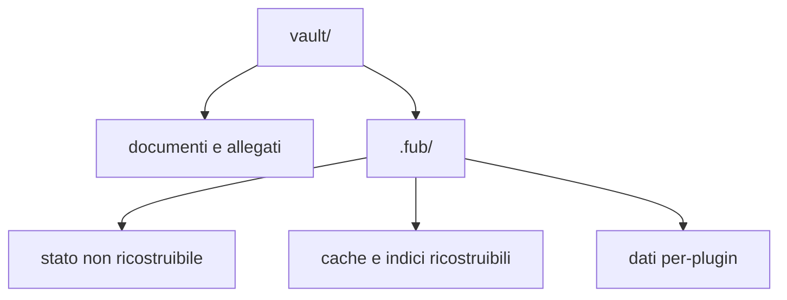

# Vault e file

> **Per chi:** chi vuole capire che cosa Fub legge, scrive e conserva.
> **Risultato:** distinguere documenti, stato autorevole e dati ricostruibili.

## Il vault

Un vault è una cartella scelta dall'utente. I path pubblici sono relativi alla
radice e usano `/`; nel contratto sono rappresentati da `DocId`.

Fub non sposta i documenti in un contenitore proprietario. Un file Markdown
resta un file Markdown e può essere aperto da altri strumenti.

## Apertura

L'apertura procede a fasi:

1. riconosce la struttura del vault;
2. rende disponibili albero e operazioni di base;
3. legge e indicizza i documenti;
4. segnala i file non leggibili senza rendere inutilizzabile l'intero vault.

Durante l'indicizzazione la ricerca espone lo stato del lavoro invece di
restituire silenziosamente un risultato incompleto.

Un file o una cartella il cui nome non si scrive in UTF-8, per esempio un nome
in Latin-1 estratto da un vecchio archivio, resta fuori dal vault: non compare
nell'albero, non ferma l'apertura e il log lo annota. Nessun `DocId` lo sa
nominare, quindi nessun documento del vault può trovarsi lì. Una cartella che
non si lascia elencare invece ferma l'apertura: senza il suo contenuto l'elenco
dei documenti sarebbe incompleto, e gli indici poterebbero ciò che non vedono.
Le cartelle che il sistema scrive nella radice di un disco (`lost+found`,
`System Volume Information`, `$RECYCLE.BIN`) stanno fra le cartelle escluse di
serie, quindi un vault nella radice di una chiavetta si apre.

L'anagrafe ricorda i file dell'apertura precedente: da lì Fub riconosce una
nota rinominata ad app chiusa, per esempio da un client di sync, e le fa
seguire bozza e dati per-documento. Un'anagrafe assente, rotta o di una
versione più nuova si ricostruisce dal vault. Un'anagrafe che il disco non sa
leggere parte vuota allo stesso modo, ma in quella sessione non si riscrive e
la raccolta degli spazi orfani non gira: i dati delle note rinominate restano
dove sono, e le riconosce la prima apertura che torna a leggerla.

La raccolta toglie lo spazio per-documento soltanto di una nota che non c'è più
sul disco. Una nota che le impostazioni escludono dal vault, perché sta in una
cartella di `files.excluded-folders` o perché è un file nascosto, esce
dall'albero e dagli indici ma conserva i suoi dati: togliere l'esclusione la
rimette com'era.

Un documento oltre 64 MiB non si legge per intero. Il parse costa decine di
volte la sorgente, e una nota da qualche centinaio di MB esauriva la memoria a
ogni apertura. Oltre quel limite il documento resta nell'albero e si rinomina,
si sposta, si cestina e torna dal cestino come un allegato, ma non si apre,
non entra negli indici e un salvataggio che lo farebbe crescere oltre è
rifiutato. Il file non viene toccato. La stessa regola vale per ogni formato, e
un formato può averne una più stretta: un foglio si ferma a 16 MiB.

## Modifiche sicure

Le scritture usano una revisione di base. Se il file è cambiato da quando una
modifica è stata calcolata, l'esito è un conflitto, non una sovrascrittura
silenziosa.

Le operazioni principali emettono eventi tipizzati. Rename e cancellazione
aggiornano identità, indici e sessioni attraverso il kernel e l'host, invece di
essere semplici chiamate filesystem dalla UI.

## Rinomine e archiviazione recuperabili

Prima di una rinomina Fub fotografa la revisione del file e le modifiche
necessarie ai backlink. Pubblica quindi un intent schema 1 sotto `.fub/` prima
di spostare dati per-documento o contenuto. Se il processo si interrompe, la
riapertura attende l'indice completo e confronta i byte osservati con la
preimmagine: riprende la rinomina in avanti, completa i backlink già preparati
oppure termina un rollback già dichiarato.

La posizione dei file non basta a giustificare una sovrascrittura. Se compare
una destinazione, cambia la sorgente o entrambe le posizioni sono ambigue, Fub
lascia l'intent ispezionabile e segnala un conflitto. Un record illeggibile o
prodotto da uno schema futuro non blocca il recupero degli altri record. Lo
spazio per-documento rimasto a metà di una migrazione (`*.in-progress`) è
l'unica copia di quei dati: la raccolta degli spazi orfani non lo cancella.

Se la destinazione ha già uno spazio per-documento, per esempio il residuo di
una nota cancellata, i dati della nota rinominata la seguono comunque. Ciò che
occupava la destinazione si sposta accanto, sotto `<nome>~displaced` (poi
`~displaced-2` e così via), con i byte intatti, e l'avviso della rinomina dice
dove. La raccolta non tocca quei nomi. Se uno spazio non si lascia spostare per
un guasto del disco, una rinomina fatta da Fub si ferma prima di muovere il
file e riporta indietro ciò che aveva già spostato. Una rinomina fatta da
un'altra applicazione arriva a file già spostato: i dati restano sotto il nome
vecchio e l'avviso lo segnala, ma finché restano lì la raccolta li tratta come
lo spazio di una nota che non c'è più.

`vault.archive` applica la stessa regola a un insieme di file. Verifica tutte le
sorgenti, le revisioni e le destinazioni prima della prima mossa e pubblica un
record durevole dell'intero batch. Dopo ogni file registra l'avanzamento. Una
riapertura può quindi riconciliare sia una mossa già registrata sia una mossa
conclusa appena prima dell'interruzione, senza ripeterla e senza toccare una
destinazione estranea. I file completati formano un'unica operazione annullabile
nell'esito del comando.

## Destinazione delle nuove note

`files.new-note-folder` è un'impostazione del vault. Il valore vuoto crea le
note nella radice; un nome semplice viene creato nella cartella configurata,
mentre un path esplicito conserva la propria cartella. La scelta del nome libero
e il controllo delle collisioni avvengono nel kernel insieme alla scrittura,
senza una verifica separata nella shell.

`files.new-note-extension` sceglie l'estensione di una nota creata senza
estensione; il valore predefinito è `md`. Un nome la riceve quando il suo
ultimo segmento non porta già un'estensione servita da un formato del vault:
`Idee` diventa `Idee.md`, `Lavagna.canvas` resta un canvas e `Report v1.2`
diventa `Report v1.2.md`. Se nessun formato installato serve l'estensione
scelta, i comandi che creano note rispondono con un errore e non scrivono un
file che il vault non saprebbe aprire.

«Nuovo disegno» (`drawing.create`, con la feature `draw`) fa nascere un disegno
vuoto e lo apre. Senza nome si chiama «Disegno», o «Disegno 1», «Disegno 2», …
nella lingua di chi lo crea, con le cifre della convenzione dei nomi liberi. Un
nome senza estensione riceve `.svg`, e uno con l'estensione di un altro formato
non è un disegno. Un nome semplice nasce nella cartella `folder`, se è data,
altrimenti nella radice; un path esplicito conserva la propria cartella. Un nome
occupato è un errore e mai una sovrascrittura, e prima di scrivere il nome passa
la regola dei nomi nuovi. Senza `template`, o con `blank`, il file lo scrive il
provider dei disegni, con il nome per titolo e «Livello 1». Con un altro
`template` è il file di quel modello, nella lingua di chi lo crea; con `from` è
la copia di un disegno del vault, e un modello e `from` insieme sono un errore.
In tutti e due i casi il `title` della radice diventa il nome. La finestra che
offre i modelli è in [Disegni, modelli e suggerimenti](drawing-new.md). La prova
a vuoto fa gli stessi controlli e non scrive; l'annullamento manda il disegno nel
cestino.

«Annota il PDF» (`pdf.annotate`, con la feature `draw`) apre le annotazioni di
un PDF del vault: il file `X.pdf.fubann` accanto a `X.pdf`, con il nome intero
del PDF più `.fubann`, perché è il nome a legarle al PDF. Se il file c'è, il
comando lo apre e basta, senza scrivere e senza annullamento. Se non c'è, lo
scrive il provider delle annotazioni (radice, titolo e `fub:annotates`) e lo
apre; l'annullamento lo manda nel cestino. Il nome passa la regola dei nomi
nuovi prima di scrivere, un nome preso da un altro file è un errore, e un nome
che non finisce con `.pdf` o un PDF che non c'è non si annotano. Il PDF non si
scrive mai. Impronta e numero di pagine li scrive l'editor col primo gesto,
come racconta [Annotazioni dei PDF](pdf-annotations.md).

## Explorer e cartelle

L'albero dei file, le cartelle nuove e le operazioni su una cartella intera
(rinomina, spostamento, cestino) sono descritti in
[Explorer e cartelle](explorer-and-folders.md).

## Cattura rapida

Il clipper del browser, la condivisione mobile, `fub-cli capture` e l'URI
`fub://capture` scrivono tutti con lo stesso comando dell'host,
`capture.apply`. Il parametro `payload_json` porta il payload capture v1 come
testo JSON; `template` è facoltativo e vale soltanto per una cattura che crea.
La validazione è la stessa per ogni trasporto: titolo su una riga, testo non
vuoto, `source_url` http o https senza credenziali, e `vault`, `folder` e
`note` dentro il recinto del vault.

- `create` crea la nota con `note.create`, o con `note.from_template` se c'è
  un template. Il nome è `note` se c'è; altrimenti il titolo diventa un
  segmento portabile, senza caratteri riservati e al più di 80 caratteri. Un
  nome occupato è un conflitto e la nota esistente resta intatta.
- `append` e `prepend` scrivono in una nota esistente; `prepend` scrive dopo il
  frontmatter.
- `daily` scrive nella nota del giorno, che `note.daily` crea se manca.

Il blocco scritto contiene il titolo come intestazione `# …`, il testo e, se
c'è, la riga della fonte nella lingua del vault. Una riga vuota separa le parti
e il blocco dal testo vicino, e il blocco usa i terminatori di riga del
documento. La destinazione deve essere un formato di testo, e le proprietà
vogliono un formato con frontmatter: un canvas o una base sono rifiutati prima
di qualunque scrittura.

L'ordine delle scritture rende sicuro un nuovo tentativo. Tutti i controlli
vengono prima; poi si scrivono le proprietà, che ripetute non cambiano niente;
per ultimo il testo, in una sola scrittura che discende dalla revisione letta.
Una nota nata dalla cattura e rimasta senza testo torna nel cestino. La prova a
vuoto dice quale documento verrebbe scritto.

`fub://new` segue le stesse regole di nome e di titolo: senza `name` il nome
viene dal titolo, e il titolo va in testa al corpo, dopo l'eventuale
frontmatter del template.

## Collegamenti `fub://` sul desktop

Il sistema consegna un `fub://` all'app desktop, anche quando l'app parte
proprio per aprirlo. L'host tiene i collegamenti in una coda della macchina,
che resta valida anche senza un vault aperto e prima che esista una finestra.
La coda ne tiene al più 32 e conta quelli che non ha preso. L'evento
`fub://pending-action` sveglia la finestra, che prende la coda con
`uri.pending` all'avvio e a ogni evento. Ogni collegamento si prende una
volta.

`uri.pending` descrive ogni collegamento: l'azione, se scrive, il vault chiesto
con la sua radice e se è quello aperto. Un vault si riconosce dalla radice o da
un nome unico fra i vault noti. Un collegamento non valido, o con una callback,
arriva con il motivo e non si esegue.

- `open` apre la nota al titolo o al blocco chiesti, nel riquadro col fuoco,
  in uno nuovo (`split`) o in una finestra (`window`). Una nota che non c'è si
  dice e non si crea.
- `search` apre la ricerca con il testo e i filtri `tag:` e `folder:`.
- `new`, `daily`, `unique` e `capture` scrivono con `uri.apply`. La finestra
  chiede prima la prova a vuoto, che dice quale nota nascerà, e scrive soltanto
  dopo la conferma. Una cattura mostra anche l'inizio del testo.

Un collegamento per un altro vault noto apre quel vault dopo una conferma, con
lo stesso flusso del pulsante. Se il vault non si apre, il collegamento si
ferma. Un vault sconosciuto non si apre mai da un collegamento.

## Bozze

Una bozza protegge testo che non è ancora diventato una scrittura riuscita sul
documento. Le bozze appartengono al vault e non sostituiscono il file
autorevole.

Il lifecycle dell'editor deve eseguire flush, eventuale persistenza della bozza
e teardown nell'ordine previsto quando si chiude l'ultima superficie.

## Cestino

La cancellazione sposta la voce nel cestino del vault. Un sidecar può ricordare
la posizione originale e consentire il ripristino.

Il sidecar è un aiuto, non l'unica copia della nota. Se manca o non è
compatibile, il comportamento di degrado deve preservare il contenuto e usare
una destinazione sicura. Un sidecar presente che il disco non sa leggere non
vale come assente: l'elenco del cestino e il ripristino si fermano con l'errore
invece di rimettere la nota nella radice.

Il cestino è piatto, quindi per una nota di una cartella il sidecar è l'unico
posto che ricorda da dove veniva. Se non si scrive, la nota torna dov'era e la
cancellazione fallisce con l'errore. Una nota della radice si cestina lo stesso,
perché il nome basta a riportarla.

Finché una nota sta nel cestino, i suoi dati per-documento restano, ma non sotto
il suo path: il path è l'identità di una nota viva, e una nota cestinata lo
lascia libero. La cestinatura li parcheggia sotto l'identità che la voce ha nel
cestino e mette nel sidecar l'organizzazione della nota (icona, posto fra le
appuntate, posto nell'ordine della sua cartella); la storia delle versioni
segue la stessa regola. Una nota nuova che riprende quel path parte quindi da
zero, senza ereditare niente da quella cestinata, e un ripristino altrove non
porta via ciò che appartiene alla nota che ha preso il path. Il ripristino
riporta tutto sotto il path d'arrivo, anche se non è quello d'origine; se lì
c'è già uno spazio per-documento vale la regola delle rinomine
(`~displaced`), e un'icona già scelta per la nota che occupa quel path non si
sovrascrive. L'ordine a mano torna soltanto se la nota rientra nella stessa
cartella.

La raccolta degli spazi orfani conserva lo stato parcheggiato di ogni voce che
è ancora nel cestino e toglie quello delle altre. Una voce cestinata da una
versione precedente di Fub, o senza sidecar come quelle cestinate da Obsidian,
non ha parcheggiato niente e non dice la sua cartella: la raccolta conserva i
dati di ogni nota con quel nome, in qualunque cartella. Al ripristino di una voce
così i dati seguono la nota solo se il path d'origine è libero; se lo occupa una
nota viva Fub non indovina di chi siano, li lascia dove stanno e lo dice con un
avviso. Lo stesso vale per la cancellazione fatta con `trash.os`: lo stato resta
sotto il path d'origine. Se il disco non sa dire se il cestino c'è, se il cestino
non si elenca, o se un sidecar presente non si legge o viene da una versione più
nuova di Fub, la raccolta si ferma invece di indovinare da quale cartella
venisse la nota. Anche l'elenco del cestino risponde con l'errore invece di
mostrarsi vuoto.

L'impostazione di vault `files.trash` sceglie dove finisce una nota cancellata
dalla shell. `vault` (default) usa il cestino interno. `system` usa il comando
`trash.os`, che prova il cestino del sistema operativo e, se non è disponibile,
sposta la nota nel cestino interno; l'esito del comando segnala il ripiego con
un messaggio, lo stesso dalla shell e dalla palette. Col cestino
del vault la cancellazione non chiede conferma e offre «Annulla» nell'avviso;
col cestino di sistema, da cui Fub non può ripristinare, chiede conferma.
Svuotare il cestino interno resta un comando irreversibile separato.

## Versioning

Il versioning conserva snapshot del contenuto. L'impostazione del vault
`versioning.enabled` (accesa di serie) decide se ne nascono di nuovi, e vale
dalla scrittura successiva, senza riaprire il vault. Spenta, la storia già
registrata resta leggibile e segue le note rinominate o cancellate, mentre
`version.restore` rifiuta finché non si riaccende: nessuno fotograferebbe il
contenuto che il ripristino sostituisce. `version.restore` cattura la
revisione del documento, quindi verifica che il riferimento alla versione
esista e che il blob sia leggibile e integro (dimensione e impronta FNV-1a).
La scrittura condizionata usa quella revisione come confronto e scambio (CAS).
Per gli writer cooperativi, una modifica intervenuta durante la lettura viene
rifiutata come conflitto.
Per gli writer esterni il controllo è best-effort: una modifica già osservabile
al confronto produce lo stesso conflitto. Un riferimento o un blob non valido e
gli errori di lettura o confronto non modificano né il documento né l'indice
delle versioni. Le garanzie di un errore di scrittura dipendono dal supporto:
per i file regolari sostituibili il valore precedente resta intatto; symlink,
hardlink e filesystem senza conteggio dei nomi richiedono invece la scrittura
in-place descritta nel riferimento tecnico.

Il pannello cronologia mostra il testo di una versione oppure il suo confronto
riga per riga con la nota attuale. Il testo di una versione si può anche
copiare negli appunti, senza scrivere nel vault. Il confronto riassume le righe uguali
lontane dai cambiamenti e dichiara quante righe non mostra oltre il limite del
pannello. Se una delle due versioni non è testo, o la parte diversa è troppo
grande, il pannello lo dice invece di calcolarlo.

Quando riesce, il ripristino è una scrittura normale: fotografa prima il
contenuto sostituito e, se il contenuto cambia, crea una nuova versione; quando
esiste una versione precedente, il comando dichiara anche il ripristino inverso.

Le versioni si diradano col tempo, a ogni nuova versione della nota. Nelle
ultime 24 ore restano tutte; fino a 7 giorni ne resta una per ora, fino a 90
giorni una per giorno. Oltre i 90 giorni resta soltanto la versione più recente
della nota. Le fasce non sono configurabili.

Un file oltre 64 MiB non ha versioni: il versioning non lo apre e non lo
copia, e una scrittura su di lui passa senza fotografia, come a versioning
spento. Per la stessa ragione il ripristino rifiuta di sostituire una nota
cresciuta oltre quel limite, e il pannello non la legge per confrontarla.

## Cartelle esterne

Le cartelle esterne non vengono scoperte né collegate automaticamente. Dopo aver
scelto un path assoluto, l'utente può usare i comandi generici `mount.add`
(`name`, `target`, `namespace`), `mount.list` e `mount.remove` (`name`).
L'elenco restituisce rotte tipizzate con namespace stabile e target, e le dice
anche in un messaggio, con le cartelle configurate che non si raggiungono; i
tre comandi confermano l'esito anche dalla palette. I path
relativi risolti nel namespace restano recintati, senza attraversare `..`,
separatori Windows o symlink. Alla registrazione gli antenati del path scelto
si risolvono una volta (su macOS `/var` è `/private/var`) e si salva il path
reale; da lì in poi un antenato che diventa symlink/reparse rende la rotta
inattiva. Sono rifiutati un target che è esso stesso symlink/reparse, anche
penzolante, root del vault in qualunque forma la si nomini, `.fub/`, cartelle sovrapposte, alias e filesystem che non
forniscono identità e stat senza seguire i collegamenti. Se una destinazione
registrata è scollegata o cambia identità, Fub apre comunque il vault con la
rotta inattiva e una diagnostica; `mount.remove` resta disponibile. Il registro
resta nel vault, ma il contenuto esterno resta fuori da scansione e snapshot:
scollegarlo o rimuovere la rotta non cancella né sposta alcun file esterno.

## Cartella `.fub/`

La classificazione precisa è in
[`../reference/on-disk-layout.md`](../reference/on-disk-layout.md).

La regola importante è per voce, non per cartella:

- impostazioni, organizzazione, bozze, versioni e storage di un plugin possono
  contenere dati non ricostruibili;
- anagrafe e indici possono essere ricreati dal vault;
- un file sconosciuto non va cancellato soltanto perché si trova sotto
  `.fub/data/`.

## Compatibilità con altri strumenti

Fub comprende convenzioni usate nei vault Markdown, tra cui frontmatter YAML,
wikilink, tag, heading, ancore ed embed. Il provider decide la semantica del
formato; il kernel conserva path e sorgente senza incorporare regole Markdown.

Le proprietà del frontmatter restano nel file. Un vault può dichiararne il tipo
per nome nell'impostazione versionata `properties.types`; questa dichiarazione
sceglie widget e semantica di query, ma non rinomina chiavi convenzionali né
sposta valori in un database. Gli aggiornamenti strutturati modificano la sola
chiave interessata e conservano commenti, ordine, virgolette, terminatori e
corpo non coinvolti. YAML incompatibile o non rappresentabile resta disponibile
in modalità sorgente.

## Importare ed esportare

Importare note da altri programmi ed esportare il vault, o una sua cartella,
ha una pagina propria: [Importare ed esportare](import-and-export.md).

## Snapshot globale e backup

Lo snapshot globale offline comprende l'intero stato autorevole del vault:
documenti, allegati, file sconosciuti, `.trash/`, stato autorevole sotto
`.fub/` e storage autorevole dei plugin. La configurazione macchina è esclusa.
Le cache dichiarate ricostruibili vengono invalidate e ricostruite alla
riapertura, non copiate come se fossero autorità. In particolare,
`.fub/data/plugins/<id>/` è cache soltanto se contiene `.fub-cache-root`; senza
quel marker resta storage autorevole legacy.

`fub_kernel::snapshot` prepara e valida in memoria un manifest schema 1 con
path relativo normalizzato, classe, owner, schema quando applicabile, size e
digest SHA-256. Il kernel non possiede il `FormatRegistry`: documenti, allegati
e sconosciuti hanno la classe unica `user`, mentre i dati core, del cestino,
sidecar e plugin hanno classi proprie. Rifiuta prima di ogni mutazione schema
futuro, entry mancante o duplicata, traversal, symlink/file speciali e mismatch
di size o digest.
La base revision è il digest deterministico del manifest autorevole live e viene
ricontrollata immediatamente prima del commit.

L'applicazione richiede un vault chiuso e quiescente e una radice già canonica,
senza symlink. Un lock sibling stabile, staging privato, record persistente e
le fasi `prepare`/`commit`/`finalize` conservano il contenitore precedente fino
alla pubblicazione verificata. Dopo un crash, l'host esegue la recovery prima
dell'apertura: riconosce soltanto i propri artefatti con schema e transaction id
validi, completa o annulla la fase deterministica e preserva file ignoti. La
garanzia all-or-old-or-new vale tra writer cooperativi; writer esterni,
filesystem senza rename/fsync durevoli e rollback impossibile restano limiti
espliciti.

Per lo schema 1 la pubblicazione usa directory POSIX `0700` e file `0600`;
owner, ACL, xattr e bit executable non sono portabili nel manifest e quindi
non vengono preservati. Su Windows ACL e proprietà restano quelle applicate
dal filesystem alla creazione dello staging, normalmente ereditate dal
parent, e non sono rappresentate né garantite dallo snapshot.

Questo flusso è distinto da `fub.versioning`:
`version.restore` ripristina un solo documento con CAS per-file e non è una
transazione dell'intero vault. È distinto anche dal drill backup/restore offline
dell'issue [#7](https://github.com/Fubeo/Fub/issues/7), che conserva il proprio
fixture e manifesto indipendente. La feature `fub.backup` resta invece uno
snapshot namespaced delle sole note nello stesso vault. Gli snapshot prendono il
nome dal giorno, e un secondo backup nello stesso giorno sostituisce il
precedente soltanto a copia finita. La copia nuova si scrive nell'altra cartella
del giorno (`<data>.1/`), il manifest `snapshots.json` passa a lei e solo allora
la vecchia si cancella: un guasto a metà lascia intero lo snapshot precedente.
Accanto alla cartella di ogni snapshot sta il suo inventario
(`<data>.files.json`, o `<data>.1.files.json`): path, dimensione e impronta di
ogni nota copiata. Il ripristino lo confronta con le copie prima di creare
qualsiasi nota: una copia mancante, troncata o alterata ferma il ripristino con
un errore che la nomina, invece di riportare meno note dichiarando di esserci
riuscito. Gli snapshot scritti prima dell'inventario si controllano sul numero
di note che il manifest ricorda. Dopo ogni backup riuscito restano gli snapshot più recenti indicati da
`backup.keep` (10 di serie; 0 li tiene tutti). Un manifest scritto da una
versione più recente di Fub non si usa e non si riscrive; i campi che questa
versione non conosce tornano su disco come erano.

## Limiti

- Fub non sincronizza automaticamente il vault con un servizio remoto;
- il backup completo include ogni dato classificato come autorevole;
- eliminare l'intera `.fub/` può perdere impostazioni, organizzazione, bozze,
  versioni e dati di plugin;
- eliminare soltanto una cache è sicuro solo quando il riferimento tecnico la
  dichiara ricostruibile.

La prova del drill storico è tracciata nell'issue
[#7](https://github.com/Fubeo/Fub/issues/7); il suo fixture resta distinto dalla
verifica del protocollo globale #5.
