# Stato del progetto

> **Aggiornato al 31 ottobre 2026.**
> **Per chi:** chi apre una sessione e deve sapere che cosa esiste, che cosa
> gira e che cosa viene dopo.
> **Risultato:** partire dal presente, non dalla cronologia.
> **Fonti:** il codice in `main` e le PR citate; la regola con cui si aggiorna
> questa pagina sta in fondo.

## Dove siamo

- **Nessun rilascio pubblico.** Il primo release candidate `v0.1.0-rc.1` è
  stato ritirato con il suo tag remoto: le modifiche restano non rilasciate e
  un nuovo candidato richiede la matrice CI sul proprio SHA (vedi
  [Rilascio](#il-rilascio)). Workspace e shell dichiarano `0.1.0`; il
  contratto plugin è `fub:abi@0.2.0`.
- **Una catena di PR pronta o in revisione** (#256–#268): Live come Word e
  Blocchi, gli errori del tasto destro, N0 (la sonda e il banco nella
  WebView vera), N12 (il menu «/»), N13 (il blocco vivo), la chiusura di
  FubDraw con l'[ADR 0231](../decisions/0231-la-chiusura-di-fubdraw.md) e
  il server MCP con l'[ADR 0232](../decisions/0232-il-server-mcp-di-fub.md).
  Il tag `fubdraw-completo` su `main` conserva l'ultimo FubDraw intero.
- **In corso, K0: le misure dei motori** (ramo `fase/k0-misure`). Le sei
  prove in `tools/motori-prova/` (VectorCraft, PdfCraft, PhotoCraft,
  LightCraft, WordCraft, GridCraft) misurano peso, RAM, tempi e librerie
  doppie; lo scenario R1 misura la memoria nella WebView vera dal banco
  `apps/client/bench/webview/`. I numeri approdano in
  [misure](../misure/README.md) e i tetti in `budgets.json`.

Le milestone #5, #6, #7, #8, #10, #11, #12, #13, #17 e #56 sono chiuse con
evidenze riferite a codice, test, documentazione e CI.

## L'ordine di lavoro

L'ordine deciso per le prossime fasi. Il disegno è la direzione, non
l'architettura: le date non esistono, i cancelli sì.

```mermaid
flowchart LR
    FATTO["fatto o in revisione<br/>N0 N1 N2 N12 N13"] --> K0
    K0["K0 · misure (+P0 PdfCraft)"] --> K12["K1 · K2<br/>modello e pagina Componenti"]
    K12 --> K3["K3 · strato dei motori"]
    K3 --> P1["P1 · il motore dei PDF"]
    P1 --> N347["N3 N4 N7<br/>logica in Rust, inchiostro, file Craft"]
    N347 --> K5["K5 · il disegno"]
    K5 --> P4["P4 · le parti dei PDF"]
    P4 --> LAV["Lavagna v1"]
    LAV --> K4["K4 · la consegna"]
    K4 --> P25["P2 P3 P5<br/>visore, annotare, completo"]
    P25 --> K6["K6 · disegno completo"]
    K6 --> N59["N5 N9<br/>strati nativi, egui o Tauri"]
    N59 --> K78["K7 K8 · foto e libreria foto"]
    K78 --> K9["K9 · documenti e fogli completi"]
    K9 --> RESTO["K10 e il resto"]
```

Le tappe e i loro cancelli. «In pila» significa: finito nel ramo, in attesa
dell'unione.

| Fase | Che cosa | Cancello | Stato |
|---|---|---|---|
| N0 · Misurare | la sonda e il banco nella WebView vera | i sei scenari con numeri in `docs/misure/`, la CI esegue S1–S3 | in pila (#258) |
| N12 · menu «/» | il pannello dei blocchi sopra CodeMirror | la tabella delle 60 query sopra la soglia; battuta invariata | in pila (#259) |
| N13 · blocco vivo | il moto dei Blocchi dentro CodeMirror | le coreografie nei tre livelli; battuta invariata | in pila (#261) |
| N1 · Chiudere FubDraw | l'editor alla Illustrator si riduce e si chiude | corpus aperto e salvato byte per byte, ADR 0231 | in pila (#262–#267) |
| N2 · Server MCP | `fub-cli mcp`, stdio e JSON-RPC | conformità, conflitti senza perdite, radici di scrittura | in pila (#268) |
| K0 · Misure e prove | i sei motori misurati da soli | `docs/misure/motori-*.md`, tetti in `budgets.json`, P0 passato | in corso |
| K1 · K2 · Componenti | il modello a componenti e la sua pagina | nessun attivo con un requisito spento; il profilo al primo avvio | da fare |
| K3 · Strato dei motori | `fub-motori`: registro pigro e servizi comuni | RAM che torna dopo «chiudi tutto»; avvio invariato | da fare |
| P1 · Motore dei PDF | PdfCraft sotto il visore di oggi | alla pari o meglio di pdf.js sul corpus | da fare |
| N3 · N4 · N7 | logica in Rust, inchiostro su tutto, file Craft | le fixture di parità; l'inchiostro segue le schede | da fare |
| K5 · Il disegno | VectorCraft come motore, la penna di Fub guida | il corpus senza perdite visibili; `bench:ink` invariato | da fare |
| Lavagna v1 | schede, fili, inchiostro, estratti | 300 schede negli obiettivi di N5; Obsidian non perde l'inchiostro | da fare |
| K4 · La consegna | dati scaricabili, edizioni, librerie a runtime | il peso dell'installatore entro i tetti | da fare |
| P2 · P3 · P5 | visore, annotare, modifica completa dei PDF | i casi difficili provati; le quattro prove verdi | da fare |
| K6 · K7 · K8 · K9 | le modalità complete, una app alla volta | copertura dei comandi al 100% per ciascuna | da fare |
| N5 · N9 | strati nativi della penna, cancello egui | una tabella di numeri e la decisione in un ADR | da fare |
| K10 · Seguirli | il controllo settimanale dei motori | il report di `motori-upstream.yml` | continua |

Perché quest'ordine: K5 viene prima della lavagna perché la lavagna disegna
col motore vettoriale; K4 dopo la lavagna perché le edizioni hanno senso
quando i componenti grandi esistono; N9 prima delle foto perché decide come
si mostra la loro tela.

## Il rilascio

Un tag `vX.Y.Z` costruisce gli installer desktop sulle tre piattaforme e li
carica in una release **bozza**: la pubblica una persona, dopo averli
provati (`.github/workflows/release.yml`). Requisiti da verificare sul
candidato: versione, changelog e compatibilità degli schemi coerenti; WIT
frozen e compatibilità ABI verificate; test e guard pertinenti verdi;
supply chain Rust e npm con SBOM; benchmark richiesti registrati; visuali e
accessibilità delle superfici incluse; artefatti per le piattaforme
supportate; documentazione di avvio coerente col prodotto.

## Capacità consegnate in `main`

- vault local-first: revisioni, bozze, cestino, versioning con snapshot
  globale offline e ripristino;
- ricerca full-text, link, backlink, Graph View con gate di memoria e
  [budget prestazionali](../product/performance-budget.md);
- superfici condivise per documento (`DocumentSession` e registro delle
  superfici), con la versione 2 del protocollo dei fogli a byte e la barra
  dei fogli sopra la facciata di GridCraft (ADR 0219);
- documenti di videoscrittura come proiezione senza perdite silenziose e
  cartelle di Excel con innesto dei valori;
- disegni SVG con il formato scena, l'import da Excalidraw e draw.io e
  l'editor ridotto ai due spazi di lavoro (ADR 0231 in pila);
- la finestra Scrittoio, i temi installabili (`theme-1`, `theme-2`) e il
  banco visuale con a11y;
- runtime WASM dei plugin (M5): capability, catalogo firmato, limiti,
  [retrospettiva](m5-wasm-runtime.md);
- automazione locale: CLI con REPL, `fub://`, clipper del browser, canale di
  controllo.

## Lavoro residuo e differite

- [#9](https://github.com/Fubeo/Fub/issues/9) sincronizzazione distribuita:
  esclusa dalla prima release; resta OPEN come lavoro futuro. Watcher,
  catch-up, rejoin e sincronizzazione fra superfici restano capacità locali.
  Rientra in scope soltanto con una capacità end-to-end dimostrata.
- [#57](https://github.com/Fubeo/Fub/issues/57) e
  [#58](https://github.com/Fubeo/Fub/issues/58): follow-up WASM esplicitamente
  differiti (provider in ingresso, quote assolute CPU/RAM di processo).
- La battuta sulle note grandi: in Live e Blocchi a 7.201 righe supera il
  budget di [prestazioni](../product/performance-budget.md#la-battuta);
  serve un passo di ottimizzazione con misura prima e dopo.

## Regola di avanzamento

Una capacità è consegnata quando è in `main` e possiede evidenza sufficiente
nei test e nella documentazione. Un criterio trasferito deve avere una issue
proprietaria esplicita; non può essere spuntato per inferenza. Una capacità
consegnata non torna incompleta soltanto perché un follow-up è aperto.

Chi chiude una fase aggiorna questa pagina: la riga della tabella, i
collegamenti alle PR e, se un cancello è passato, i numeri in
[misure](../misure/README.md).

## Fonti

- [M5 — retrospettiva](m5-wasm-runtime.md)
- [Changelog](../../CHANGELOG.md)
- [Issue aperte](https://github.com/Fubeo/Fub/issues)
- [La mappa del repository](../map/repo.md)
