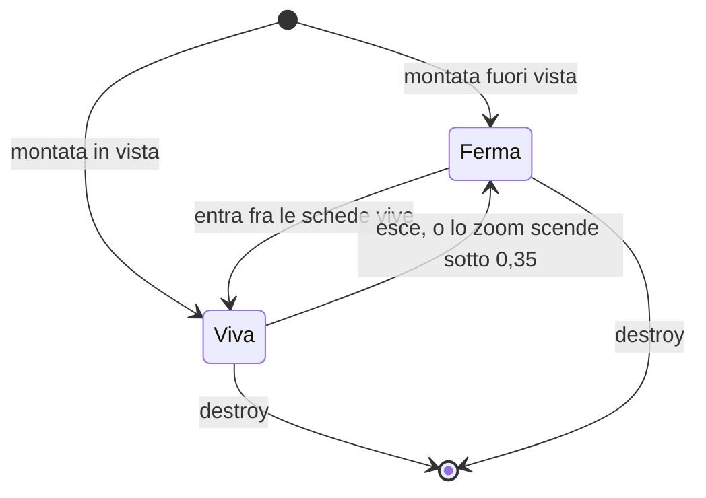

# Le schede della lavagna

> **Ambito:** il contratto fra la lavagna e chi mostra il contenuto di una
> scheda di file: le specie, i due modi di una scheda, le regole che scelgono
> le schede vive e le immagini ferme.
> **Fonti autorevoli:** `apps/client/src/editors/canvas/cards.ts` e le prove
> in `apps/client/src/editors/canvas/cards.test.ts`; per le estensioni,
> `apps/client/src/ui/format-kind.ts` e
> `apps/client/src/editors/media/media-types.ts`.

Questa pagina serve a chi scrive un renderer di scheda (la parte che mostra
una nota, un foglio, un PDF, un'immagine o una pagina web dentro la scheda) e
a chi lavora sul motore della lavagna che li monta.

## Schede vive e ferme

Una scheda di file ha due modi.

- **Viva** (`live`): il renderer ha aperto il file e ci si può entrare per
  scorrere, scegliere e copiare. Una scheda viva tiene risorse aperte: una
  sessione di foglio, un documento PDF, il DOM di una nota con i suoi
  ascolti.
- **Ferma** (`snapshot`): nessuna risorsa aperta. Mostra l'ultima immagine
  ferma che ha avuto, oppure, per le specie fatte di DOM (nota, foglio), il
  loro contenuto reso inerte. Una scheda mai stata viva mostra titolo e
  specie.

Il passaggio fra i due modi avviene solo a fine gesto, mai durante.

La tela chiama `setMode` solo quando il modo cambia davvero; `destroy` chiude
la `Lifetime` della scheda in qualunque modo sia.

## Le specie

La specie sceglie il renderer. Viene dall'estensione del file, come fa la
shell per l'albero e le schede del riquadro: il client non conosce il
provider di un file senza chiederlo al backend.

| Specie | Da dove viene |
|---|---|
| `null` | nodi `text` e `group`: la tela li disegna da sé |
| `web` | nodi `link` |
| `note` | `md`, `markdown` |
| `document` | ciò che `formatKindOf` dice `word` o `odt` (`docx`, `doc`, `dot`, `rtf`, `odt`) |
| `sheet` | ciò che `formatKindOf` dice `sheet` (`xlsx`, `xlsm`, `xltx`, `xltm`) |
| `pdf` | ciò che `mediaKindOfId` dice `pdf` |
| `image` | ciò che `mediaKindOfId` dice `image`, SVG compreso |
| `craft` | nessuna estensione ci porta ancora (arriva con T18) |
| `file` | tutto il resto: CSV, `.canvas`, audio, video, ZIP, nomi senza estensione |

Regole dell'estensione:

- conta l'ultimo segmento del percorso, in minuscolo: `FOTO.JPG` è
  un'immagine;
- il `subpath` non conta: `Nota.md#1.2 Titolo` è una nota;
- un punto nel nome di una cartella non è un'estensione:
  `Corsi.2026/leggimi` è un file;
- un nome nascosto senza altro punto (`.md`) non ha estensione.

L'SVG è un'immagine ferma anche se `formatKindOf` lo chiama disegno: nella
scheda non diventa mai il disegno vivo.

Una specie senza renderer registrato, per esempio perché il suo componente è
spento, si mostra come scheda di file con «Apri».

## Il contratto

I tipi stanno in `cards.ts`, con i commenti che ne spiegano i campi. In
breve:

- `CardRenderer` dichiara le specie che sa mostrare (`kinds`) e monta una
  scheda con `mount(node, host, mode, context)`, che restituisce una
  `CardView`.
- `CardContext` dà al renderer il percorso del file senza `subpath`, il
  `subpath` a parte, l'id della lavagna, una `Lifetime` che si chiude con
  `destroy`, la cache delle immagini ferme, la misura e lo zoom correnti, e
  `missing()` per dire che il file non c'è.
- `CardView` risponde a `setMode` e a `destroy`; può rispondere anche a
  `resize` (a fine gesto), `enter` e `leave` (entrare nella scheda e
  uscirne; `enter` restituisce `false` se non c'è niente in cui entrare),
  `key` (`true` se il tasto è della scheda) e `page` (la pagina mostrata, da
  1).
- `createCardRegistry` costruisce il registro per specie. Due renderer
  diversi per la stessa specie sono un errore, lanciato quando il registro
  si costruisce: `card kind <specie> has two renderers`. Lo stesso renderer
  che nomina due volte una specie non è un doppione.

Ascolti, osservatori e timer di un renderer passano dalla `Lifetime` del
contesto, come vuole `check-listeners.mjs`.

### Un renderer non scrive mai il file

Un renderer legge e basta. Nessun renderer scrive nel file della sua scheda,
né quando è vivo né quando si chiude: sfogliare un PDF, scorrere un foglio o
scegliere delle celle non cambia il file. Le sole scritture che partono
dalla lavagna sono il file `.canvas` e i file che vi si depositano dal
computer o si incollano.

## Le immagini ferme

`CardSnapshots` tiene le immagini ferme in memoria, per file e per parte; la
cache stessa arriva con T2 (`apps/client/src/editors/canvas/card-cache.ts`).
La parte dice che cosa è e a quale larghezza, e si costruisce sempre con
`snapshotPart(prefisso, larghezza)`:

- la larghezza si arrotonda al multiplo di 32 px più vicino, mai sotto 32,
  così una scheda che cambia misura di poco ritrova la stessa immagine;
- il prefisso non è vuoto e non contiene `@`, che separa la larghezza;
- `whole@640` è l'immagine intera, `page-3@640` la pagina 3 di un PDF.

`forget(path)` dimentica tutte le parti di un file: serve quando il file
cambia, si sposta o esce dalla lavagna.

## Quali schede sono vive

`liveCardIds(nodes, view, zoom, limit)` restituisce gli id delle schede che
devono essere vive. Le regole:

1. sotto `LIVE_ZOOM_MIN` nessuna; allo zoom esatto sì;
2. una vista vuota (larghezza o altezza zero) non ha schede vive;
3. la vista si allarga di `LIVE_MARGIN` della sua larghezza e della sua
   altezza per lato;
4. è dentro una scheda il cui rettangolo tocca la vista allargata, anche
   solo sul bordo; una scheda più grande della vista, che la contiene tutta,
   è dentro;
5. contano solo le schede con una specie;
6. se sono più di `limit` restano le più vicine al centro della vista. La
   distanza è quella fra il centro e il punto più vicino della scheda, quindi
   una scheda che copre il centro vale zero; a pari distanza vince l'ordine
   del file. Un `limit` zero o negativo non lascia nessuna scheda.

I valori di partenza:

| Costante | Valore | Che cosa regola |
|---|---|---|
| `LIVE_ZOOM_MIN` | 0,35 | lo zoom da cui in su una scheda può essere viva |
| `LIVE_MARGIN` | 0,5 | il margine per lato, in frazione della vista |
| `MAX_LIVE_CARDS` | 40 | il massimo di schede vive insieme, il `limit` di serie |

Sono valori di partenza, non misure: vengono dal passo 15 (N6) dei «Piani di
Fub», che li propone come compromesso fra fluidità e schede pronte quando
ci si sposta di poco. La misura della lavagna con 20 fogli vivi (scenario S3
del banco WebView) li conferma o li cambia, e allora questa pagina dirà la
misura da cui vengono.

## Il cambio di modo

`updateLiveCards(cards, wanted, current, quiet)` mette ogni scheda nel modo
voluto. Tutto avviene nel lavoro rimandato con la chiave `cards`
(`CARD_QUIET_KEY`), che la penna esegue quando è su: mentre la penna è giù
nessuna scheda cambia modo.

- `wanted` si copia quando si chiama: è la decisione di quel momento;
- le schede montate si leggono quando il lavoro va: una scheda smontata nel
  frattempo non riceve niente ed esce da `current`;
- `setMode` si chiama solo dove il modo cambia, e `current` si aggiorna nel
  lavoro, non prima;
- se un `setMode` lancia, le altre schede cambiano lo stesso, quella resta
  col modo di prima e l'errore esce alla fine del lavoro.

`quiet` è un tipo strutturale di `cards.ts`, `CardQuiet`, con il solo
`defer(key, work)`: la lavagna non dipende dal modulo della penna.
