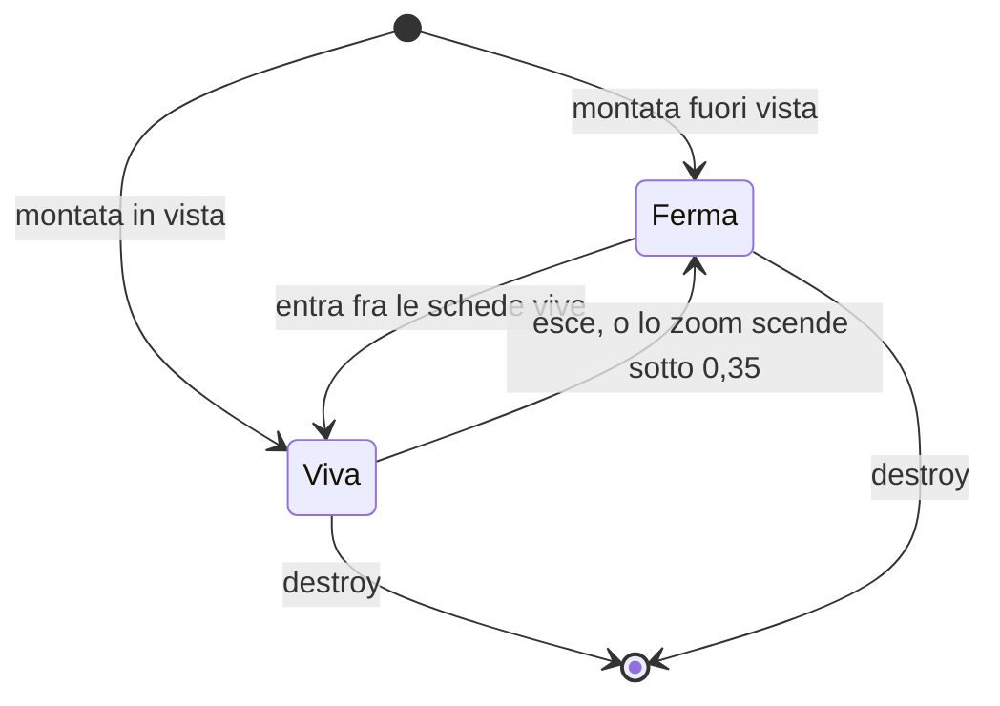
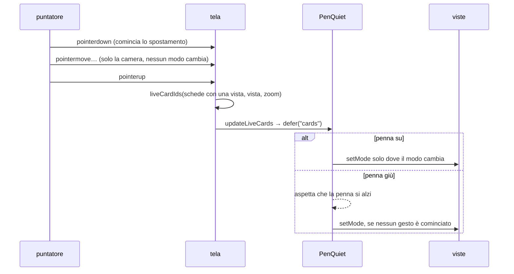

# Le schede della lavagna

> **Ambito:** il contratto fra la lavagna e chi mostra il contenuto di una
> scheda di file: le specie, le misure con cui nascono, i due modi di una
> scheda, le regole che scelgono le schede vive e le immagini ferme.
> **Fonti autorevoli:** `apps/client/src/editors/canvas/cards.ts` e le prove
> in `apps/client/src/editors/canvas/cards.test.ts`; per le misure di nascita,
> `apps/client/src/editors/canvas/drop-layout.ts` e le sue prove; per le
> estensioni, `apps/client/src/ui/format-kind.ts` e
> `apps/client/src/editors/media/media-types.ts`.

Questa pagina serve a chi scrive un renderer di scheda (la parte che mostra
una nota, un foglio, un PDF, un'immagine o una pagina web dentro la scheda) e
a chi lavora sul motore della lavagna che li monta.
Come si entra in una scheda, la rotella e i comandi con i loro tasti stanno in
[I tasti e i gesti della lavagna](canvas-input.md).

## Schede vive e ferme

Una scheda di file ha due modi.

- **Viva** (`live`): il renderer ha aperto il file e ci si può entrare per
  scorrere, scegliere e copiare. Una scheda viva tiene risorse aperte: una
  sessione di foglio, un documento PDF, il DOM di una nota con i suoi
  ascolti.
- **Ferma** (`snapshot`): nessuna risorsa aperta. Mostra l'ultima immagine
  ferma che ha avuto, oppure, per le specie fatte di DOM (nota, foglio), il
  loro contenuto reso inerte. Una scheda mai stata viva mostra titolo e
  specie.

Il passaggio fra i due modi avviene solo a fine gesto, mai durante.



La tela chiama `setMode` solo quando il modo cambia davvero; `destroy` chiude
la `Lifetime` della scheda in qualunque modo sia.

## Le specie

La specie sceglie il renderer. Viene dall'estensione del file, come fa la
shell per l'albero e le schede del riquadro: il client non conosce il
provider di un file senza chiederlo al backend.

| Specie | Da dove viene |
|---|---|
| `null` | nodi `text` e `group`: la tela li disegna da sé |
| `web` | nodi `link` |
| `note` | `md`, `markdown` |
| `document` | ciò che `formatKindOf` dice `word` o `odt` (`docx`, `doc`, `dot`, `rtf`, `odt`) |
| `sheet` | ciò che `formatKindOf` dice `sheet` (`xlsx`, `xlsm`, `xltx`, `xltm`) |
| `pdf` | ciò che `mediaKindOfId` dice `pdf` |
| `image` | ciò che `mediaKindOfId` dice `image`, SVG compreso |
| `craft` | nessuna estensione ci porta ancora (arriva con T18) |
| `file` | tutto il resto: CSV, `.canvas`, audio, video, ZIP, nomi senza estensione |

Regole dell'estensione:

- conta l'ultimo segmento del percorso, in minuscolo: `FOTO.JPG` è
  un'immagine;
- il `subpath` non conta: `Nota.md#1.2 Titolo` è una nota;
- un punto nel nome di una cartella non è un'estensione:
  `Corsi.2026/leggimi` è un file;
- un nome nascosto senza altro punto (`.md`) non ha estensione.

L'SVG è un'immagine ferma anche se `formatKindOf` lo chiama disegno: nella
scheda non diventa mai il disegno vivo.

Una specie senza renderer registrato, per esempio perché il suo componente è
spento, si mostra come scheda di file con «Apri».

## Le misure di nascita

Una scheda portata sulla lavagna nasce con la misura della sua specie. Le
misure stanno in `drop-layout.ts`, con `bornSize` e `dropLayout`:

| Specie | Misura di nascita |
|---|---|
| `note`, `document` | 320×240 |
| `sheet` | 480×300 |
| `pdf` | 360 di larghezza, con le proporzioni della prima pagina; 360×480 finché la prima pagina non si sa |
| `image` | il lato lungo 480, con le proporzioni dell'immagine; 480×360 finché la misura non si sa |
| `web` | 320×120 |
| `file`, `craft` | 320×160 |

Le misure di nascita non si agganciano alla griglia di 8 px: si arrotondano
all'intero più vicino, e nessun lato scende sotto 40 px, la misura minima
della tela. Così un'immagine 16:9 nasce 480×270, esatta. Un'immagine molto
stretta, come 1×4000, ha il lato corto a 40 px: lì la proporzione non si
tiene. Ridimensionare a mano una scheda, invece, aggancia a 8 px come prima.

Quando si lasciano insieme più schede, si dispongono in griglia: `ceil(sqrt(n))`
colonne, riempite per righe nell'ordine del nome del file. Le posizioni si
agganciano a 8 px. La colonna o la riga dopo parte al primo multiplo di 8 che
lascia almeno 24 px dopo il bordo della precedente, cioè dopo la sua scheda più
larga o la più alta della riga. Dopo un foglio alto 300 la riga sotto parte
328 px più in basso, con 28 px di spazio. Oltre 12 schede, un gruppo le
raccoglie con 24 px di margine per lato.

### Il rilascio e l'incolla

La tela (`#intake` in `engine.ts`) usa queste regole quando arrivano file
trascinati dal computer o dall'albero, o incollati:

- la griglia parte dal punto del rilascio. Un incolla parte dall'ultimo
  punto in cui il puntatore è stato visto sulla vista. Se il puntatore ne è
  uscito, parte dal centro della vista;
- la misura di un'immagine viene dalla porta `measureImage` (in
  `editors/core/bootstrap.ts`: i byte dalla `ResourceTransport`, la misura
  da `decodeImage` o dall'immagine decodificata). Se la porta manca,
  fallisce o non risponde entro 3 s (`MEASURE_IMAGE_TIMEOUT_MS`), l'immagine
  nasce 480×360. Si misurano quattro immagini alla volta;
- oltre 12 file nasce anche il gruppo, con l'etichetta «{count} file»
  (`canvas.intake.group`). Il gruppo sta prima delle schede nel documento,
  cioè sotto di loro;
- le schede, il gruppo e il file cambiato di una scheda (sotto) entrano in
  un commit solo, che un annulla toglie tutto insieme;
- lasciato su una scheda di file, il primo file ne prende il posto e gli
  altri nascono in griglia;
- le celle copiate diventano una scheda di testo con una tabella Markdown.
  Per l'HTML con una tabella c'è la porta `clipboardMarkdown`, la stessa
  conversione dell'incolla dell'editor Markdown. Il testo a tabulazioni su
  più righe passa da `parseTsv` e `markdownTable`. Una riga sola resta
  testo;
- mentre si trascinano file o voci dell'albero, rettangoli tratteggiati
  (`canvas-drop-ghost`) mostrano dove nasceranno le schede. Il loro numero
  è quello dei file in `dataTransfer.items`. Se non si sa, cioè per le voci
  dell'albero e quando il browser (WebKit) non dice i tipi, ce n'è uno.
  Spariscono all'uscita e al rilascio.

Il deposito dei file del computer (`depositCanvasFiles`) dà tutto o niente:
se l'host rifiuta un file a metà, l'errore compare nella barra
(`canvas-intake-error`) e non nasce nessuna scheda, nemmeno per i file già
copiati.

Dove finiscono lo dice `canvas.drop_folder` (`dropFolderFor`, in
`state/canvas-intake.ts`): le note con `files.attachment-folder`, una
cartella accanto alla lavagna o una del vault. La prima copia lo dice con una
notifica, e «Cambia cartella» apre quella voce; la notifica dice anche se la
cartella è esclusa da `files.excluded-folders`, dove i file non si trovano con
la ricerca.

## Il contratto

I tipi stanno in `cards.ts`, con i commenti che ne spiegano i campi. In
breve:

- `CardRenderer` dichiara le specie che sa mostrare (`kinds`) e monta una
  scheda con `mount(node, host, mode, context)`, che restituisce una
  `CardView`.
- `CardContext` dà al renderer il percorso del file senza `subpath`, il
  `subpath` a parte, l'id della lavagna, una `Lifetime` che si chiude con
  `destroy`, la cache delle immagini ferme, la misura e lo zoom correnti,
  `missing()` per dire che il file non c'è, e per il PDF `initialPage` (la
  pagina ricordata, o `null`) e `pageChanged(pagina)` (vedi «Riaprire dove
  eri»). `parts` porta le parti di un estratto già lette e provate, o
  `null` se la scheda mostra solo il suo `subpath` ([Gli estratti della
  lavagna](canvas-parts.md)).
- `CardView` risponde a `setMode` e a `destroy`; può rispondere anche a
  `resize` (a fine gesto), `enter` e `leave` (entrare nella scheda e
  uscirne; `enter` restituisce `false` se non c'è niente in cui entrare),
  `key` (`true` se il tasto è della scheda) e `page` (la pagina mostrata, da
  1).
- `createCardRegistry` costruisce il registro per specie. Due renderer
  diversi per la stessa specie sono un errore, lanciato quando il registro
  si costruisce: `card kind <specie> has two renderers`. Lo stesso renderer
  che nomina due volte una specie non è un doppione.

Ascolti, osservatori e timer di un renderer passano dalla `Lifetime` del
contesto, come vuole `check-listeners.mjs`.

### Un renderer non scrive mai il file

Un renderer legge e basta. Nessun renderer scrive nel file della sua scheda,
né quando è vivo né quando si chiude: sfogliare un PDF, scorrere un foglio o
scegliere delle celle non cambia il file. Le sole scritture che partono
dalla lavagna sono il file `.canvas`, i file che vi si depositano dal
computer o si incollano, e ciò che si scrive dentro una scheda con l'editor
vero del file (vedi «Scrivere dentro una scheda»), che passa dalla sessione
del documento e non dal renderer.

## Le immagini ferme

`CardSnapshots` tiene le immagini ferme in memoria, per file e per parte; la
cache stessa arriva con T2 (`apps/client/src/editors/canvas/card-cache.ts`).
La parte dice che cosa è e a quale larghezza, e si costruisce sempre con
`snapshotPart(prefisso, larghezza)`:

- la larghezza si arrotonda al multiplo di 32 px più vicino, mai sotto 32,
  così una scheda che cambia misura di poco ritrova la stessa immagine;
- il prefisso non è vuoto e non contiene `@`, che separa la larghezza;
- `whole@640` è l'immagine intera, `page-3@640` la pagina 3 di un PDF.

`forget(path)` dimentica tutte le parti di un file: serve quando il file
cambia, si sposta o esce dalla lavagna.

## Quali schede sono vive

`liveCardIds(nodes, view, zoom, limit)` restituisce gli id delle schede che
devono essere vive. Le regole:

1. sotto `LIVE_ZOOM_MIN` nessuna; allo zoom esatto sì;
2. una vista vuota (larghezza o altezza zero) non ha schede vive;
3. la vista si allarga di `LIVE_MARGIN` della sua larghezza e della sua
   altezza per lato;
4. è dentro una scheda il cui rettangolo tocca la vista allargata, anche
   solo sul bordo; una scheda più grande della vista, che la contiene tutta,
   è dentro;
5. contano solo le schede con una specie;
6. se sono più di `limit` restano le più vicine al centro della vista. La
   distanza è quella fra il centro e il punto più vicino della scheda, quindi
   una scheda che copre il centro vale zero; a pari distanza vince l'ordine
   del file. Un `limit` zero o negativo non lascia nessuna scheda.

I valori di partenza:

| Costante | Valore | Che cosa regola |
|---|---|---|
| `LIVE_ZOOM_MIN` | 0,35 | lo zoom da cui in su una scheda può essere viva |
| `LIVE_MARGIN` | 0,5 | il margine per lato, in frazione della vista |
| `MAX_LIVE_CARDS` | 40 | il massimo di schede vive insieme, il `limit` di serie |

Sono valori di partenza, non misure: vengono dal passo 15 (N6) dei «Piani di
Fub», che li propone come compromesso fra fluidità e schede pronte quando
ci si sposta di poco. La misura della lavagna con 20 fogli vivi (scenario S3
del banco WebView) li conferma o li cambia, e allora questa pagina dirà la
misura da cui vengono.

## Il cambio di modo

`updateLiveCards(cards, wanted, current, quiet)` mette ogni scheda nel modo
voluto. Tutto avviene nel lavoro rimandato con la chiave `cards`
(`CARD_QUIET_KEY`), che la penna esegue quando è su: mentre la penna è giù
nessuna scheda cambia modo.

- `wanted` si copia quando si chiama: è la decisione di quel momento;
- le schede montate si leggono quando il lavoro va: una scheda smontata nel
  frattempo non riceve niente ed esce da `current`;
- `setMode` si chiama solo dove il modo cambia, e `current` si aggiorna nel
  lavoro, non prima;
- se un `setMode` lancia, le altre schede cambiano lo stesso, quella resta
  col modo di prima e l'errore esce alla fine del lavoro.

`quiet` è un tipo strutturale di `cards.ts`, `CardQuiet`, con il solo
`defer(key, work)`: la lavagna non dipende dal modulo della penna.

## Come la tela tiene le schede

La tela (`editors/canvas/engine.ts`) riceve le schede con l'opzione
`cards?: CanvasCards`, cioè `{ registry: CardRegistry; snapshots:
CardSnapshots; watch(path, changed) }`. Senza (un'altra finestra, le prove
vecchie) ogni scheda ha il corpo di sempre: il percorso del file, il
segnaposto, l'indirizzo.

La resa è a chiavi: la tela tiene una mappa id → scheda sulla scena, con
l'elemento `.canvas-node`, il corpo e ciò che lo tiene vivo. A ogni resa:

- chi c'è già si aggiorna sul posto: posizione, misura, colore, titolo,
  scelta, la maniglia per ridimensionare (non in sola lettura);
- chi è nuovo nasce, chi non c'è più si distrugge;
- l'ordine sulla scena segue il file (la prima sotto, l'ultima sopra), e una
  scheda si sposta nel DOM solo se è fuori posto;
- il corpo si rifà solo se cambia la sua chiave: `type`, `file`, `subpath`,
  `url`, `text`, `label` e lo sfondo di un gruppo. I corpi di sempre si
  rifanno anche quando cambia la lingua, e quelli di testo quando cambiano
  le sintassi del Markdown o la sola lettura; una vista no.

Spostare, ridimensionare, colorare o scrivere in un'altra scheda non tocca
le viste; cambiare il file della scheda, toglierla o cambiarle l'id le
smonta. Una scheda che torna con l'annulla ha una vista nuova. Il campo di
modifica di una scheda prende il posto del corpo: la vista si smonta quando
il campo si apre, e il corpo si rifà alla prima resa dopo che si chiude.

Per una scheda con una specie e un renderer la tela chiama
`mount(node, corpo, "snapshot", context)`: nasce ferma, e quali schede sono
vive lo decide la tela subito dopo (vedi «Vive e ferme»). Il `context` porta:

- `path`, il file senza `#…`, e `subpath`, da `subpath` o dal `#` nel
  percorso; una scheda di link ha `path` vuoto e l'indirizzo in `node.url`;
- `documentId`, la lavagna; `lifetime`, una `Lifetime` per vista;
- `size()`, la misura di adesso in unità della lavagna, e `zoom()`;
- `missing()`, che dice che il file non c'è: la vista si smonta e la scheda
  mostra «File mancante» (vedi «Il file che manca»). Da una vista già smontata
  non fa niente;
- `initialPage`, la pagina ricordata della scheda, e `pageChanged(pagina)`,
  che la ricorda (vedi «Riaprire dove eri»). Da una vista già smontata
  `pageChanged` non fa niente.

Sulla scheda montata ci sono `data-card-kind` (la specie) e `data-card-mode`.
Un renderer che lancia in `mount` lascia il corpo di sempre e un avviso in
console: la tela va avanti. Una vista si smonta con `destroy()` e poi con la
chiusura della sua `Lifetime`, una volta sola; se `destroy` lancia, le altre
si smontano lo stesso. `destroy` della tela smonta tutte le viste, e dopo
nessuna resa ne monta altre.

Oltre `MAX_INTERACTIVE_NODES` (2000 schede) la scena mostra il messaggio
della lavagna troppo grande e nessuna vista; tornati sotto, le schede
rinascono. L'inchiostro sulle schede si ridisegna dopo ogni resa sullo
stesso elemento, e un tratto scritto aggiorna solo il suo livello, senza
resa.

## Il file che manca

Quando un renderer scopre che il file non c'è, chiama `context.missing()`. La
tela smonta la vista e mostra il segnaposto «File mancante: {percorso}»
(`canvas.card.missing`), con `data-card-missing="true"` sulla scheda e due
gesti in testo:

- **Ritrova…** (`canvas.card.relink`) apre il selettore dei file del vault,
  col nome del file che manca. Gli omonimi vengono per primi. Con un nome il
  selettore chiede tutto il vault, una volta, al clic, perché un omonimo oltre
  le 500 voci della lista non si troverebbe. Il file scelto sostituisce il
  percorso della scheda in un commit solo; il `#…` che la scheda aveva nel
  percorso e il `subpath` restano. Un annulla torna al file di prima.
- **Togli dalla lavagna** (`canvas.card.remove`) toglie la scheda e le sue
  linee, come Canc, per quella scheda sola. Un annulla la riporta.

Le regole:

- La tela ascolta il file con `watch` finché la scheda è mancante. Quando il
  file torna o cambia, la scheda si rimonta da sé con la sua vista; se il
  renderer dice di nuovo che manca, torna mancante.
- Se il file torna, o la scheda cambia, mentre il selettore di «Ritrova…» è
  aperto, la scelta è vecchia e non tocca niente.
- Il segnaposto si rifà quando cambiano la lingua o la sola lettura, e quando
  la scheda cambia (allora il file si chiede di nuovo). Uno spostamento o un
  colore di un'altra scheda non lo tocca.
- In sola lettura il segnaposto c'è, senza gesti. Senza un selettore
  (`onPickFile` assente) manca «Ritrova…», e «Togli» resta.
- Una scheda di link non manca mai: il suo `missing()` non fa niente.
- Il doppio clic su una scheda mancante apre il campo del file, come per ogni
  scheda senza vista. Il campo fa dimenticare il file mancante: alla sua
  chiusura la scheda si rimonta e il file si chiede di nuovo.

## Quando la tela cambia il modo

La tela sceglie le schede vive con `liveCardIds` e cambia loro il modo con
`updateLiveCards`, nel silenzio della penna della tela (la stessa
`PenQuiet` dell'inchiostro). La vista passata a `liveCardIds` è il viewport
in coordinate della lavagna (la camera divisa per lo zoom), con lo zoom
della camera; contano solo le schede con una vista montata, così una specie
senza renderer non toglie posto alle altre.

La scelta si rifà:

- **a fine gesto**: al rilascio del puntatore dopo uno spostamento della
  lavagna, un pizzico, un trascinamento o un ridimensionamento di schede, e
  `WHEEL_SETTLE_MS` (150 ms) dopo l'ultimo scatto della rotella; anche un
  gesto fermato a metà (un `pointercancel`, la penna che si posa sotto il
  dito) è un gesto finito;
- **dopo ogni resa**: un documento nuovo o cambiato da fuori, un annulla,
  una scheda aggiunta o tolta;
- **quando la vista cambia misura** (un `ResizeObserver` sul viewport, che
  si stacca con la tela), e lo zoom dei pulsanti e dei tasti, che è un gesto
  già finito.

Durante un gesto nessuna scheda cambia modo, nemmeno se lo zoom passa sotto
0,35 e torna sopra nello stesso gesto: conta solo dove il gesto finisce.
Con la penna giù il cambio aspetta che si alzi; il lavoro che arriva quando
la penna si alza non fa niente se intanto è cominciato un altro gesto (la
sua fine rifà la scelta). Con la lavagna nascosta (dentro un elemento
`hidden`, come la linguetta di un altro riquadro, o fuori dalla pagina) le
schede restano come sono; quando torna in vista la vista cambia misura e la
scelta si rifà.

Il percorso di uno spostamento col tasto centrale:



Il modo riuscito si scrive sulla scheda in `data-card-mode`; un `setMode`
che lancia lascia il modo di prima e un avviso in console. A fine gesto la
tela chiama anche `resize()` sulle viste la cui scheda ha cambiato misura
(un ridimensionamento, un annulla, una modifica da fuori), una volta per
misura nuova; durante un ridimensionamento non lo chiama.

## Riaprire dove eri

Riaprendo una lavagna tornano la vista di prima, le schede scelte e la
pagina di ogni scheda PDF. Le ricorda Fub su questo computer, negli stati di
vista; il file `.canvas` non cambia (niente `fub:page`, nessun campo nuovo).
Il codice sta in `view-state.ts`; la tela lo usa se ha l'opzione
`viewMemory` e un `documentId`, e la superficie della shell (`surface.ts`)
gliela dà sopra `api.viewState` e `api.setViewState`, una sola per tutte le
lavagne.

Lo stato sta nella chiave `canvas.view:<documentId>`:

```json
{ "version": 1, "camera": { "x": 0, "y": 0, "zoom": 1 },
  "selection": ["id"], "pages": { "id": 3 } }
```

- Al più 500 schede scelte (le prime della scelta) e 1000 pagine (le più
  recenti). Le schede scelte sono solo schede: i fili scelti non si
  ricordano.
- Una `version` diversa da 1 è di un'altra versione: la lavagna parte come
  se lo stato non ci fosse e non lo riscrive mai. Uno stato rotto (non un
  oggetto, senza `version`) vale nessuno stato, e la prima scrittura lo
  sostituisce. Dentro la versione 1 un campo che non si legge vale vuoto, e
  i campi in più (il navigatore, la griglia, il tema per scheda dei passi
  dopo) si conservano a ogni riscrittura.
- **All'apertura** (`setDoc`) la tela inquadra tutto come prima, poi legge
  lo stato: la camera ricordata vale se almeno una scheda cade nella vista
  che dava, sennò resta «inquadra tutto»; la scelta torna con le sole schede
  che ci sono ancora. Arriva solo ciò che nessuno ha cambiato nel frattempo:
  una vista già spostata, o una scelta già fatta, restano. Le schede PDF
  già montate su un'altra pagina si rimontano sulla loro.
- **La pagina di una scheda PDF** è quella ricordata (`initialPage`), sennò
  il `#page=N` del `subpath`, sennò la prima; una pagina ricordata oltre la
  fine del file vale la prima. La scheda dice ogni pagina voltata con
  `pageChanged`, anche quando corregge da sé una pagina che non c'è più.
  Una scheda tolta e rimessa ha un id nuovo, e parte dalla prima.
- **La scrittura** aspetta 500 ms dopo l'ultimo cambio della camera, della
  scelta o di una pagina; alla chiusura della tela, e prima di un nuovo
  `setDoc`, parte subito. Prima che la lettura sia arrivata non si scrive
  niente, e dopo la chiusura nessuna scrittura parte più. Lo stesso stato
  non si riscrive. Le letture e le scritture di una lavagna vanno in fila:
  la lavagna riaperta legge dopo l'ultima scrittura di quella chiusa. Due
  finestre sulla stessa lavagna: vince l'ultima scrittura.
- Una scrittura che non riesce lascia una riga nel registro e la lavagna va
  avanti. Una lettura che non riesce fa partire la lavagna come prima, e
  quella lavagna non scrive (non si sa che cosa coprirebbe).
- La shell non porta gli stati di vista con il nome: una lavagna rinominata
  riparte dalla vista intera.

## Le porte della shell

Nella shell le schede arrivano alla tela dalla registrazione della lavagna
(`editors/core/bootstrap.ts`), dentro il suo montaggio pigro: i renderer si
caricano col codice della lavagna, non all'avvio di Fub. La scheda di foglio
arriva con un suo `import()` alla prima scheda di foglio; finché non c'è, la
vista tiene il modo chiesto dalla tela e lo passa alla scheda vera appena
montata.

Le porte vengono dall'opzione `canvasCards?: CanvasCardPorts`, che la shell
costruisce in `state/document-controller.ts`, e da due opzioni che c'erano
già, `media` e `gridHost`:

| Specie | Da dove legge |
|---|---|
| nota, documento | `renderEmbed` e la stessa montatura sicura delle schede di testo (`mountMarkdown`), con i link risolti dalla nota |
| immagine, PDF | la `transport` di `media`, nel vault di adesso; un file che non c'è (`not_found`) è un file mancante, un'immagine oltre 64 MiB non si legge |
| foglio | `gridHost`; il giornale e la base della sessione aperta del documento se c'è, sennò il giornale vuoto e la revisione di `readDocument` |
| web | la cache delle schede di link (`linkCardView`, `requestLinkCard`, l'evento `link-cards`) e il visore della finestra |

Senza `media` le immagini e i PDF, senza `gridHost` i fogli, hanno il corpo
di sempre; senza `canvasCards` tutte le schede.

`watch(path)` ascolta gli eventi del kernel per quel percorso:
`document_changed`, `document_removed` e `document_renamed` per i file che un
formato serve (note, fogli), le loro varianti `entry_*` per gli altri
(immagini, PDF). Ogni ascolto ha il suo smontaggio. Prima di avvisare la
scheda, la cache delle immagini ferme dimentica il file (`forget`): nessuna
scheda, nemmeno su un'altra lavagna, ritrova l'immagine di prima. La tela
ascolta il file con questo stesso `watch` quando la scheda è mancante (vedi
«Il file che manca»).

La cache delle immagini ferme è una sola per finestra, per tutte le lavagne
che vi si aprono. Si svuota quando una lavagna si monta in un vault diverso
da quello in cui la cache si è riempita: lo stesso percorso è un altro file.

## Scrivere dentro una scheda

Chi scrive dentro una scheda usa l'editor vero del file, sulla stessa
`DocumentSession` di un riquadro: le stesse bozze, gli stessi conflitti, lo
stesso salvataggio. La tela non importa nessun editor (il confine di
CodeMirror): riceve una porta, `CardEditorPort` in `editors/canvas/cards.ts`,
che la shell costruisce in `state/card-editors.ts` con la collezione delle
sessioni e il registro delle superfici della finestra. Arriva alla tela
dall'opzione `canvasCards.editors`, passando da `surface.ts` accanto al
registro dei renderer (`CardEditing`). Senza porta le schede restano in
lettura.

`open(path, host, { compact, readOnly, lifetime })`:

- prenota la sessione (`retain`) e la tiene finché l'editor vive: un
  riquadro che si chiude non la chiude sotto la scheda;
- legge il file con `readForSurface` e chiede la superficie al registro per
  `format_id` e `source_kind`, come un riquadro, nella sua modalità
  predefinita; la monta in `host` e la attacca (`attachSurface`);
- dà `null`, senza lasciare niente montato né prenotato, se il file non ha
  un editor (il registro ripiegherebbe sulla superficie d'errore, o la
  superficie non tiene il testo), se la sessione non si apre, o se la vita
  della scheda si chiude mentre `open` aspetta.

L'annulla è della superficie: un cambio arrivato da un riquadro, o da
un'altra scheda sullo stesso file, entra con `syncDoc` e non si annulla qui.
Una battuta rimasta indietro si ribasa sul testo autorevole come in un
riquadro. Due `open` sullo stesso file sono due superfici e una sessione.

`state()` dice `clean`, `pending` (da salvare, o testo tenuto dall'editor),
`conflict` (lo stato `conflitto` della sessione) o `readonly`: chiesto dalla
scheda, la chiusura della finestra, una cancellazione in sospeso, il
prestito a un'app (la stessa regola dei riquadri, `heldReadOnly`), oppure la
sessione chiusa sotto l'editor (il file tolto). Allora la superficie resta
ferma in sola lettura, e nessuna battuta finisce dove non si salva. La
sessione segue le rinomine, e la scheda con lei. `leave()` registra il testo
tenuto dall'editor e salva adesso; `destroy()` lo registra, stacca, smonta e
lascia la prenotazione, una volta sola.

Chiusa la lavagna (o la scheda), se nessun riquadro e nessun'altra scheda
tiene il file, la sessione decide come alla chiusura di un riquadro: salva e
si chiude. Se non può salvare, un conflitto o un disco che rifiuta, la bozza
è già scritta e la sessione resta aperta con il testo: il lavoro non si
perde.
