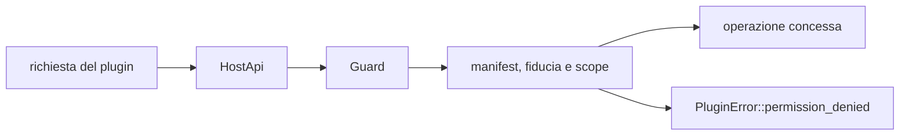

# Permessi e sicurezza

> **Ambito:** fiducia dei bundle, capability, confini del vault, runtime WASM e
> contenuto non fidato.
> **Fonti autorevoli:** `fub-abi::Gate`, kernel, `fub-wasm-host` e CSP Tauri.

## Modello di fiducia

| Livello | Significato |
|---|---|
| `core` | componente del prodotto |
| `verified` | estensione verificata secondo la policy |
| `community` | estensione installata dalla comunità |
| `development` | estensione locale di sviluppo |
| `revoked` | dichiarata ma non eseguibile |

`revoked` non è un livello più basso: equivale all'assenza del diritto di
attivarsi.

## Capability

I permessi sono una mappa namespaced. Una capability può avere parametri, per
esempio scope, host consentiti o limiti.

Il flusso è:

Un solo `Guard` applica la policy. Gli adattatori nativi e WASM non mantengono
copie divergenti delle regole.

## Famiglie di accesso

| Famiglia | Esempio di controllo |
|---|---|
| lettura vault | radice, tipo di voce e path relativo |
| scrittura vault | capability esplicita, revisione e atomicità |
| storage plugin | namespace dell'id proprietario |
| query | provider e scope serviti |
| eventi e job | maschera, budget, fatti propri e nomi di job propri |
| rete | metodo, host e limiti |
| tempo e random | quantità e disponibilità |
| impostazioni | livello scrivibile e chiave dichiarata |
| transfer | handle e contenuto, non path arbitrari |

L'elenco esatto delle funzioni vive nel contratto.

## Path fence

Ogni path del vault viene canonicalizzato e verificato contro la radice.
Symlink, componenti `..`, differenze di separatore e maiuscole non devono
consentire una fuga.

Un handle di transfer non diventa automaticamente un path filesystem.

## Temi installati

Un tema non riceve capability e non può dichiarare permessi. L'host accetta
soltanto i motori `theme-1` e `theme-2`, un id sicuro e il namespace
`theme://<id>/`; installazione e lettura rifiutano symlink, traversal e file
non regolari. Una voce del catalogo deve dichiarare lo stesso motore del
manifest che consegna. Quale motore si possa montare lo decide la shell: un
tema di un altro motore è rifiutato dal loader con una diagnosi.

Da `theme-2` un tema può dichiarare impostazioni: al massimo 32, con nome
`a-z`, `0-9`, `-`, etichetta in prosa e specie fra interruttore, numero (con
minimo e massimo) e scelta. L'host le dichiara al registro delle impostazioni con chiave
`<id>:<nome>`, a livello macchina e non scrivibili da programma; il tema non
sceglie chiave né livello. Il client porta il valore corrente sulla radice del
documento come `data-opt-<nome>` e, per i numeri, `--opt-<nome>`. La pubblicazione avviene da staging con rename atomico e non
sovrascrive un id esistente. I limiti correnti sono 64 KiB per il manifest,
4 MiB per ciascun foglio/skin, 1.024 asset, 64 MiB per asset e 256 MiB totali.

Il client rivalida fogli, skin, asset, ruoli e contrasto prima del mount. Una
preview dalle Impostazioni non cambia la scelta persistente: annullamento o
chiusura rimontano il tema autorevole precedente; un bundle non leggibile o
rifiutato non ottiene un mount parziale.

Un tema veste la cornice e i segni di Fub, e il contenuto soltanto dove la
modalità della superficie ne dà l'autorità al tema: una regola sul contenuto si
scrive sotto `.look-tema`. In `look-file` i valori del file e la sua carta
vincono, e i segni prendono i ruoli facoltativi della carta chiara
(`--paper-*`). Per le classi di contenuto del documento e del foglio di
calcolo il sanitizer rifiuta una regola fuori da `.look-tema` (`content-look`),
in una pelle, in un tema e in un frammento. Un tema `theme-2` può non
dichiarare i ruoli facoltativi (`optional_roles` del contratto): la struttura
ha un ripiego, e le coppie di contrasto di quei ruoli (`optional_pairs`)
contano solo per chi li dichiara
([ADR 0222](../decisions/0222-tre-strati-e-l-aspetto-del-contenuto.md)).

## Runtime WASM

Il runtime:

- usa Wasmtime component model;
- non collega WASI;
- non concede filesystem o rete direttamente;
- serve soltanto le famiglie host disponibili;
- applica limiti alla memoria lineare e alle tabelle;
- interrompe chiamate oltre la deadline;
- converte trap in errori tipizzati;
- limita la ricorsione delle forme;
- smonta registrazioni e risorse.

Il componente condivide un'istanza fra i propri provider e non è rientrante.

## UI non fidata

`UiNode` può rappresentare forme fidate e non fidate. Un componente di terzi
non può ottenere:

- HTML arbitrario;
- webview;
- JavaScript;
- DOM;
- listener globali;
- estensioni CodeMirror.

Ogni albero WASM passa dalla validazione non fidata prima della serializzazione
IPC. Il percorso `ViewProvider` applica lo stesso controllo prima di inoltrare
la forma alla shell; i provider ancora differiti non creano un bypass.

Alcuni intenti `Custom` fanno eseguire alla shell un'azione con un privilegio
del processo: scrivere negli appunti (`fub.clipboard.text`,
`settings.export`), ricaricare la finestra dopo un ripristino
(`fub.vault.restored`), modificare il testo della nota aperta come una
battuta dell'utente (`fub.editor.action`) e aprire una pagina web
(`fub.web.open`, soltanto `http` e `https`). L'elenco è
`fub_abi::ui::privileged_intent`. Il kernel
accetta questi intenti soltanto da provider `Core`, sia come `ViewUpdate` di
una view sia come `CommandEffect` di un comando, nel percorso sincrono e in
quello staccato. Da un provider di altro grado l'esito è `PermissionDenied` e
la shell non riceve niente. Gli intenti `Custom` senza privilegio restano
aperti a tutti.

## Webview

La Content Security Policy impedisce script remoti, iframe e oggetti non
previsti. Il rendering non deve creare HTML attivo da una stringa del vault o
del plugin senza sanitizzazione e una decisione esplicita.

### Immagini remote

Un'immagine con un indirizzo remoto non si carica mai da sola: il sanitizzatore
toglie il `src` e lascia l'indirizzo inerte in `data-remote-src`, e Live e
Lettura mostrano un segnaposto con il testo alternativo e il sito. Il pulsante
**Scarica nel vault** chiede conferma nominando sito e indirizzo; poi l'host
scarica l'immagine con `viewer_save`, soltanto `https`, senza credenziali né
redirect, entro il limite delle risorse in linea, nella cartella degli allegati
(`files.attachment-folder`). La nota riscrive la destinazione verso il file con
una modifica annullabile; una definizione di riferimento cambia soltanto se la
usano solo immagini. La webview non chiede mai l'immagine alla rete. Una nota
nella radice con una cartella relativa alla nota (`./`) non ha dove scaricarla
e lo dice.

## Visore web

Una pagina web non entra mai nella webview della shell. Si apre nella finestra
`fub-viewer`, che ha un profilo suo, incognito, sotto la cartella di
configurazione. Non ha un ponte IPC, perché nessuna capability nomina la sua
label. Nega le nuove finestre e i download.

- **Indirizzi.** Il visore apre soltanto `https` sulla porta 443, senza
  credenziali nell'URL, e mai `javascript:`, `data:`, `file:`, `blob:` o gli
  schemi delle risorse del vault. La stessa regola vale per ogni navigazione
  della pagina.
- **Siti approvati.** Un host si apre soltanto se sta in `viewer.hosts`, una
  lista di macchina. La shell lo aggiunge dopo il sì dell'utente a una
  conferma, e le impostazioni lo mostrano e lo tolgono. Un sottodominio è un
  sito a parte.
- **Navigazione fermata.** Una pagina che porta su un sito non approvato viene
  fermata. La finestra principale riceve l'evento `fub://viewer` e chiede di
  nuovo; un sito rifiutato non si richiede nella stessa sessione.
- **Barra.** Indirizzo, indietro, avanti, ricarica, porta davanti e chiudi
  stanno nella finestra principale e arrivano al visore con `viewer_control`.
  Quel comando esegue soltanto tre script scritti nel codice nativo.
- **Salvataggio come nota.** `web.clip` è un comando dell'host. Rilegge da sé
  `viewer.hosts`, riscarica la pagina dalla rete dell'host, che non segue i
  redirect, e scrive Markdown con la fonte, attraverso la cattura. Una
  risposta che non è 2xx, che non è HTML o che supera 2 MiB non scrive niente
  e lo dice. In prova il comando non chiama la rete.

Un link `https` di una nota va al browser di sistema. Va al visore con Alt+clic
o quando `viewer.links` è acceso. Un indirizzo che il visore non apre resta al
browser di sistema.

## Host nativo del clipper

Il clipper del browser consegna prima a `fub-clipper-host` (nome
`local.fub.clipper`), per messaggistica nativa: è il solo canale autenticato,
perché l'host accetta soltanto un'estensione abbinata con
`fub-cli pair pair --extension-id ID`. `fub://capture` e il file
`.fubcapture.json` sono il ripiego, senza autenticazione e con
un'approvazione per ogni cattura.

Il browser trova l'host da un manifest dell'utente, mai di sistema.
`fub-cli native-install --extension-id ID` dice dove lo scriverebbe; con
`--yes` lo scrive in ogni browser installato, o in quelli dati con
`--browser`. Su Windows scrive anche la chiave di `HKEY_CURRENT_USER` che punta
al manifest. L'id decide la famiglia: le 32 lettere di un'estensione Chromium
danno `allowed_origins`, l'id di Firefox `allowed_extensions`, e un id della
famiglia sbagliata per il browser nominato è un errore d'uso. Un file con quel
nome che non è un manifest dell'host resta com'è; `--uninstall` toglie
soltanto ciò che l'host ha scritto. Quando l'invio ripiega, il popup scrive i
due comandi con l'id vero dell'estensione.

## Canale di controllo

Un vault ha un solo scrittore. Quando lo tiene l'app desktop, la CLI e l'host
nativo del clipper non aprono un secondo writer: mandano all'app le porte
generiche dell'host (indice, comandi, view, lettura e scrittura con revisione,
job, impostazioni, cattura) e l'app le esegue con le sue regole, il suo
`Guard` e i suoi eventi. Una scrittura con una revisione vecchia è un
conflitto anche da qui, e la shell vede la modifica come vede quella di
un'altra finestra. Il canale serve soltanto i vault che l'app ha già aperto:
non apre, non chiude e non cambia il vault corrente; aprire un altro vault,
chiuderlo o elencare i plugin si fa dall'app, o con l'app chiusa.

Il server (`fub_host::control`) ascolta soltanto su `127.0.0.1`, su una porta
scelta dal sistema, e risponde soltanto a chi porta il token: 32 byte casuali,
confrontati senza fermarsi al primo byte diverso. Il token sta in
`control.endpoint`, che la CLI accetta soltanto se è un file regolare del solo
proprietario e se indica il loopback. Una domanda è al più 48 MiB, le domande
servite insieme al più otto. Il server ha un owner: l'app lo chiude
all'uscita, prima dei vault, e toglie il file se è ancora il suo. Un file
rimasto da un'app caduta indica una porta che non risponde, e il vault resta
`busy`. `--standalone` non passa mai dall'app.

## Supply chain

- sorgenti delle dipendenze limitate dalla policy;
- licenze controllate;
- advisory e crate yanked bloccano la CI;
- SBOM generata;
- lockfile committati;
- artefatti generati verificati;
- dipendenze duplicate sensibili controllate.

Il controllo npm rifiuta le licenze assenti o sconosciute. Se i metadati
dichiarano `NOASSERTION`, può concludere una licenza soltanto dal testo completo
già esaminato e identificato dal suo SHA-256, verificando anche nome e versione
del pacchetto installato. La SBOM conserva la dichiarazione originale e registra
la conclusione con la provenienza; un testo diverso resta bloccante.

## Dati sensibili

Fub è local-first ma i vault possono contenere dati sensibili. Log e bundle
diagnostici devono:

- evitare contenuto completo per impostazione predefinita;
- redigere path quando possibile;
- dichiarare ciò che includono;
- essere creati con un gesto esplicito;
- non diventare canali di esportazione invisibili.

## Segnalazioni

La procedura per vulnerabilità è in [`../../SECURITY.md`](../../SECURITY.md).
Questo documento descrive l'architettura; non sostituisce la policy di
segnalazione.

## Checklist per un nuovo servizio

Prima di aggiungere una host function:

1. definire il dato minimo;
2. decidere capability e parametri;
3. applicarla nel `Guard`;
4. evitare path o handle più potenti del necessario;
5. tipizzare errori;
6. aggiungere test concesso/negato;
7. verificare backend nativo e WASM;
8. aggiornare WIT e compatibilità;
9. documentare il contratto, non la cronaca.
